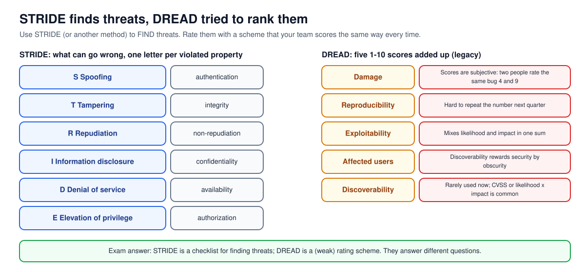

# Lesson 01: What Is Threat Modeling? STRIDE, DREAD and the Challenges

**Syllabus items covered:** "What is Threat Modeling?", "STRIDE vs. DREAD approaches", "Threat modeling and its challenges." ([CDE 2], also the design step of Secure SDLC in [chapter 02](../02-tools-pipelines-and-secure-sdlc/README.md)).

**Time:** 90 minutes. **Safety:** concepts only; the labs use fictional shop systems.

> **DBA analogy.** Before you design a backup strategy you ask: what can go wrong (disk, human, ransomware), how bad is it, and what do we do about it? Threat modeling is the same question for security, asked at **design time**, while changing the design is still cheap.

## 1. What is threat modeling?

Threat modeling is a structured way to answer four questions about a system:

1. **What are we building?** Draw it: a data flow diagram (DFD) with processes, data stores, external actors, data flows and **trust boundaries** (the lines where the trust level changes, such as Internet to DMZ, or app to database).
2. **What can go wrong?** Walk every element and flow with a checklist such as STRIDE.
3. **What are we going to do about it?** Mitigate, eliminate, transfer (insurance, a provider) or accept.
4. **Did we do a good job?** Check that each risk has an owner, a control and a test.

These are the "four questions" in Shostack's book (see references). The output is not a diagram for its own sake. It is a **list of threats, each with a decision**.

For the AI-specific version (prompt injection, tool abuse, ATLAS, MAESTRO) see the repo's [AI threat modeling lesson](../../01-ai-security-fundamentals/03-ai-threat-modeling.md) and the [CAISP threat modeling chapter](../../caisp-course/ch5-threat-modeling-ai-systems/README.md). This lesson is the **classic DevSecOps** view and does not repeat those.

## 2. STRIDE

STRIDE is a mnemonic for six threat types. Each one breaks a security property.

| Letter | Threat | Property broken | Web shop example | Typical control |
|---|---|---|---|---|
| S | Spoofing | Authentication | Stolen session cookie | MFA, signed short-lived sessions |
| T | Tampering | Integrity | Client sends its own order total | Server-side validation, signatures |
| R | Repudiation | Non-repudiation | "I never approved that refund" | Audit log with identity and time |
| I | Information disclosure | Confidentiality | SQL error shows table names | Generic errors, encryption |
| D | Denial of service | Availability | Unbounded request bodies | Limits, rate limiting, CDN |
| E | Elevation of privilege | Authorization | Normal user reaches /admin | Deny by default, role checks |

**How to apply it.** For each **element** of the DFD ask which letters apply. Processes can suffer all six. Data stores mainly suffer T, I and D (and R if they hold logs). Data flows suffer T, I and D. External actors are mostly spoofing and repudiation. This "STRIDE per element" table keeps a session short.

**Strengths:** easy to teach, good coverage, works for any team. **Limits:** it lists categories, not risk. A long list of "possible tampering" tells you nothing about which one to fix first.

## 3. DREAD, and why it fell out of favour

DREAD is a **rating** scheme. You score each threat from 1 to 10 (some teams use 1 to 3) on five questions and add or average them:

| Letter | Question |
|---|---|
| D | Damage: how bad is it if it happens? |
| R | Reproducibility: how easily can it be repeated? |
| E | Exploitability: how much skill or tooling is needed? |
| A | Affected users: how many people? |
| D | Discoverability: how easy is it to find the flaw? |

**Weaknesses (be able to list these in an interview):**

- **Subjective.** Two reviewers give the same bug 4 and 9. The number looks scientific but is an opinion.
- **Not repeatable.** Rescoring next quarter gives a different answer.
- **Discoverability is a trap.** Scoring a flaw low because "nobody will find it" is security by obscurity.
- **Mixes likelihood and impact** in one sum, so a rare but catastrophic threat can look average.
- **Weak link to evidence.** Nothing ties the score to data such as exploit availability.
- **Little current use.** It was used early at Microsoft and later dropped there (verify the history); most teams now use CVSS, OWASP Risk Rating (likelihood times impact) or a simple high/medium/low with a clear rubric.

**STRIDE vs DREAD in one sentence:** STRIDE *finds* threats; DREAD *ranks* them (badly). They are not alternatives; the exam question is a trick. If asked "which is better", say they answer different questions, and recommend STRIDE (or another finding method) plus a documented, calibrated rating scheme.

Other methods you should be able to name: **PASTA** (risk-centric, seven stages), **LINDDUN** (privacy), **attack trees** (goal-down), **VAST** (scales across teams, used by ThreatModeler), **MAESTRO** (agentic AI). The repo's [method comparison](../../01-ai-security-fundamentals/03-ai-threat-modeling.md#210-choosing-a-method-stride-pasta-linddun-dread-attack-trees-and-maestro) is a good table.

## 4. Challenges of threat modeling (and what to do)

| Challenge | Why it happens | What helps |
|---|---|---|
| **It is a meeting, so it gets skipped** | Takes experts' time, delivery pressure | Small, frequent sessions per feature; a lightweight checklist for low-risk changes |
| **The model goes stale** | Diagrams live in a slide deck; the system changes weekly | Keep the model **in the repo** and check it in CI ([lesson 02](02-threat-modeling-tools-and-ci-cd.md)) |
| **Needs security expertise** | Developers do not know attack patterns | Threat libraries, STRIDE-per-element, a security champion in the room |
| **Too many threats, no priority** | A list of 200 items | A rating rubric (impact x likelihood), top-10 only, and a date |
| **Accepting risk silently** | Nobody records who accepted what | `accepts` with owner and review date (see the lab) |
| **No link to testing** | Threats stay on paper | Every high threat becomes a requirement and a test ([lesson 03](03-security-requirements-as-code.md)) |
| **Agile and CI/CD speed** | A big upfront model does not fit two-week sprints | Model the **delta**: new flows, new data, new trust boundaries |
| **Tool friction** | Drawing tools are manual and not diff-able | Text-based models (pytm, Threagile, annotations) |

**Where it sits in Secure SDLC.** Requirements gives you abuse cases and security requirements; threat modeling runs at **Design**; its output feeds the test plan (the **Testing** gates in [chapter 06](../06-dynamic-analysis/README.md)) and monitoring ([chapter 02 SDLC lesson](../02-tools-pipelines-and-secure-sdlc/README.md)).

## 5. Exercise: model a small flow in 15 minutes

Draw: **Browser -> Web server -> Payment service -> Database**. Mark two trust boundaries (Internet|DMZ, DMZ|Internal). For each of the three flows write one STRIDE threat and a mitigation. Then rate each threat **high/medium/low** with one sentence of reasoning. Check yourself against the lab fixture in [threat-modeling-as-code](labs/threat-modeling-as-code/README.md), which models the same shop.

## 6. Common mistakes

- Modeling only the happy path and forgetting admin, batch and support flows.
- Listing threats with no decision (mitigate, accept, transfer, eliminate).
- Using DREAD scores as if they were measurements.
- Forgetting third-party services and CI/CD itself (the pipeline is part of the system, see [CSE chapter 2](../../csse-course/ch2-attacking-code-and-application-supply-chain/README.md)).
- Treating the model as a document instead of something that is re-run.

## 7. Checklist

- [ ] I can draw a DFD with trust boundaries.
- [ ] I can recite STRIDE with the broken property for each letter.
- [ ] I can give three weaknesses of DREAD and name a better rating approach.
- [ ] I can list five challenges and one answer for each.
- [ ] I know that STRIDE finds and DREAD ranks.

## References

- Adam Shostack, *Threat Modeling: Designing for Security*; the Threat Modeling Manifesto (threatmodelingmanifesto.org).
- OWASP Threat Modeling Cheat Sheet and OWASP Threat Modeling Process (verify the current page names at owasp.org).
- Repo: [AI threat modeling](../../01-ai-security-fundamentals/03-ai-threat-modeling.md), [CAISP chapter 5](../../caisp-course/ch5-threat-modeling-ai-systems/README.md).
