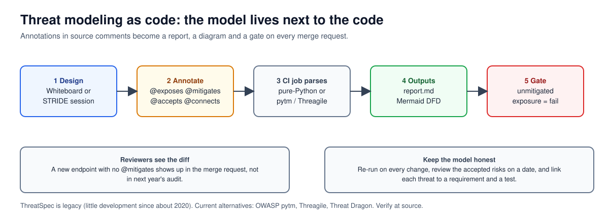

# Lesson 02: Classical Threat Modeling Tools, and How They Fit in CI/CD

**Syllabus items covered:** "Classical Threat modeling tools and how they fit in CI/CD pipeline", "Using ThreatSpec to do Threat Modeling as Code.", "Using BDD security to codify threats." ([CDE 2]; the BDD line also appears in [CDP 2](../02-tools-pipelines-and-secure-sdlc/README.md)).

**Time:** 2 hours plus labs. **Safety:** all systems and names are fictional.

> **DevOps analogy.** A threat model in a PowerPoint is like a server configured by hand: it was right once. A threat model **as code** is like Terraform: it is in git, reviewed in a pull request, and re-checked on every run.

## 1. The classical tools

| Tool | Type | Strength | Weakness for CI/CD | Status (verify at source) |
|---|---|---|---|---|
| **Microsoft Threat Modeling Tool** | Desktop GUI, DFD + STRIDE rules | Free, good built-in threat rules | Windows desktop, binary model files, hard to diff or automate | Long-lived free tool; check Microsoft's current status |
| **OWASP Threat Dragon** | Web and desktop app, DFD in JSON | Free, open source, rule engine | JSON diagrams are diff-able but editing is graphical | Active OWASP project |
| **IriusRisk** | Commercial platform, questionnaires and libraries | Scale, compliance mapping, Jira integration | Cost; model lives in the product | Commercial |
| **OWASP pytm** | Python library: the model **is** Python code | Generates DFD, sequence diagram and report from code | Need to know Python | Active OWASP project |
| **Threagile** | Open source, YAML model, written in Go | Declarative model, risk rules run automatically, CI friendly | YAML models get long | Open source |
| **ThreatSpec** | Annotations in source code comments | Model sits **next to the code** | Little or no development since about 2020 | **Legacy.** Teach the idea, use the alternatives |
| **Whiteboard / draw.io / Miro** | Free-form diagram | Fast, anyone can join | Not machine-readable | Always useful for the first session |

**Which to choose.** For a team that already lives in git: start with a **text-based** model (pytm or Threagile), or the annotation idea. Use a GUI tool for workshops and a text model for the long-lived truth. Do not pick a tool before you have done one session on a whiteboard.

## 2. How threat modeling fits into CI/CD

Threat modeling is a design activity, so the pipeline cannot "do" it. The pipeline can **keep it honest**.



| Pipeline stage | What the model contributes |
|---|---|
| **Merge request** | A changed model file or new annotations are reviewed like code. A new endpoint with no mitigation shows up in the diff. |
| **Build / test** | Parse the model: generate the report and diagram as build artifacts; fail on unmitigated high threats or on annotation errors. |
| **Test planning** | Each mitigation points to a test (unit, BDD scenario, DAST rule). Missing test means open risk. |
| **Release gate** | Check that accepted risks have an owner and an unexpired review date. |
| **Operate** | Incidents and pen-test findings update the model. |

**Limits.** A pipeline check proves the model is **consistent** (every exposure has a decision). It does not prove the model is **complete**: nobody can parse a forgotten data flow. The humans in the design session do that.

## 3. Threat modeling as code with annotations (the ThreatSpec idea)

ThreatSpec keeps the model in **comments** in the source. A tool collects the comments and builds a report and a diagram. The tags (shape taken from ThreatSpec; the lab uses a simplified grammar, verify the real one):

```text
# @exposes   DMZ:WebServer to Tampering with unvalidated form fields
# @mitigates DMZ:WebServer against Tampering with server-side schema validation
# @accepts   Denial of Service to DMZ:WebServer with the CDN absorbs volumetric floods
# @connects  DMZ:WebServer to Internal:PaymentService with mutual TLS
```

| Tag | Meaning |
|---|---|
| `@exposes` | This component has a threat (an open risk) |
| `@mitigates` | This code reduces the threat; the comment sits **at the code that does it** |
| `@accepts` | The risk is accepted, with a reason (and in a real process an owner and a date) |
| `@connects` | A data flow between two components; the DFD comes from these |

**Why it is attractive.** The mitigation comment is next to the validation code, so a developer who deletes the code sees the comment. Reviewers see both in one diff.

**Why it is legacy.** The ThreatSpec project has had little or no development since about 2020 (verify at its repository). Learn the idea; for new work look at **pytm** (the model as Python objects, generates DFD and findings), **Threagile** (YAML model with built-in risk rules) or **Threat Dragon** (diagrams with a rule engine). All three are text or JSON files you can review and run in CI.

**The lab** [threat-modeling-as-code](labs/threat-modeling-as-code/README.md) is a small pure-Python version: parse annotations from Python and JavaScript fixtures, build a report and a **Mermaid DFD**, and fail the gate when an exposure has no mitigation and no accepted risk. Read it as a teaching model, not a product.

## 4. BDD security: codifying threats as executable specs

**BDD** (behaviour-driven development) writes requirements in plain language (Gherkin): `Given`, `When`, `Then`. A step runner turns each line into code. For security this gives **readable abuse cases that run as tests**:

```gherkin
Scenario: Account locks after repeated failures (threat T-01)
  When I submit a wrong password 5 times for "alice"
  And I log in as "alice" with password "correct-horse-battery"
  Then the response status is 429
```

The business and security people can read it; the pipeline runs it on every build. This is the course's "BDD security" idea (BDD-Security by Continuum Security, which later became part of IriusRisk).

**Current status (verify at source):** the BDD-Security project appears unmaintained since about 2022. **Gauntlt** (another Gherkin attack tool) is also old. The idea is still good. Today you write the steps in **pytest-bdd** or **behave** (Python), **Cucumber** (Java, JS), or drive **ZAP** through its Automation Framework and assert on the result. The [BDD lab](labs/bdd-security-threats/README.md) keeps everything offline with a tiny runner and a simulated app.

**Where it fits:** unit-level and API-level security regression tests, run in CI. It complements, not replaces, DAST ([chapter 06](../06-dynamic-analysis/README.md)): BDD checks the specific abuse cases from **your** threat model; a scanner checks generic classes of bugs.

## 5. Connecting the pieces

```text
Threat (model)  ->  Requirement (catalog)  ->  Test (BDD / unit / DAST)  ->  Evidence (CI result)
   T-01                REQ-AUTH-01              "locks after 5 failures"      green build
```

If you cannot fill all four boxes for a high threat, it is an open risk. [Lesson 03](03-security-requirements-as-code.md) builds the requirement-to-test link.

## 6. Common mistakes

- Picking a tool first and doing the thinking never.
- Letting the model drift: no CI check, no owner.
- Annotating every function. Annotate **trust boundaries and security controls**, not everything.
- Treating "accepted" as a way to make the build green. Accepts need an owner, a reason and a review date.
- Writing BDD scenarios that only test the happy path.

## 7. Checklist

- [ ] I can name five threat modeling tools and one limit of each.
- [ ] I can explain what a pipeline can and cannot check about a threat model.
- [ ] I can write the four annotation tags and say what the gate fails on.
- [ ] I know ThreatSpec and BDD-Security are legacy and which tools replace them.
- [ ] I can write a Gherkin scenario for one abuse case.

## References

- OWASP pytm, OWASP Threat Dragon, Threagile, ThreatSpec repositories and docs (check activity before adopting).
- Cucumber Gherkin reference; behave and pytest-bdd documentation.
- Real-tool notes: [threat-modeling-tools.md](real-tools/threat-modeling-tools.md), [bdd-and-asvs.md](real-tools/bdd-and-asvs.md).
