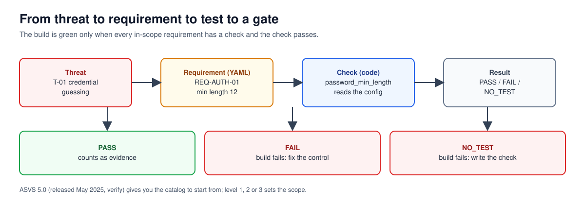

# Lesson 03: Security Requirements as Code (OWASP ASVS)

**Syllabus items covered:** "Automate security requirements as code." ([CDE 2]); the "Security Requirements (Requirements)" step of Secure SDLC in [chapter 02](../02-tools-pipelines-and-secure-sdlc/README.md).

**Time:** 90 minutes. **Safety:** fixtures only.

> **DBA analogy.** A security requirement is like a `CHECK` constraint or a compliance rule on a database: "password length >= 12". A requirement written in a Word document is a wish. A requirement written as a **constraint with a test** is enforced every time the build runs.

## 1. Why requirements usually fail

- They are vague: "the system shall be secure".
- They sit in a document nobody reads after sign-off.
- Nobody can say **today** which ones pass.
- Auditors ask for evidence once a year and the team scrambles.

**Security requirements as code** fixes this by making each requirement a record with an id, a level, a link to the threat it answers, and a **check** that runs in CI.

## 2. Where the requirements come from: OWASP ASVS

The **OWASP Application Security Verification Standard (ASVS)** is a catalog of testable security requirements for web applications and APIs. **Version 5.0 was released in May 2025** (verify the current version and the exact requirement numbers at owasp.org before you cite them).

- Requirements are grouped into chapters (for example authentication, session management, access control, validation, cryptography, communication, logging, file handling, API).
- Each requirement belongs to a **verification level** (1, 2 or 3): level 1 is the baseline every application should reach, level 2 suits applications that handle sensitive data (the usual target), level 3 is for the most critical systems.
- Each requirement is written so it can be **verified** (tested, reviewed or scanned).

How to use it: pick a **target level**, copy the in-scope requirements into your own catalog, remove what does not apply (with a written reason), add the **threats from your model** as the reason each requirement exists, and write a check for each. Other sources: OWASP Proactive Controls, NIST SSDF (SP 800-218), PCI DSS for payment data, and the MASVS for mobile.

## 3. The catalog format

The lab uses YAML. One record per requirement:

```yaml
- id: REQ-AUTH-01
  title: Passwords are at least 12 characters long
  asvs_chapter: "V6 Authentication"     # chapter-level pointer; verify exact ASVS ids yourself
  level: 1
  threat: "T-01 credential guessing"     # why this requirement exists
  check: password_min_length             # name of the automated check
```

Rules of a good record: **one** testable statement, an **id that never changes**, a **link to a threat**, a **level**, and a **check name** (or an explicit "manual review" status with an owner).

## 4. From requirement to test



| Kind of check | Example | Where it runs |
|---|---|---|
| **Configuration check** | TLS minimum version, cookie flags, security headers | Unit test on config, or InSpec / OPA on IaC ([chapter 08](../08-iac-configuration-and-compliance-as-code/README.md)) |
| **Unit / API test** | Password policy rejects short passwords; lockout after 5 failures | pytest, JUnit, [BDD scenarios](labs/bdd-security-threats/README.md) |
| **Static analysis rule** | No `md5`, no string-built SQL | SAST ([lesson 05/01](../05-static-analysis-and-secrets/01-sast-basics-and-tools.md)) |
| **Dependency rule** | No component with a critical advisory | SCA ([chapter 04](../04-software-component-analysis/README.md)) |
| **Dynamic test** | No reflected XSS on key pages | DAST ([chapter 06](../06-dynamic-analysis/README.md)) |
| **Manual review** | Threat model reviewed this quarter | Task with an owner and a date |

## 5. The gate: "a requirement with no passing test fails the build"

Every in-scope requirement ends in exactly one of four states:

| State | Meaning | Build |
|---|---|---|
| `PASS` | A check exists and passes | green |
| `FAIL` | A check exists and fails | **red** (fix the control) |
| `NO_TEST` | No check is registered | **red** (write the check, or record a reviewed exception) |
| `OUT_OF_SCOPE` | Level above the target | ignored, but visible |

The important one is `NO_TEST`. A gate that only runs the tests that exist would stay green while coverage shrinks. This gate counts **missing** tests as failures, so adding a requirement forces someone to say how it will be verified.

The lab [security-requirements-as-code](labs/security-requirements-as-code/README.md) implements this: an 11-requirement YAML catalog, a check registry, a gate and a **threat traceability** report (threat to requirements to status).

## 6. Evidence and audit

Keep the CI output (a JSON or Markdown report per build) as evidence. For compliance work you can show: the requirement, the test, the date and commit of the last pass. This is the same idea as compliance as code in [chapter 08](../08-iac-configuration-and-compliance-as-code/README.md).

## 7. Pitfalls

- **Copying all of ASVS** and testing none of it. Start with level 1 and a small set you can really verify.
- **Checks that cannot fail.** Make each check fail first (the lab's weak config does this).
- **Exceptions with no expiry.** Use a dated waiver with an owner.
- **Tests that read config, not behaviour.** A config check says the setting exists; a behaviour test (lockout really happens) says it works. Use both for important controls.
- **Version drift.** ASVS 4.x ids differ from 5.0; keep your own ids stable and map to ASVS in a field.

## 8. Checklist

- [ ] I can define a security requirement as a record with id, level, threat and check.
- [ ] I can explain ASVS levels and which one I would choose for a customer-data app.
- [ ] I can explain why `NO_TEST` must fail the build.
- [ ] I can map a threat to a requirement to a test to evidence.
- [ ] I know ASVS 5.0 is the current major version (verify) and that ids changed from 4.x.

## References

- OWASP ASVS (current version, verify): owasp.org/www-project-application-security-verification-standard.
- OWASP Proactive Controls; NIST SP 800-218 (SSDF); PCI DSS v4.0.1 (for payment systems).
- Repo: [04 AI attack surface and security requirements](../../01-ai-security-fundamentals/04-ai-attack-surface-and-security-requirements.md) (the same threat-to-requirement idea for AI systems).
