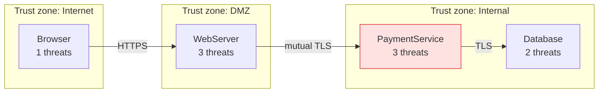

# Lab: Using ThreatSpec-style annotations to do threat modeling as code

**Course exercise:** "Using ThreatSpec to do Threat Modeling as Code." Lessons: [02 Threat modeling tools and CI/CD](../../02-threat-modeling-tools-and-ci-cd.md#3-threat-modeling-as-code-with-annotations-the-threatspec-idea). Related: [CAISP threat-model-ai-system lab](../../../../caisp-course/ch5-threat-modeling-ai-systems/labs/threat-model-ai-system/tm_tool.py) (a DFD-in-YAML approach).

**Time:** 60 minutes. **Tests:** 8, all offline. **Safety:** fictional shop code that is only parsed, never imported or run.

> **Outdated to current.** **ThreatSpec is legacy** (little or no development since about 2020; verify at its repository). The annotation grammar here follows its *shape* but is simplified. For new work use **OWASP pytm**, **Threagile** or **Threat Dragon** (see [real-tools](../../real-tools/threat-modeling-tools.md)).

## What it does

Four fixture files under [fixtures/shop](fixtures/shop) (three Python, one JavaScript) carry comment annotations:

| Tag | Form |
|---|---|
| `@exposes` | `Zone:Component to <STRIDE threat> with <description>` |
| `@mitigates` | `Zone:Component against <STRIDE threat> with <mitigation>` |
| `@accepts` | `<STRIDE threat> to Zone:Component with <reason>` |
| `@connects` | `Zone:A to Zone:B with <protocol>` |

[tmcode.py](tmcode.py) (pure Python, no dependencies) builds a model and produces:

1. a **Markdown report**: one row per exposure with status `mitigated`, `accepted` or `UNMITIGATED`, and the file and line of the evidence;
2. a **Mermaid DFD**: one subgraph per **trust zone** (the text before the colon), edges from `@connects`, unmitigated components coloured red;
3. a **gate**: exit 1 when an exposure has neither mitigation nor accepted risk, or when an annotation is malformed or uses a non-STRIDE threat name.

It also warns about **orphan mitigations** (a mitigation for a threat nobody declared).

## Run

```text
.venv/Scripts/python devsecops-course/03-security-requirements-and-threat-modeling/labs/threat-modeling-as-code/demo.py
.venv/Scripts/python -m pytest devsecops-course/03-security-requirements-and-threat-modeling/labs/threat-modeling-as-code -v
```

## Expected output (real run)

````text
# Threat model report (generated)

| Component | Threat | Status | Evidence |
|---|---|---|---|
| DMZ:WebServer | Spoofing | mitigated | web_server.py:5 |
| DMZ:WebServer | Tampering | mitigated | web_server.py:11 |
| DMZ:WebServer | Denial of Service | accepted | web_server.py:13 |
| Internal:Database | Tampering | mitigated | db_layer.py:4 |
| Internal:Database | Information Disclosure | mitigated | db_layer.py:6 |
| Internal:PaymentService | Tampering | mitigated | payments.py:4 |
| Internal:PaymentService | Repudiation | UNMITIGATED | - |
| Internal:PaymentService | Information Disclosure | UNMITIGATED | - |
| Internet:Browser | Tampering | mitigated | browser_ui.js:4 |

## Unmitigated exposures
- Internal:PaymentService: Repudiation (no record of who approved a refund) at payments.py:5
- Internal:PaymentService: Information Disclosure (card numbers in debug logs) at payments.py:11

## Mitigations with no matching exposure (review)
- Internet:Browser: Spoofing at browser_ui.js:5
- Internal:Database: Elevation of Privilege at db_layer.py:7



gate exit code: 1
````

Paste the Mermaid block into any Mermaid renderer (GitHub renders it in Markdown) to see the diagram.

## Steps

1. Read the report. Two exposures on `Internal:PaymentService` have no decision: repudiation (no record of who approved a refund) and information disclosure (card numbers in debug logs).
2. Fix the first by adding, in `payments.py`, a line such as `# @mitigates Internal:PaymentService against Repudiation with signed audit log of refund approvals`. Run again.
3. For the second, you may not just `@accepts` it: card numbers in logs are a compliance problem. Remove the leak and add a mitigation comment next to the fix. Notice how the red node turns normal when the gate is clean.
4. Add `@exposes DMZ:WebServer to Elevation of Privilege with admin routes share the session` without a mitigation and watch the gate fail.
5. Try a typo: `@exposes X:Y to Spoofng with ...`. The parser reports a non-STRIDE threat, so mistakes cannot hide.
6. Move a `@mitigates` line to a different function: the model is unchanged, which shows the comment is documentation of where the control lives.

## Limits and honesty

- The gate proves the model is **consistent**, not **complete**. A forgotten data flow produces no annotation and no failure.
- Anyone can write a false `@mitigates`. Pair each mitigation with a test (see the [requirements lab](../security-requirements-as-code/README.md) and the [BDD lab](../bdd-security-threats/README.md)).
- Real tools do much more: threat rules, risk ratings, diagrams with layout, reports for auditors.

## Run the real tool (hedged)

- **pytm:** write the model as Python objects and run it to get a DFD and threat list (see [real-tools](../../real-tools/threat-modeling-tools.md)).
- **Threagile:** write a YAML model and run the binary or container with `-model` and `-output` (verify flags).
- **ThreatSpec:** only for studying the original idea.
