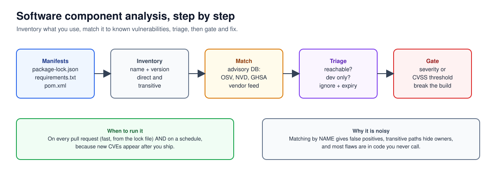

# Lesson 01: What Is Software Component Analysis (SCA)? Challenges and What to Look For

**Syllabus items covered:** "What is Software Component Analysis.", "Software Component Analysis and Its challenges.", "What to look in a SCA solution (Free or Commercial)." ([CDP 4]).

**Time:** 90 minutes. **Safety:** all package names, versions and advisory ids in the labs are FICTIONAL.

> **DBA analogy.** Your database server runs on libraries you did not write (OpenSSL, zlib, a JDBC driver). When a CVE appears for one of them you ask: do we have it, which version, where, and is the vulnerable feature used? SCA is that inventory-and-patch-advisory process for application dependencies. It is also called **software composition analysis**; the syllabus says "software component analysis". Same thing.

## 1. What is SCA?

Modern applications are mostly other people's code. A typical web app has tens of direct dependencies and hundreds or thousands of **transitive** ones (the dependencies of your dependencies). SCA does three jobs:

1. **Inventory:** list every component and version you ship (from lock files, manifests, jars, images). This list is an **SBOM** (software bill of materials), see [CSE chapter 6](../../csse-course/ch6-common-defenses-against-supply-chain-attacks/README.md).
2. **Match:** compare each component with a database of known vulnerabilities (NVD, GitHub advisories, OSV, vendor feeds).
3. **Act:** report severity, a fix version and the path that pulled it in, and break the build if the policy says so. Many tools also check **licences**.

SCA finds **known** vulnerabilities in **third-party** code. It does not find bugs in your own code (that is SAST, [chapter 05](../05-static-analysis-and-secrets/README.md)) and not unknown flaws (zero-days). It also does not detect a malicious package, only a known-vulnerable one; see typosquatting and malicious packages in the [CSE chapter 2 labs](../../csse-course/ch2-attacking-code-and-application-supply-chain/labs/typosquatting-dependency/README.md).

**Where it fits.** CDP 4 sits next to SAST and DAST: SAST reads your source, DAST probes the running app, SCA checks what you imported. Equifax (2017) is the classic case: a known flaw in a web framework (Apache Struts) went unpatched ([CSE chapter 1](../../csse-course/ch1-introduction-to-supply-chain-security/README.md) covers the case).

## 2. Data sources and identifiers

| Source | What it is | Note |
|---|---|---|
| **NVD** (NIST) | CVE records with CPE names and CVSS | CPE matching is by **name**; quality varies; the API needs a key for good rates |
| **OSV** (osv.dev, OpenSSF) | Open, machine-readable database keyed by **ecosystem + package name + version range** | Used by pip-audit, osv-scanner and others |
| **GitHub Advisory Database** | Reviewed advisories per ecosystem | Feeds Dependabot and `npm audit` |
| **Vendor feeds** | Snyk, Sonatype, Black Duck etc. | Often faster and curated; licence terms apply |
| **CVSS** | A 0-10 severity score | Measures severity in general, **not your** risk |

Each record has "introduced" and "fixed" versions. SCA must compare versions **numerically** (1.10.0 is newer than 1.9.0), which is exactly what the shared helper in [labs/_shared](labs/_shared/osv_common.py) does.

## 3. Challenges of SCA

| Challenge | What goes wrong | What helps |
|---|---|---|
| **Transitive dependencies** | The vulnerable library is three levels down; you did not choose it | Show the **path**; bump the direct parent; use overrides or resolutions; keep lock files |
| **Name-based matching (false positives)** | `widgetlib-docs` is flagged for a flaw in `widgetlib-core` because the CPE product name matches | Prefer coordinate (package url) matching; confidence levels; suppression files with a reason and an expiry |
| **Missed components (false negatives)** | Files copied into `vendor/`, renamed jars, shaded or bundled code, minified JS | Several detection methods (manifest, file hash, banner); [RetireJS lab](labs/retirejs-npm-audit/README.md) |
| **Reachability** | The flaw is in a function you never call, so the risk is low | Reachability analysis (commercial tools, Semgrep Supply Chain, others); the [Python lab](labs/safety-pip-python/README.md) has a small ast demo |
| **Volume and fatigue** | Hundreds of "high" findings; nobody reads them | Gate only on **new** findings, on reachable or fixable ones, and on a threshold; rank by exploitability (EPSS, CISA KEV; verify current names) |
| **No fix available** | Advisory exists but there is no patched version | Document, mitigate (WAF, config), replace the library, or accept with an expiry |
| **Dev versus production** | A flaw in a test tool is not a flaw in production | Separate `dev` scopes (`npm audit --omit=dev`, Maven `test` scope) |
| **Database lag and quality** | Advisory published weeks after the fix; wrong version ranges | Use two sources when stakes are high; rescan regularly |
| **Updates are risky** | Major upgrades break the build | Dependabot or Renovate PRs with tests; pin versions; upgrade often in small steps |
| **Licences and policy** | GPL code in a closed product | Licence policy checks (many SCA tools include them) |

## 4. What to look for in an SCA solution (free or commercial)

Use this as a buyer's checklist. Score each line for each candidate.

| Question | Why it matters |
|---|---|
| Which **languages and package managers** (npm, pip, Maven, Gradle, Go, NuGet, Cargo, containers)? | Coverage gaps are blind spots |
| Reads **lock files** and resolves **transitive** dependencies? | Pinned truth vs a guess |
| **Database quality:** sources, update frequency, who curates? | Late or noisy data ruins trust |
| **Matching method:** package coordinates, CPE, file hashes? | Controls false positives and negatives |
| **Reachability** or function-level data? | Prioritises real risk |
| **Fix advice:** fixed version, breaking-change hint, automatic PRs? | Saves developer time |
| **Policy and gating:** severity, CVSS, new-only, licence rules, exit codes | Needed for break-the-build |
| **Suppression workflow:** reason, owner, expiry, audit trail | Without it, suppressions rot |
| **Offline or air-gapped** mode, **mirror** support | Regulated environments |
| **CI/CD integration:** CLI, Maven/Gradle plugin, GitHub/GitLab app, SARIF output | Fits your pipeline |
| **SBOM** in and out (CycloneDX, SPDX) | Inventory and customer requests |
| **Licence and cost:** open source, free tier limits, per-developer pricing, data licence | Some free databases restrict commercial use |
| **Privacy:** does it upload your manifests or code to a vendor? | Contract and IP concerns |
| **Maintenance:** release cadence, bus factor | An abandoned scanner is a liability |

**Practical advice.** Pick one primary SCA tool for the pipeline and one independent second source for periodic cross-checks. Do not run five tools on every commit; the noise will kill the programme.

## 5. A short policy that works

1. **Pin** dependencies and commit lock files.
2. Run SCA on **every pull request** (fast, from the lock file) and **on a schedule** (new CVEs appear after you ship).
3. Break the build on **new critical/high findings that have a fix**, or on CVSS above an agreed number.
4. Everything else becomes a **ticket with an SLA** (see [chapter 14](../14-vulnerability-management/README.md)).
5. Suppressions need a **reason, an owner and an expiry date**.
6. Review the policy every quarter using metrics: findings opened and closed, time to fix, false-positive rate.

## 6. Exercise

Open [labs/_shared/advisories.osv.json](labs/_shared/advisories.osv.json). Find the record for `acme-templ`. What are the `introduced` and `fixed` versions? Would `2.1.5` be reported? Would `2.0.9`? (Answer: fixed in 2.1.5 so 2.1.5 is clean; 2.0.9 is affected because it is at or above 2.0.0 and below 2.1.5.)

## 7. Common mistakes

- Treating a CVSS score as risk. Ask: is the code reachable, is the component internet-facing, is there an exploit?
- Scanning only the top-level `package.json` and not the lock file.
- Ignoring transitive findings because "we do not use that package".
- Suppressing a finding with no reason or end date.
- Never rescanning after release.

## 8. Checklist

- [ ] I can define SCA and say what it does not find.
- [ ] I can name five challenges and an answer to each.
- [ ] I can list ten criteria for choosing an SCA tool.
- [ ] I know the difference between name matching and coordinate matching.
- [ ] I can state a break-the-build policy that avoids alert fatigue.

## References

- OWASP Dependency-Check, OWASP Top 10 "Vulnerable and Outdated Components" (A06:2021 in the 2021 list; verify the current edition), OSV schema (ossf.github.io/osv-schema), FIRST EPSS, CISA KEV catalog.
- Repo: [CSE ch2 sca lab](../../csse-course/ch2-attacking-code-and-application-supply-chain/labs/sca/README.md), [CAISP ch4 third-party-vulns lab](../../caisp-course/ch4-ai-attacks-and-defenses-devops/labs/third-party-vulns/README.md).
