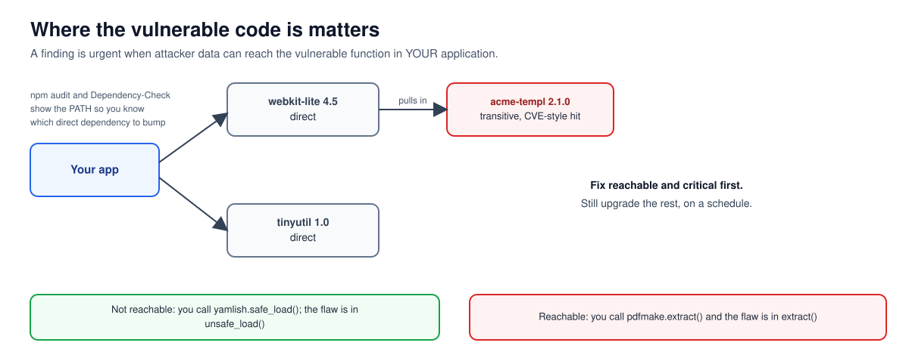

# Lesson 02: Embedding SCA Tools in the Pipeline

**Syllabus items covered:** "Embedding SCA tools like OWASP Dependency Checker, Safety, RetireJs and NPM Audit, Snyk into the pipeline." and the three labs and the demo ([CDP 4]).

**Time:** 2 hours plus labs. **Safety:** the labs are offline twins using fixtures. Real tool commands here are hedged: **verify at source**, and never commit API tokens.

> **DevOps analogy.** SCA in the pipeline is a linter with a vulnerability database behind it. Like a linter it needs three things: fast feedback on a pull request, a threshold that breaks the build, and a way to say "known, accepted, until date X".

## 1. The tools and when to use each

| Tool | Ecosystem | Method | Notes (verify at source) |
|---|---|---|---|
| **OWASP Dependency-Check** | Java first (Maven, Gradle, jars), also .NET, JS, Python, more | Collects evidence (vendor, product, version) and matches **CPE** names to the NVD; also OSS Index | Needs an **NVD API key** after the NVD API 2.0 changes; first run downloads a large database; false positives are common, suppression file needed |
| **Safety** (pyup) | Python | Matches requirements to its vulnerability database | Free database has limits and licence terms; newer versions changed commands and may need an account. Check current docs |
| **pip-audit** (PyPA) | Python | Uses PyPI/OSV advisory data; audits an environment or a requirements file | A current free alternative to Safety |
| **RetireJS** | JavaScript | Detects libraries from **file names, content banners and hashes**, including files not in npm | Great for legacy front ends and copied vendor files |
| **npm audit** | npm projects | Resolves `package-lock.json` and queries the registry's advisory service (GitHub advisories) | Built in; `npm audit fix` can bump versions; check for breaking majors |
| **osv-scanner** (Google) | Many ecosystems | Matches lock files and SBOMs to OSV | A current multi-language alternative |
| **Snyk** | Many ecosystems | Commercial platform and CLI; curated database; reachability in some plans; fix PRs | Needs an account and token; free tier limits; do not commit the token |
| **Dependabot / Renovate** | Many | Opens upgrade pull requests | Fixes, not only reports |
| **Trivy / Grype** | Containers, file systems, lock files | Scan images and repos; produce SBOMs | See [CSE chapter 6](../../csse-course/ch6-common-defenses-against-supply-chain-attacks/README.md) |

**Rule of thumb.** Use the ecosystem's built-in or closest tool first (npm audit, pip-audit, Dependency-Check for Java), add RetireJS for front-end files outside npm, and add a multi-ecosystem scanner (osv-scanner, Trivy, Snyk) as the common reporting layer.

## 2. Where in the pipeline

```text
developer -> pull request ----> [SCA fast check: lock files, new findings only]  -> block merge on critical/high with fix
                |
                +--> build ---> [SBOM generated and stored as an artifact]
main/release -----> scheduled -> [SCA rescan of the SBOM / deployed images]     -> tickets with SLA
```

- **Pull request:** quick, offline-capable if you mirror the database, compare with the base branch so only **new** findings fail.
- **Release build:** generate an SBOM, keep it with the artifact.
- **Nightly or weekly:** rescan the last SBOM. New CVEs appear after code is merged.
- **Container images:** also scan the image, because OS packages are not in your lock file ([chapter 11](../11-defending-containers-at-scale/README.md)).

## 3. Break-the-build thresholds

Choose a rule that people can live with. All three labs implement the same ideas:

| Rule | Example | Used by |
|---|---|---|
| **Severity floor** | fail at `high` or above | `npm audit --audit-level=high`, Snyk `--severity-threshold=high` |
| **CVSS score** | fail at 7.0 or more | Dependency-Check `failBuildOnCVSS` / `--failOnCVSS` |
| **Count cap** | fail when more than N findings | custom, useful when migrating a messy legacy repo |
| **New only** | fail only on findings not in the baseline | needs a baseline file |
| **Fixable only** | ignore findings with no fixed version | avoids blocking on what nobody can fix; track them separately |
| **Confidence floor** | ignore low-confidence name matches | Dependency-Check evidence confidence |
| **Production scope** | ignore dev and test dependencies | `--omit=dev`, Maven scope filter |

**Ignore files need discipline.** Every suppression must have a reason, an owner and an **expiry**. The shared helper `apply_ignores` rejects entries with no reason or no expiry, and reactivates expired ones. Real equivalents: Dependency-Check suppression XML, `.snyk` policy, `.trivyignore`, npm `overrides` plus a tracked ticket.

## 4. The three labs

All three read the **same OSV-format advisory database** ([labs/_shared/advisories.osv.json](labs/_shared/advisories.osv.json)) so you can compare approaches. All names are fictional.

| Lab | Real tools it mirrors | What you learn |
|---|---|---|
| [retirejs-npm-audit](labs/retirejs-npm-audit/README.md) | RetireJS and `npm audit` | Walk `package-lock.json` for direct and transitive findings with the path; detect libraries from file names and banners; compare what each tool misses |
| [safety-pip-python](labs/safety-pip-python/README.md) | Safety, pip-audit | Parse `requirements.txt` (pins, ranges, includes), match advisories, add a **reachability** check with `ast` |
| [dependency-check-java](labs/dependency-check-java/README.md) (demo level) | OWASP Dependency-Check | Parse a `pom.xml` with properties and managed versions; **CPE-style** name matching with confidence; why it creates false positives; fail on CVSS |



## 5. Handling the output

1. **Sort** by severity, then reachability, then fixability.
2. **Fix** with the smallest upgrade that is inside the declared range first (the npm lab prints whether the fix is inside the range or a major bump).
3. **Pin or override** transitive versions when the parent has not updated.
4. **Replace** abandoned libraries instead of patching around them.
5. **Record** accepted risks with an expiry; feed the rest to your vulnerability management tool ([chapter 14](../14-vulnerability-management/README.md): DefectDojo and metrics).
6. **Measure:** time to fix, number of expired suppressions, false-positive rate.

## 6. Real-tool pointers

Hedged command sketches are in [real-tools/dependency-check.md](real-tools/dependency-check.md) and [real-tools/sca-cli-tools.md](real-tools/sca-cli-tools.md). The older course labs use pip and Safety; the guide shows the current alternatives (pip-audit, osv-scanner).

## 7. Common mistakes

- Running `npm audit` without a lock file, or `pip-audit` on an unpinned file.
- Failing every build on low-severity findings, then disabling the check.
- Putting a Snyk or NVD token in the repository. Use CI secret variables.
- Trusting one tool completely. Different databases, different gaps.
- Forgetting to scan base images and OS packages.

## 8. Checklist

- [ ] I can say which tool I would use for a JavaScript, a Python and a Java project, and why.
- [ ] I can write a break-the-build rule and justify it.
- [ ] I can explain why Dependency-Check needs an NVD API key and why it is noisy.
- [ ] I know Safety has current alternatives (pip-audit, osv-scanner).
- [ ] I can describe a suppression policy.

## References

- Tool docs: OWASP Dependency-Check, npm audit, RetireJS, Safety, pip-audit, osv-scanner, Snyk, Dependabot, Renovate (verify current versions and flags).
- Repo: [CSE ch2 sca-sast-pre-commit lab](../../csse-course/ch2-attacking-code-and-application-supply-chain/labs/sca-sast-pre-commit/README.md), [CSE ch6 Snyk and Trivy labs](../../csse-course/ch6-common-defenses-against-supply-chain-attacks/labs/snyk-container-scan/README.md).
