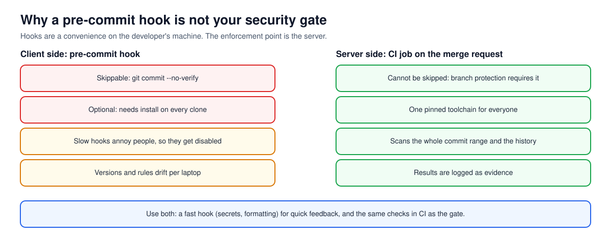

# Lesson 01: What Is SAST? Challenges and Embedding SAST Tools

**Syllabus items covered:** "What is Static Application Security Testing.", "Static Analysis and Its challenges.", "Embedding SAST tools like Find Bugs into the pipeline." ([CDP 5]); the Java, Rails and Python labs.

**Time:** 2 hours plus labs. **Safety:** all scanned code is fixture code that is only parsed. Commands for real tools are hedged: **verify at source**.

> **DBA analogy.** SAST is like reviewing stored procedures and SQL scripts **without running them**: a program reads the code and flags patterns that are known to be dangerous (string-built SQL, weak crypto, unchecked input). Fast, early, cheap, but it only knows what its rules know.

## 1. What is SAST?

**Static Application Security Testing** analyses source code, bytecode or binaries **without executing them**. It runs early (on the developer's machine or in CI on every commit) and reports the file and line, a weakness class (usually a **CWE** id) and sometimes the data flow.

| Question | SAST | DAST ([chapter 06](../06-dynamic-analysis/README.md)) | SCA ([chapter 04](../04-software-component-analysis/README.md)) | IAST/RASP ([chapter 07](../07-runtime-analysis-rasp-iast/README.md)) |
|---|---|---|---|---|
| Looks at | Your source or bytecode | Running app from outside | Third-party dependencies | Running app from inside |
| Needs a running app | No | Yes | No | Yes |
| Finds | Injection patterns, hard-coded secrets, weak crypto, risky APIs | Runtime and config issues, auth and session flaws | Known CVEs in libraries | Real data flows during tests |
| Weakness | False positives, no runtime context | Late, slow, coverage depends on crawling | Known issues only | Needs agent and tests |

SAST techniques, from simple to deep: **pattern or regex matching**, **AST matching** (structure), **data-flow or taint analysis** (does untrusted data reach a dangerous sink?), and **control-flow and interprocedural analysis**. [Lesson 03](03-custom-rules-regex-ast-graph.md) shows all three of the first ones in a lab.

## 2. Challenges of static analysis

| Challenge | What it looks like | What helps |
|---|---|---|
| **False positives** | 200 findings, 150 harmless; developers stop reading | Tune rules, custom rules for your frameworks, triage with decisions that expire, show only new findings on pull requests |
| **False negatives** | The scanner says clean, the bug is in framework magic or reflection | Several tools, code review, DAST, tests; do not read "no findings" as "safe" |
| **Language and framework coverage** | Works for Java, silent about your template engine | Choose tools per language; add custom rules |
| **No runtime context** | Cannot know if a value is attacker controlled in production | Taint rules with sources and sinks; IAST for confirmation |
| **Speed** | Deep scans take an hour | Fast rules on pull requests (changed files), deep scan nightly |
| **Build needed** | Java bytecode tools need a compile | Run after build; cache |
| **Triage load** | Nobody owns the results | Gate on new findings; owner per repository; SLA ([chapter 14](../14-vulnerability-management/README.md)) |
| **Developer experience** | Findings far from the editor | IDE plugins, comments on the pull request, SARIF in the code review UI |
| **Rule maintenance** | Rules rot as code changes | Test rules with good and bad examples (see the labs) |

**Triage rule of thumb.** Every finding gets a decision: fix, false positive (with reason), accepted risk (with owner and date), or "defer with a ticket". A **line-independent fingerprint** keeps the decision attached when code moves; the SpotBugs and Brakeman labs use this idea.

## 3. Tools by language

| Language | Tool | Notes (verify at source) |
|---|---|---|
| Java | **SpotBugs** (successor of **FindBugs**, which is dead) + **find-sec-bugs** plugin | Bytecode analysis; SpotBugs on its own is mostly bug finding, **find-sec-bugs** adds the security patterns with CWE ids |
| Ruby on Rails | **Brakeman** | Rails-specific static analyser, JSON, SARIF and other outputs; no need to run the app |
| Python | **Bandit** | AST based, plugin API for custom checks, `# nosec` suppression; Semgrep for custom patterns |
| Many languages | **Semgrep** | Pattern syntax that looks like the code; custom rules in YAML; taint mode; open-source engine (LGPL) vs commercial platform; the **Opengrep** fork exists since 2025 |
| Many languages | **CodeQL** (GitHub) | Treats code as a database queried with QL; strong data-flow and control-flow analysis; free for open source, licensing for private code via GitHub Advanced Security (verify) |
| Many languages | **SonarQube**, Checkmarx, Fortify, Veracode, Snyk Code | Commercial or mixed platforms; broader governance and dashboards |

**FindBugs to SpotBugs.** The syllabus says "Find Bugs". FindBugs stopped development around 2015; **SpotBugs** is the maintained fork and the one to use. Add **find-sec-bugs** for security rules. Both read `.class` files, so they run after compilation.

## 4. Embedding SAST in the pipeline



```text
pull request -> [fast SAST on changed files + secrets scan] -> comment on PR / block on new high findings
main         -> [full SAST (deep)] -> SARIF/JSON artifact -> vulnerability manager -> tickets
```

Practical rules:

1. **Run in CI as the gate** and optionally in the IDE for feedback ([lesson 02](02-secrets-scanning-and-pre-commit.md) explains why a pre-commit hook cannot be the gate).
2. **Fail only on new findings** above a severity and confidence level; keep a baseline for the old ones and burn it down on a schedule.
3. **Use SARIF** (a standard JSON format) so results show up in the GitHub or GitLab UI and in DefectDojo.
4. **Pin tool versions** and rule sets so results are reproducible.
5. **Test your rules** against known good and bad code (the [bandit-custom-checks](labs/bandit-custom-checks/README.md) and [custom rules](labs/custom-rules-regex-ast-graph/README.md) labs show how).
6. **Measure** false-positive rate, time to triage and findings fixed.

Existing material you can reuse: the [CSE ch2 SAST lab](../../csse-course/ch2-attacking-code-and-application-supply-chain/labs/sast/README.md), the [CSE ch6 sast-in-pipeline lab](../../csse-course/ch6-common-defenses-against-supply-chain-attacks/labs/sast-in-pipeline/README.md) (SARIF and baseline), the [CMCPSE ch5 SAST lab](../../cmcpse-course/ch5-devsecops-for-mcp-security/labs/sast-vulnerable-mcp-server/README.md) and the [CAISP ai-code-weaknesses lab](../../caisp-course/ch4-ai-attacks-and-defenses-devops/labs/ai-code-weaknesses/README.md) (weaknesses in AI-generated code).

## 5. The three tool labs in this chapter

| Lab | Real tool mirrored | What you practise |
|---|---|---|
| [spotbugs-java-scan](labs/spotbugs-java-scan/README.md) | SpotBugs + find-sec-bugs | Parse XML and SARIF reports, filter test code and non-security categories, map to CWE, decisions with expiry, gate on rank |
| [brakeman-bandit](labs/brakeman-bandit/README.md) | Brakeman and Bandit | Normalise two tools' outputs into one schema, score severity x confidence, baseline gate |
| [bandit-custom-checks](labs/bandit-custom-checks/README.md) | Bandit plugins | Write enterprise-specific checks and measure false-positive reduction |

## 6. Common mistakes

- Turning on every rule on day one, then disabling the tool when it is noisy.
- Reading "0 findings" as "secure".
- Suppressing findings without a reason or date.
- Scanning only `main` after merge; the cheapest time to fix is the pull request.
- Using FindBugs, which is unmaintained, instead of SpotBugs.
- Not scanning generated or AI-written code because "the tool wrote it".

## 7. Checklist

- [ ] I can define SAST and compare it with DAST, SCA and IAST.
- [ ] I can name five SAST challenges and a remedy for each.
- [ ] I know FindBugs is superseded by SpotBugs, and what find-sec-bugs adds.
- [ ] I can pick a tool for Java, Rails and Python.
- [ ] I can describe a gating policy that uses new findings only.

## References

- SpotBugs and find-sec-bugs documentation; Brakeman docs; Bandit docs; Semgrep docs; CodeQL docs; SARIF 2.1.0 specification (OASIS).
- OWASP Source Code Analysis Tools list and the Code Review Guide; MITRE CWE (cwe.mitre.org).
- Repo: [CSE ch2 SAST lab](../../csse-course/ch2-attacking-code-and-application-supply-chain/labs/sast/README.md), [CMCPSE ch5](../../cmcpse-course/ch5-devsecops-for-mcp-security/02-sast-and-secret-scanning.md).
