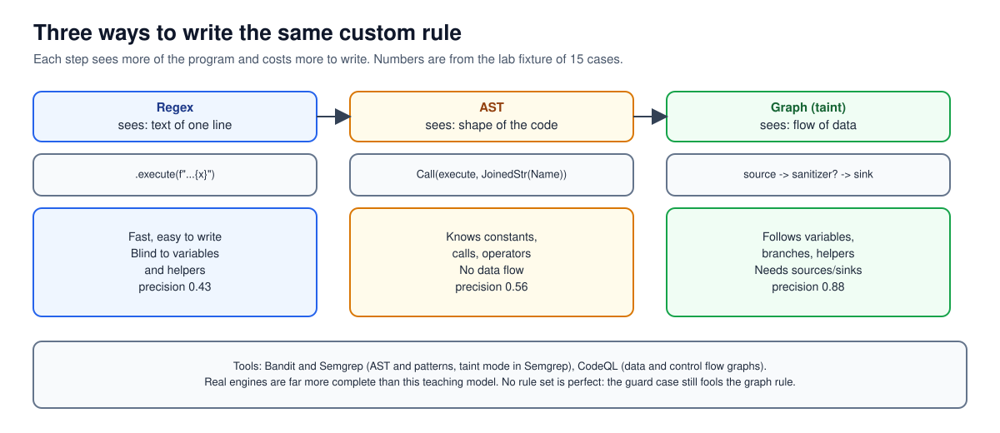

# Lesson 03: Writing Custom Rules: Regex, AST and Graph (Data and Control Flow)

**Syllabus items covered:** "Writing custom rules to weed out false positives and improve the quality of the results.", "Various approaches to write custom rules in free and paid tools", "Regular expressions", "Abstract Syntax Trees", "Graphs ( Data and Control Flow analysis)", and the lab "Writing custom checks in the bandit for your enterprise applications." ([CDE 3]).

**Time:** 3 hours plus labs. **Safety:** only fixture code is parsed. Nothing is imported or run.

> **DBA analogy.** A generic rule is like `LIKE '%select%'` over your query logs: noisy. A parsed query plan (AST) is better: you see the structure. A data-lineage graph tells you where a value came from and where it ends up. Custom SAST rules climb the same ladder.

## 1. Why write custom rules at all

Out-of-the-box rule sets are written for the average application. Yours is not average:

1. **Cut false positives.** A generic "SQL built from strings" rule flags `"SELECT * FROM " + TABLE` where `TABLE` is a constant. A custom rule that knows your constants and your safe helper functions stays quiet.
2. **Catch what the generic rules cannot.** Your internal database wrapper, your HTTP client, your logging helper and your authorization decorators are invisible to standard rules.
3. **Enforce policy.** "All outbound calls through `corp_http` must set a timeout." "Every `delete_*` function must have a role decorator."
4. **Raise the quality of results** so developers trust the tool and read the output.

The loop: **find a false positive or a miss, write a rule or an exception, test it with good and bad examples, version it, measure precision and recall.**

## 2. Three approaches



| Approach | Sees | Good for | Weak at |
|---|---|---|---|
| **Regular expressions** | One line (or a few) of text | Secrets, banned function names, config smells, quick wins | Variables, multi-line code, strings that merely mention a word; easy to evade with formatting |
| **Abstract Syntax Trees (AST)** | The structure: calls, arguments, decorators, operators | Banned calls with specific arguments (`verify=False`), missing decorators, constant folding | Does not know where a value came from |
| **Graphs: data and control flow** | How values move between statements and functions | Injection (source to sink), missing sanitizers, "validated before use" | Needs sources, sinks and sanitizers modelled; harder to write; slower |

### 2.1 Regular expressions

```text
\.execute\(\s*(?:f["']|["'][^"']*["']\s*[+%]|[^,)]*\.format\()
```

Fast and easy, and it works on any language. It also matches `execute("SELECT * FROM " + TABLE)` (false positive) and misses `q = "..." + uid; cur.execute(q)` (false negative). Use regex where the question really is about text: secret formats, file names, license headers.

### 2.2 Abstract syntax trees

An AST is the parsed shape of the code. In Python the `ast` module gives you nodes such as `Call`, `BinOp`, `JoinedStr` (an f-string), `Name`, `Constant`.

```python
tree = ast.parse(source)
for node in ast.walk(tree):
    if isinstance(node, ast.Call) and node.func.attr == "execute":
        arg = node.args[0]
        if isinstance(arg, (ast.BinOp, ast.JoinedStr)) and not all_constant(arg):
            report(node)
```

It folds `"a" + "b"` as a constant and understands the call and its arguments, but if the argument is a variable it sees only a `Name` and has to give up. **Bandit** is AST-based: checks receive a context with the call name, arguments and keywords. **Semgrep** matches code patterns that look like the code itself (also AST-based) and has a taint mode. **Python `ast`**, JavaScript parsers (acorn, tree-sitter) and Java parsers (JavaParser, Spoon) all give you ASTs.

### 2.3 Graphs: data flow and control flow

A **control flow graph** shows which statements can follow which (branches, loops). A **data flow graph** shows where each value is defined and used. **Taint analysis** is the practical use:

- **Source:** where untrusted data enters (`request.args`, `sys.argv`, `input()`).
- **Propagation:** assignments, concatenation, f-strings, function calls.
- **Sanitizer:** something that makes data safe for a sink (`int()`, an escape function, parameterised queries).
- **Sink:** where tainted data is dangerous (`cursor.execute`, `os.system`, `eval`).
- **Finding:** a path from a source to a sink with **no sanitizer** on it.

The lab implements a tiny version over the Python AST: flow-sensitive inside a function (so overwriting a tainted variable with a constant kills the taint), merging of `if/else` branches (tainted if either branch is tainted), and **one level of function summaries** (so `execute(build_query(uid))` is caught). Real engines go much further: interprocedural and cross-file analysis, aliasing, object fields, framework models. **CodeQL** (queries over a code database) and **Semgrep taint mode** (`pattern-sources`, `pattern-sinks`, `pattern-sanitizers`) are the production tools. Some Semgrep features (for example cross-file taint) are in the commercial engine; verify what the open-source engine supports. The **Opengrep** fork continues the open-source engine since 2025.

### 2.4 Comparing precision

The lab [custom-rules-regex-ast-graph](labs/custom-rules-regex-ast-graph/README.md) detects the **same vulnerability (SQL injection) in 15 code shapes**, 7 vulnerable and 8 safe, with all three methods. Results from the fixture run:

| Detector | Precision | Recall | Why |
|---|---|---|---|
| Regex | 0.43 | 0.43 | Flags constants and casts; misses variables and helpers |
| AST | 0.56 | 0.71 | Folds constants; misses indirection; ignores assignment order |
| Graph (taint) | 0.88 | 1.00 | Follows data; one remaining false positive (a validation guard) |

Precision is the share of findings that are real. Recall is the share of real bugs found. These numbers come from a small fixture and show a **trend, not a benchmark**. No method is perfect: the "validated with `isdigit()` then abort" case still fools the graph detector because it has no path-sensitive reasoning.

## 3. Practical guidance: choosing the approach

| Situation | Use |
|---|---|
| Secrets, license headers, banned strings | Regex |
| "This function must not be called with that argument", missing decorator, banned import | AST rule (Bandit plugin, Semgrep pattern) |
| "User data must not reach this sink without this sanitizer" | Taint rule (Semgrep taint mode, CodeQL) |
| Proving a rule is right | Add test files: lines that must match and lines that must not |

Prefer the **simplest approach that works** and move up only when false positives or misses justify it. Keep rules small, named, documented and versioned like code; each rule gets a test file.

## 4. Free and paid tools for custom rules

| Tool | Rule style | Notes (verify at source) |
|---|---|---|
| **Bandit** | Python plugin functions on AST nodes, `# nosec` | Free; custom plugins via entry points ([lab](labs/bandit-custom-checks/README.md)) |
| **Semgrep** | YAML patterns, metavariables, taint mode | Open-source engine and commercial platform; Opengrep fork (2025) |
| **CodeQL** | QL queries over a code database | Strong data and control flow; licensing for private code (verify) |
| **SpotBugs** | Java detectors (bytecode) and find-sec-bugs rules | Custom detectors are Java classes; heavier to write |
| **Brakeman** | Custom checks in Ruby (check classes) | Rails-focused |
| **ESLint** (plus security plugins) | AST rules for JavaScript | Free; write rules as visitors |
| **SonarQube, Checkmarx, Fortify, Snyk Code** | Product-specific rule languages or rule editors | Paid or mixed; vendor docs |

## 5. The Bandit-style lab

[bandit-custom-checks](labs/bandit-custom-checks/README.md) builds a small **Bandit-like framework** (`@checks("Call")`, `@test_id("E901")`, a `Context` object, `# nosec`) and four enterprise rules (unsafe `corpdb.execute`, `corp_http` without timeout, secrets in logs, privileged functions without a role decorator). It then scores them against **ground truth** in a fixture app: a generic baseline has 5 false positives and 3 misses; the custom rules have none. The real Bandit plugin skeleton is in a hedged section of that README.

## 6. Common mistakes

- Writing a regex when the question is about structure.
- Adding exceptions (`nosec`) instead of fixing a noisy rule.
- Rules without tests; a rule that cannot fail proves nothing.
- Modelling sanitizers too generously (a function named `clean` that does nothing).
- Not versioning rules, so results change silently.
- Treating the taint demo as a real engine.

## 7. Checklist

- [ ] I can give two reasons to write custom rules.
- [ ] I can explain regex, AST and graph approaches with one example of each strength and weakness.
- [ ] I can define source, sink, sanitizer and propagation.
- [ ] I can say how to measure a rule: precision and recall against labelled examples.
- [ ] I can name a free and a paid tool for each approach.

## References

- Bandit docs (custom plugins); Semgrep docs (rule syntax, taint mode); CodeQL docs; Python `ast` module documentation.
- Aho, Lam, Sethi, Ullman, *Compilers* (flow analysis), for the theory; OWASP Source Code Analysis tools list.
- Repo: [CSE ch2 SAST lab](../../csse-course/ch2-attacking-code-and-application-supply-chain/labs/sast/README.md) (a 12-rule AST scanner with taint), [CMCPSE ch5 SAST lab](../../cmcpse-course/ch5-devsecops-for-mcp-security/labs/sast-vulnerable-mcp-server/README.md) (custom MCP rules and Semgrep rules file).
