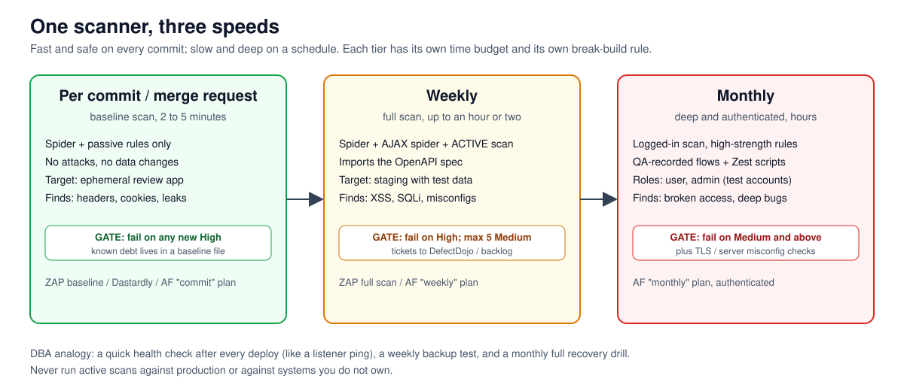

# Lesson 02: ZAP and Dastardly in pipelines: baselines and scan schedules

> **Sources merged:** [CDP 6] Embedding DAST tools like ZAP and Burp Suite Dastardly into the pipeline; Creating baseline scans for DAST; using ZAP to configure per commit/weekly/monthly scans. [CDE 4] Embedding DAST tools into the pipeline; the Burp Suite licence note.
> **Time:** about 3 hours. **Lab:** [zap-scan-schedules](labs/zap-scan-schedules/README.md). **Real tools:** [ZAP Docker scans](real-tools/zap-docker-scans.md), [Automation Framework](real-tools/zap-automation-framework.md), [Dastardly and Burp DAST](real-tools/dastardly-and-burp-dast.md).



## 1. The two tools in the syllabus

| Tool | What it is | Cost | CI role |
|---|---|---|---|
| **ZAP** (now "ZAP by Checkmarx"; formerly OWASP ZAP) | Open-source scanner and proxy with a Docker image, scripts, an Automation Framework (YAML), an API and add-ons | free | baseline, full, API and authenticated scans |
| **Burp Suite Dastardly** | Free, lightweight scanner from PortSwigger built for CI. Scans a start URL for a focused set of issues in a short time and outputs JUnit XML | free | quick pipeline gate |
| **Burp Suite DAST** (formerly Burp Suite Enterprise) | PortSwigger's commercial, scalable scan server | paid | enterprise scanning with Burp's full engine |

> **About the licence note in the syllabus.** The course says *"Students need to bring their Burp Suite Pro License to use in CI/CD"*. Treat this as a **hedged** note: **Dastardly is free**, so you can do the pipeline demo without a licence. The commercial CI product for the full Burp scanner is **Burp Suite DAST**. Burp Suite Professional is a desktop tool for manual testing. Verify current licensing and product names at PortSwigger's site.

## 2. Where a DAST stage sits in the pipeline

```text
commit -> build -> unit tests -> SAST/SCA -> package image -> deploy to REVIEW/STAGING app
                                                                 |
                                                                 +--> DAST stage (this lesson)
                                                                 |      start URL, auth, spec
                                                                 |      scan, report, gate
                                                                 v
                                                          promote only if the gate passes
```

Rules of thumb:

1. DAST needs a **running** target, so it comes **after** deploy to a test environment (a review app, a Docker Compose stack in the job, or staging).
2. The target must be **yours and disposable**. Never scan production with active rules; never scan third parties.
3. Pass the **scope** (URLs to include, URLs to exclude such as logout) so the scanner cannot wander.
4. **Store the report as an artifact** and feed it to your tracker ([chapter 14](../14-vulnerability-management/README.md)).
5. Decide the **break-build rule** before the first run (section 5).

## 3. Baseline scans

A **baseline scan** is the safe, short scan: ZAP spiders the app for a limited time and runs **passive rules only**. It does not attack. In ZAP's Docker image this is `zap-baseline.py`.

Why start here:

- it runs in minutes, so it fits on **every merge request**;
- it is safe on shared environments;
- it catches the cheap wins: missing headers, cookie flags, information leaks, outdated library banners;
- it creates the **baseline of known findings** you compare against later, so a new problem shows up as a change.

"Baseline" also means a file that records issues you already know (a config file listing rule IDs to `IGNORE`, `WARN` or `FAIL`). The pipeline fails only on **new** items, so old debt does not block every build while you work it down. The lab models this with a `baseline` set in the gate policy.

## 4. Per-commit, weekly and monthly strategy

One scan speed does not fit all needs, so run three.

| Cadence | Profile | What runs | Time | Target | Gate |
|---|---|---|---|---|---|
| **Per commit / MR** | baseline | spider + passive | 2 to 5 min | ephemeral review app | fail on any **new High** |
| **Weekly** | full | spider + AJAX spider + **active** scan + OpenAPI import | up to 1 to 2 h | staging with test data | fail on High; cap Medium count |
| **Monthly** | deep, authenticated | logged-in, high-strength active scan, QA-recorded flows, several roles | hours | staging | fail on Medium and above; plus TLS checks |

Why this split works: the commit scan gives **fast feedback to the developer**, the weekly scan gives **breadth** without blocking daily work, the monthly scan gives **depth** and catches what needs a login or a long run. DBA analogy: a quick health check after every deployment, a weekly restore test, and a monthly full disaster-recovery drill.

Triggering: per commit runs in the normal pipeline; weekly and monthly use **scheduled pipelines** (GitLab schedules, GitHub Actions `on: schedule`, Jenkins cron). See [csse ch1 CI runner and stages](../../csse-course/ch1-introduction-to-supply-chain-security/README.md) if you need to refresh how stages work.

## 5. Break-build rules

A gate turns a report into a decision. Good rules are **simple, written down and agreed with developers**.

- Fail on **High** (and Critical if your tool has it) for the commit scan; allow Medium and Low as warnings.
- Count **new** alerts only (compare with the baseline).
- Allow **time-boxed risk acceptance**: a rule ID with an owner and an expiry date, not a permanent ignore.
- Make sure a **scan error** (target down, timeout, logged out) fails the job too. "No findings because nothing ran" is the worst result.

In the lab, [`evaluate_gate`](labs/zap-scan-schedules/schedules.py) takes parsed ZAP JSON alerts and a policy (`fail_on`, `max_medium`, `accepted`, `baseline`) and returns pass or fail with reasons.

## 6. ZAP Automation Framework (AF)

Instead of long command lines, ZAP can run a **YAML plan**: an `env` section (contexts, users, parameters) and a list of `jobs` (`openapi`, `spider`, `spiderAjax`, `passiveScan-wait`, `activeScan`, `report`, `requestor`, `script`...). The plan lives in Git, is reviewed like code, and is run in CI with `zap.sh -cmd -autorun plan.yaml` or inside the Docker image. Names and parameters evolve: verify against the docs of the ZAP version you pin.

The lab **generates** the three profiles, then **validates** them with rules a reviewer would apply: scope hosts allowed, no active scan in the commit profile, report job last, passive wait before the report, a time budget on every active scan, no literal passwords (use `${ENV_VAR}`).

## 7. Dastardly in a pipeline

Dastardly is attractive when you want a **free, small, fast** gate: you give it a start URL and it produces a JUnit report that CI understands, failing the build when it finds issues. It is not a replacement for a full scan: it covers a limited set of checks and a limited crawl. Use it as a quick gate and keep ZAP (or Burp DAST) for the weekly and monthly depth. Details and CI snippets are in [dastardly-and-burp-dast.md](real-tools/dastardly-and-burp-dast.md).

## 8. Practical hygiene

- **Pin the ZAP image** to a version or digest, not `latest`. Pin GitHub Actions to a commit SHA.
- **Secrets**: passwords for the scan user come from the CI secret store, never from the plan file.
- **Exclude** logout, delete-account, payment and email-sending URLs.
- **Rate**: keep thread counts low on shared staging; coordinate with the team.
- **Evidence**: keep the HTML and JSON reports for audit (compliance, [chapter 08](../08-iac-configuration-and-compliance-as-code/README.md)).

## 9. Summary

- Baseline = fast, passive, safe on every commit. Full = active, scheduled. Deep = authenticated, monthly.
- The AF YAML makes scans reviewable and repeatable. Validate the plan before running it.
- A gate needs clear rules: new Highs fail; known debt is baselined; accepted risk expires; scan errors fail.
- Dastardly is free and quick; Burp Suite DAST is the commercial product; ZAP is the free full-featured option. Verify current product names.
