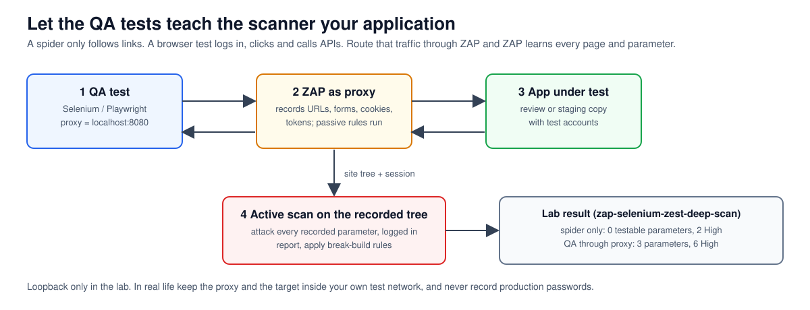

# Lesson 04: Driving DAST with QA automation and OpenAPI

> **Sources merged:** [CDE 4] Leveraging QA/Performance automation to drive DAST scans; Using Swagger (OpenAPI) and ZAP to scan APIs iteratively; the "ZAP + Selenium + Zest" lab.
> **Time:** about 3 hours. **Labs:** [zap-selenium-zest-deep-scan](labs/zap-selenium-zest-deep-scan/README.md), [openapi-zap-api-scan](labs/openapi-zap-api-scan/README.md).



## 1. The idea: reuse tests you already have

Your company already pays for **QA automation**: Selenium, Playwright or Cypress browser tests, and API tests in Postman, REST Assured or pytest. These tests know how to log in, click through the real flows, fill forms and call the real APIs. A spider does not.

So: **run the QA tests with their traffic going through ZAP** (as an HTTP proxy). ZAP records every URL, form, parameter, header and token the tests use, runs its passive rules on all of it, and then you can **actively scan** exactly those requests.

Benefits:

- **Coverage**: the scanner reaches pages behind the login and AJAX calls a spider never finds.
- **Valid input**: QA tests send realistic data (valid IDs, valid forms), so the app gets past validation and the scanner reaches deeper code.
- **Free session handling**: the test already knows how to log in.
- **No new scripts to maintain**: the QA team owns the flows.

Performance tests (JMeter, k6, Gatling) can also be proxied. Be careful: heavy load through a scanner proxy is slow, so use a **small functional run** for DAST, not the full load test.

## 2. How to wire it

```text
QA test (Selenium/Playwright/Cypress/API test)
        |  proxy = http://localhost:8080  (the ZAP proxy)
        v
      ZAP  ----------------------->  app under test (staging or a review app)
        |
        +--> after the run: spider the recorded tree, active scan, report
```

Typical steps (hedged; check the ZAP docs for your version):

1. Start ZAP headless (daemon mode) in the CI job, or as a service container.
2. Set the proxy in the test runner: browser option `--proxy-server=localhost:8080` (Selenium/Chrome), `proxy={"server": "http://localhost:8080"}` (Playwright), or the `HTTP_PROXY` setting for API tests.
3. Trust ZAP's root CA certificate in the test browser if you test HTTPS, or use a test environment with HTTP.
4. Run the QA suite. ZAP builds the **site tree** and **history**.
5. Call ZAP's API or Automation Framework: passive scan wait, then `activeScan` with the context, then `report`.
6. Apply the break-build rule ([lesson 02](02-zap-dastardly-pipelines-and-schedules.md)).

You can also let ZAP **record the session as a Zest script**, then replay it with authentication ([lesson 05](05-custom-authentication-and-zest.md)).

### What the lab does

[`qaproxy.py`](labs/zap-selenium-zest-deep-scan/qaproxy.py) has a **recording proxy** (a small forward proxy on 127.0.0.1) and a **scripted browser** that plays QA steps (open home, log in, open the account, search, look up a user) through it. The recorded URLs feed the lab prober with the session cookie. The demo prints coverage **before** (spider only) and **after** (QA-driven):

- before: 3 pages, **0** testable parameters, 2 High findings;
- after: 6 URLs, **3** testable parameters, 6 High findings.

Nothing was added to the scanner. Only the discovery changed.

## 3. Limits

- The scan is only as deep as the QA flows. Missing a flow means missing coverage (the same lesson as IAST in [chapter 07](../07-runtime-analysis-rasp-iast/README.md)).
- QA data can be unrealistic or shared; active scanning on it may corrupt test data. Reset the environment after the scan.
- Flaky UI tests make flaky scans. Prefer API-level tests for stability.
- Tokens that change on every request (CSRF, one-time nonces) need session handling rules.

## 4. OpenAPI (Swagger) + ZAP for APIs

An **OpenAPI** document (formerly Swagger) describes an HTTP API: paths, methods, parameters, request bodies, responses and security schemes. It is a **machine-readable map**. A scanner cannot discover API endpoints by crawling (there are no links), so it **imports the spec** and knows every operation.

ZAP supports this in three ways (verify current names): the **OpenAPI add-on** (import a URL or file), the packaged script `zap-api-scan.py -t <spec> -f openapi`, and the Automation Framework `openapi` job. SOAP and GraphQL have similar imports.

### "Iteratively"

The syllabus says scan APIs **iteratively**. In practice:

1. **First run**: import the spec, run a passive and a short active scan, fix crashes (spec errors, missing example values, auth failures).
2. **Improve the input**: add realistic example values and required headers; add auth; exclude dangerous operations (`DELETE /users`).
3. **Add test data** for object IDs belonging to two users, so access-control checks make sense.
4. **Run on every spec change**: keep the spec in the repo; a spec change triggers the API scan. A scan that fails to import the spec is itself a finding (the spec is stale).
5. **Track the baseline** and tune like any other scan.

### What the generated requests look like

For each operation, the lab ([`apiscan.py`](labs/openapi-zap-api-scan/apiscan.py)) builds:

| Test | Idea | Finding if |
|---|---|---|
| baseline | valid call with a good token | server error (5xx) |
| **no-auth** | same call without credentials, when the spec says it is secured | answer is 200 (missing authentication) |
| **injection probes** | a single quote and `' OR '1'='1` in string parameters | database error text appears |
| **BOLA / ID swap** | user A requests an object that belongs to user B | answer is 200 instead of 403/404 |

**BOLA** (Broken Object Level Authorization, OWASP API Top 10 number 1) cannot be found without **two users and known object ownership**. That is why test data matters. A generic scanner often misses BOLA, so add targeted tests like this one.

Real ZAP does much more (fuzzing bodies, many injection classes, schema checks), but the flow is the same: **spec in, requests out, response analysis**.

## 5. Summary

- Proxy QA automation through ZAP to get coverage, valid input and sessions for free.
- Measure coverage before and after (testable parameters, URLs, findings).
- OpenAPI gives the scanner a map of the API. Scan iteratively, and keep the spec in Git.
- Add BOLA and no-auth tests; they need two users and object ownership data.

Existing material: [pentesting web testing and Burp](../../cybersecurity-track/09-pentesting-fundamentals/03-web-app-testing-and-burp.md), [csse ch2 ZAP guide](../../csse-course/ch2-attacking-code-and-application-supply-chain/real-tools/zap.md).
