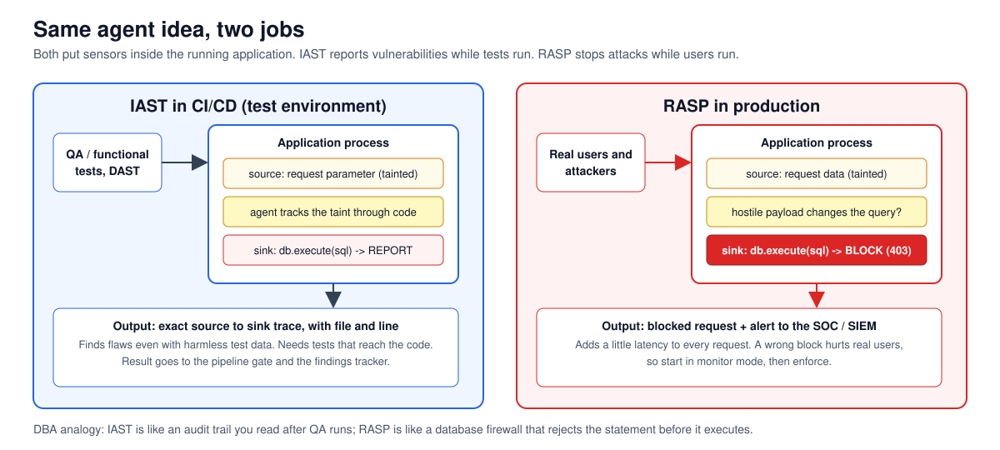

# Lesson 01: What runtime analysis is, and RASP versus IAST

> **Sources merged:** [CDE 5] What is Runtime Analysis Application Security Testing; Differences between RASP and IAST.
> **Time:** about 3 hours. **Labs:** [iast-instrumentation](labs/iast-instrumentation/README.md), [rasp-blocking](labs/rasp-blocking/README.md).



## 1. The gap between SAST and DAST

- **SAST** reads source code. It sees all the code but not the real data flow at runtime, so it guesses and gives false positives.
- **DAST** attacks from outside. It sees real behaviour but not the code, and only tests what it reaches.

**Runtime analysis** puts a **sensor inside the running application** (an *agent*) that watches the code while it executes. The agent sees real requests, the real call stack and the real values reaching dangerous functions. So it can tell you not only *"there is SQL injection"* but *"the parameter `name` from `request.args` flows through `user_by_name` line 65 into `Database.execute` at line 66"*.

The syllabus name is "Runtime Analysis Application Security Testing". In practice that umbrella covers two product families: **IAST** and **RASP**.

## 2. Instrumentation: how an agent gets inside

The agent loads **into the same process** as the application:

| Platform | How the agent attaches (typical) |
|---|---|
| Java / .NET | a Java agent (`-javaagent`) or a profiler API rewrites bytecode as classes load |
| Node.js / Python / Ruby | a library or module imported at startup that **wraps (monkey-patches)** sensitive functions |
| Containers | an init step or sidecar adds the agent library and environment variables |

The agent wraps:

- **Sources**: where untrusted data enters (HTTP parameters, headers, cookies, request body).
- **Propagators**: operations that carry data (string concatenation, formatting, copying).
- **Sinks**: dangerous functions (SQL execute, OS command, file open, HTML output, deserialization, HTTP client, LDAP, XPath).
- **Sanitizers**: functions that make data safe (parameter binding, escaping, validation).

This is **taint tracking**: mark data from a source as tainted, follow it, and raise a flag when tainted data reaches a sink **without** passing a proper sanitizer. The lab builds exactly this in about 200 lines of Python ([`taint.py`](labs/iast-instrumentation/taint.py), [`agent.py`](labs/iast-instrumentation/agent.py)).

DBA analogy: this is **fine-grained auditing** (Oracle FGA or audit triggers) for application code, plus a lineage map showing where each value in a SQL statement came from.

## 3. IAST: Interactive Application Security Testing

- **Where it runs:** test and QA environments, inside CI/CD.
- **What drives it:** existing **functional tests, integration tests or a DAST scan**. The agent just observes while they run.
- **What it does:** reports vulnerabilities with an **exact source to sink trace**, file and line, often with the request that triggered it.
- **When it reports:** it flags a vulnerable **flow** even if the test input was harmless. It does not need an attack payload, because the dangerous construction is visible in the data flow (`"... '" + name + "'"` reaching `execute`).
- **Output goes to:** the pipeline gate and the findings tracker ([chapter 14](../14-vulnerability-management/README.md)).

Why developers like it: few false positives (it saw the real flow) and a code location to fix. In the lab, the nightly suite with three tests shows **two vulnerable flows with traces**, without a single attack payload.

## 4. RASP: Runtime Application Self-Protection

- **Where it runs:** **production** (and sometimes pre-production).
- **What drives it:** real traffic, including attackers.
- **What it does:** at the sink, it checks whether the data **actually changes the meaning** of the SQL, command or path (a quote that breaks out of a string, `;`, `../`). If yes and the policy says block, it **stops the call** (raises an error, returns 403) and raises an alert.
- **Modes:** *monitor* (log only) first, then *block*. Always roll out in monitor mode to see false positives before enforcing.
- **Output goes to:** the SOC and SIEM ([cybersecurity track: SOC](../../cybersecurity-track/05-soc-fundamentals/README.md)).

Why it is valuable: it protects **while the real fix is waiting**: a virtual patch for a known flaw. Why it is risky: it sits in the request path, adds latency, and a wrong block hurts real users.

DBA analogy: IAST is reading the audit trail from QA runs. RASP is a **database firewall** (or a trigger that rejects the statement) that sits at the point of execution and knows the real statement, not just the HTTP request.

## 5. RASP versus IAST versus WAF versus DAST

| | IAST | RASP | WAF | DAST |
|---|---|---|---|---|
| Position | inside the app | inside the app | in front of the app | outside, a client |
| Environment | test / CI | production | production | test / staging |
| Goal | **find** flaws | **block** attacks | block attacks | **find** flaws |
| Sees code and data flow | **yes** | **yes** | no | no |
| Needs traffic from | tests or DAST | real users | real users | its own attack requests |
| Output | trace to code line | blocked request, alert | blocked request, alert | URL + evidence |
| Main risk | missed code not covered by tests | latency, wrong blocks | bypass by encoding tricks | coverage gaps |

A WAF sees only HTTP text, so it can be fooled by encodings and cannot know how the app uses the value. RASP sees the value **at the sink**, after decoding, which is why it has fewer false positives for the same rule. They are complements, not replacements.

## 6. The lab in one picture

```text
QA tests (no attacks)  -->  app + IAST agent  -->  report: SOURCE -> PROPAGATE -> SINK (file:line)
real attacker          -->  app + RASP agent  -->  hostile payload at sink? BLOCK + alert
```

Both use the **same instrumentation**. Only the decision differs: IAST asks "is a tainted value built into code unsafely?", RASP asks "is this tainted value hostile right now?".

## 7. Summary

- Runtime analysis puts an agent inside the process and tracks tainted data from source to sink.
- **IAST** = test time, reports flaws with code traces. **RASP** = production, blocks attacks.
- Same sensors, different mode and risk: IAST needs good tests; RASP needs careful rollout.
- Neither replaces SAST, DAST or a WAF.

Existing material: [csse ch2 dynamic-analysis lab](../../csse-course/ch2-attacking-code-and-application-supply-chain/labs/dynamic-analysis/README.md), [pentesting web testing](../../cybersecurity-track/09-pentesting-fundamentals/03-web-app-testing-and-burp.md), and the [secure AI gateway lesson](../../09-enterprise-architecture/06-secure-llm-ai-gateway.md) (a gateway is the same pattern at a different layer: a runtime enforcement point that inspects and blocks).
