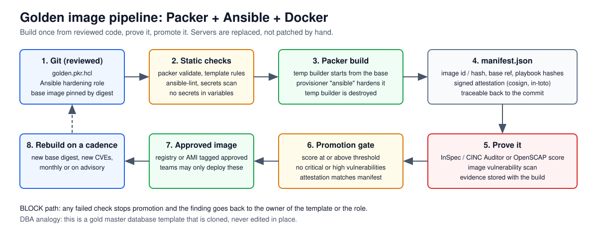

# Lesson 01: Infrastructure as Code and configuration management

> **Unofficial companion.** Your course videos and lab environment are the primary source. Tool status is hedged: **verify at the source**.

**Syllabus items:** [CDP 7] What is Infrastructure as Code and its benefits; Platform + Infrastructure Definition + Configuration Management; Tools and Services which helps to achieve IaaC.

## 1. What is Infrastructure as Code and its benefits

**Infrastructure as Code (IaC)** means you describe servers, networks, images and their settings in **text files**, keep the files in version control, and let a tool build the real thing from them. You stop logging in and clicking.

**DBA analogy.** You already know the difference between "I ran some ALTER SYSTEM commands on prod last year" and "the schema is in Liquibase or Flyway scripts, reviewed and replayed on every environment". IaC is the second way, for everything below the database.

| Benefit | Why a security person cares |
|---|---|
| **Repeatable** | Dev, test and prod are built the same way, so a test proves something about prod. |
| **Reviewable** | A change is a pull request: two people see it, a pipeline checks it, history shows who changed what. |
| **Fast recovery** | Rebuild a hardened host in minutes after a compromise instead of trusting a cleaned one. |
| **Less drift** | A server that someone changed by hand is a mystery. Code shows the intended state, and tools show the difference. |
| **Testable** | You can lint and scan the code before anything exists (see [06 Terraform policy lab](../../06-ai-devsecops/terraform/README.md)). |
| **Auditable** | The repo and pipeline logs are evidence for ISO 27001 and PCI DSS. |

**Declarative versus imperative.** Declarative: "there must be three web servers with this config" (Terraform, CloudFormation, most Ansible modules). Imperative: "run these steps in this order" (shell scripts, Ansible `command`/`shell`). Declarative is easier to make **idempotent**: running it twice gives the same result and the second run changes nothing. Idempotency is the property that makes drift correction safe.

**Mutable versus immutable.** Mutable infrastructure is patched in place. Immutable infrastructure is **replaced** by a new, tested image. The rest of this chapter (Packer golden images) and chapter 13 (secrets on immutable systems) lean on that idea.

## 2. Platform + Infrastructure Definition + Configuration Management

The syllabus splits IaC into three layers. They are different jobs and different tools:

| Layer | Question it answers | Typical tools | Output |
|---|---|---|---|
| **Platform** | Where does it run? Accounts, networks, clusters, managed services. | Terraform / OpenTofu, CloudFormation, Pulumi, Bicep | Cloud resources |
| **Infrastructure definition** | What machine or image exists? | Packer, Dockerfile, cloud images, Kubernetes manifests | A VM image or container image |
| **Configuration management (CM)** | How is the machine set up and kept set up? | Ansible, Chef, Puppet, Salt | Packages, files, users, services in a known state |

A good mental model: Terraform builds the **house**, Packer bakes the **furniture into a template**, Ansible **arranges and keeps** the rooms tidy. They overlap on purpose; for example Packer calls Ansible so the image comes out configured.

## 3. Tools and services that help achieve IaC

| Need | Tools (examples; verify current status) |
|---|---|
| Provision cloud | **Terraform** (BSL licence since Aug 2023), **OpenTofu** (the open-source fork under the Linux Foundation), CloudFormation, Pulumi |
| Configure hosts | **Ansible**, Chef, Puppet, Salt |
| Build images | **Packer**, Docker/BuildKit, cloud image builders |
| Run workloads | Docker, Kubernetes (Helm, Kustomize) |
| Store state and secrets | remote state with locking and encryption; Vault or a cloud secret manager (chapter 13) |
| Check the code | `terraform validate`, ansible-lint, Checkov, tfsec/Trivy config, OPA/Conftest, Hadolint |
| Check the result | InSpec/CINC Auditor, OpenSCAP, CIS-CAT (lesson 04) |

The licence change matters for planning, not for what you learn: HashiCorp moved Terraform and Packer to the Business Source License in August 2023, IBM completed its HashiCorp acquisition in 2025 (verify), OpenTofu exists as an open fork of Terraform, and **there is no major Packer fork**. Check the licence before you embed a tool in a product you sell.

## 4. Security of IaC itself

IaC moves risk, it does not remove it:

- **Secrets in code.** A password in a playbook or `terraform.tfvars` lives in git forever. Use Vault, a cloud secret manager or an encrypted store (lesson 02 and [chapter 13](../13-secrets-management/README.md)).
- **State files contain secrets.** Terraform state holds resource attributes, sometimes passwords. Encrypt it, restrict access, use remote state with locking.
- **Over-privileged automation.** The pipeline account that can create anything is a crown jewel. Scope it, and use short-lived credentials.
- **Unreviewed changes.** Protect the main branch, require review, and run linters and policy checks before merge ([06 Terraform lab](../../06-ai-devsecops/terraform/README.md)).
- **Supply chain.** Roles, modules, providers and base images are dependencies. Pin versions and digests, verify sources ([CSSE chapter 6](../../csse-course/ch6-common-defenses-against-supply-chain-attacks/README.md)).
- **Drift.** Manual changes break the guarantee. Detect them by re-running the code in check mode and by scanning (lesson 04).

## Practice

1. Take any manual runbook you know (for example "prepare a new database server") and write down which lines are platform, infrastructure definition and configuration management.
2. Open the [Linux for security analysts lesson](../../cybersecurity-track/01-it-fundamentals/03-linux-for-security-analysts.md) and list five settings (sshd, sysctl, file modes) you would want a CM tool to enforce.
3. Move on to [lesson 02](02-ansible-and-ansible-security.md).
