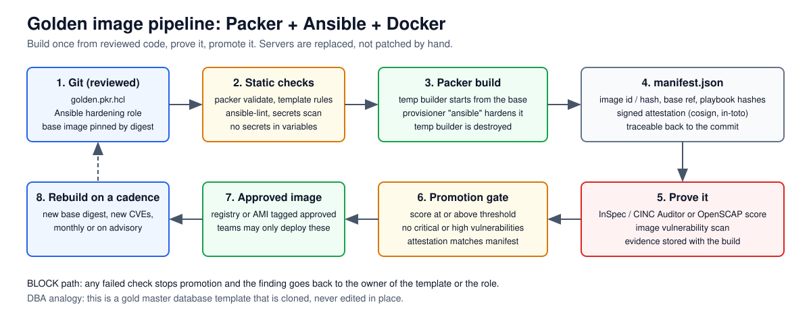

# Lesson 03: Packer and golden images

> **Unofficial companion.** Verify licence and version facts at the source.

**Syllabus items:** [CDE 6] Introduction to Packer; Benefits of Packer; Templates, builders, provisioners, and post processors; Packer for continuous security in DevOps Pipelines; Tools and Services for practicing IaaC (Packer + Ansible + Docker); lab *Create hardened Golden images using Packer + Ansible*. [CDP 7] lab *Using Ansible to create Golden images and harden Infrastructure*.

## 1. Introduction to Packer

**Packer** builds **machine images** from a template: it starts a temporary machine from a base image, runs provisioners to configure it, saves the result as an image (AMI, Azure image, GCP image, VMware template, Docker image), and destroys the temporary machine. The image is your **golden image**: the approved starting point every server or container is created from.

**DBA analogy.** A golden image is a **gold master**: a cloned, patched, hardened template you stamp copies from, instead of hand-building each server and hoping they match.

## 2. Benefits of Packer

- **Same template, many platforms**: one definition for AWS, Azure, VMware and Docker.
- **Fast, consistent starts**: configuration happens at build time, not at boot, so a new instance is ready and identical.
- **Shift security left**: hardening, patching and scanning happen **before** the image is ever used.
- **Immutable infrastructure**: patch by building a new image and replacing instances, not by logging in.
- **Auditable**: template and playbooks are in git, the build writes a manifest.
- **Fewer surprises at scale**: autoscaling launches already-hardened machines.

## 3. Templates, builders, provisioners and post-processors

Current Packer uses **HCL2** (`*.pkr.hcl`). Older **JSON templates are legacy** (`packer hcl2_upgrade` converts them). Building blocks:

| Block | Job | Example |
|---|---|---|
| `packer { required_plugins {...} }` | Pin plugin versions | `docker`, `amazon`, `ansible` plugins |
| `variable` | Inputs. Mark secrets `sensitive = true` and give them **no default**. | `variable "registry_password"` |
| `source` (the builder) | What to start from and what kind of image to make | `source "docker" "base"`, `source "amazon-ebs" "base"` |
| `build` + `provisioner` | Steps that configure the temp machine | `provisioner "ansible" { playbook_file = "./ansible/harden.yml" }`, `shell`, `file` |
| `post-processor` | Steps after the image exists | `manifest`, `docker-tag`, `docker-push`, `compress`, `checksum` |

The lab fixture [golden.pkr.hcl](labs/packer-ansible-golden-image/fixtures/golden.pkr.hcl) is a complete small example.

```hcl
source "docker" "base" {
  image  = var.base_image      # debian@sha256:... (pinned by digest)
  commit = true
}
build {
  sources = ["source.docker.base"]
  provisioner "ansible" { playbook_file = "./ansible/harden.yml" }
  post-processor "manifest" { output = "manifest.json" }
}
```

## 4. Packer for continuous security in DevOps pipelines

Treat the image build as a **pipeline stage with gates**:

1. **Pin the base** by digest or AMI id. `most_recent = true` means tomorrow's build starts from different bytes, silently.
2. **Provision with Ansible** (reviewed code), not a pile of `curl | bash` shell lines.
3. **No secrets in the template or the image.** Inject build-time credentials from the CI secret store (`PKR_VAR_*`, `env()`), use short-lived cloud credentials, and clean up. A secret baked into a layer or an AMI snapshot is a published secret.
4. **Validate before build**: `packer validate`, lint the playbooks, scan the template (the lab validator does this).
5. **Test after build**: run the compliance profile (InSpec/CINC, OpenSCAP; lesson 04) and an image vulnerability scan against the **built** image.
6. **Emit a manifest and sign it**: record the image id, base, and playbook hashes; sign with cosign/in-toto where supported.
7. **Promotion gate**: only images that pass become `approved`. The lab implements a gate with a tamper check.
8. **Rebuild on a schedule** and when advisories land; retire old images.



## 5. Tools and services for practising IaC: Packer + Ansible + Docker

You can practise the whole chain on a laptop:

- **Docker** is the builder (`source "docker"`): fast, free, and no cloud account needed.
- **Ansible** is the provisioner: the same role you will later use on real hosts.
- **Packer** glues them and writes the manifest.
- Optional: Vagrant or a local VM for a full OS, an InSpec/CINC run for the proof, and a container registry (Harbor, [CSSE ch6 lab](../../csse-course/ch6-common-defenses-against-supply-chain-attacks/README.md)).

Remember that Docker images are not VMs: the Ansible provisioner needs Python in the image and a connection mode that works with Docker (see [real-tools/packer.md](real-tools/packer.md)).

## 6. Licence note: BSL

HashiCorp relicensed Packer (and Terraform, Vault, Consul) to the **Business Source License (BSL)** in August 2023. Using it internally to build your own images is generally allowed, but BSL restricts offering competing products. IBM completed its acquisition of HashiCorp (2025; verify). There is **no major community fork of Packer** (Terraform has OpenTofu; Vault has OpenBao). Read the licence at the source before you ship Packer inside a product, and know alternatives exist: Docker BuildKit/buildx for container images, cloud-native image builders (for example AWS EC2 Image Builder), and Kiwi/Kickstart-style tools.

## 7. Lab: hardened golden image with Packer and Ansible

[packer-ansible-golden-image](labs/packer-ansible-golden-image/README.md):

- an **HCL2 subset parser** and **validator** (base pinned by digest or AMI id, no secrets in variables, an ansible provisioner, manifest output, plugin pins, no `curl | sh`);
- a **simulated build** into a manifest with a content hash that changes when the template or playbook changes;
- a **promotion gate** (clean template, compliance score, vulnerability counts, attestation matches the manifest).

Pair it with [ansible-golden-image-hardening](labs/ansible-golden-image-hardening/README.md), which supplies the hardening and the proof.

## Practice

1. Change the base image in the lab fixture from a digest to `debian:12` and read the finding.
2. Tamper with the manifest in `demo.py` and watch the gate block it.
3. Continue with [lesson 04: compliance as code](04-compliance-as-code.md).
