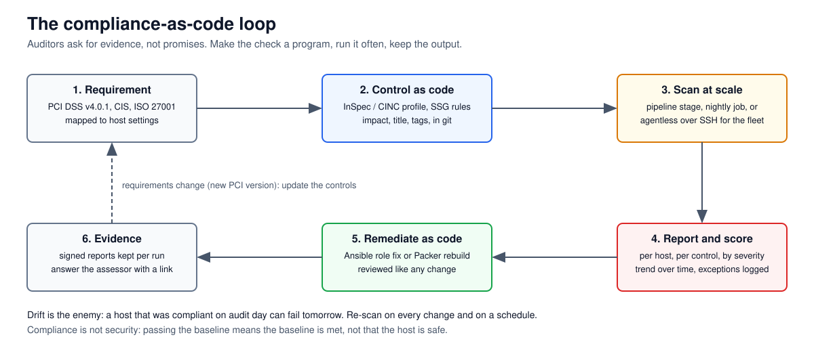

# Lesson 04: Compliance as code

> **Unofficial companion.** Standards and tool licences change. **Verify at the source.**

**Syllabus items:** [CDP 8] Different approaches to handle compliance requirements at DevOps scale; Using configuration management to achieve compliance; Manage compliance using Inspec/OpenScap at Scale; labs *Create a Inspec profile to create compliance checks for your organization* and *Use Inspec profile to scale compliance*.

## 1. Different approaches to compliance at DevOps scale

Traditional compliance is a yearly spreadsheet exercise: someone logs into a sample of servers, screenshots settings, and writes a report. At DevOps speed (hundreds of releases, servers that live hours) that is out of date before it is signed.

| Approach | How | Weakness |
|---|---|---|
| **Manual audit** | Interviews, screenshots, sampling | Slow, point in time, not repeatable |
| **Scripted checks** | Shell scripts per standard | Unstructured, hard to report |
| **Compliance as code** | Controls written as executable tests (InSpec, OpenSCAP content, Rego policies) kept in git | Needs upkeep when standards change |
| **Policy as code (preventive)** | Block non-compliant change in the pipeline (OPA/Conftest, Sentinel, admission control) | Covers what the policy sees, not runtime drift |
| **Continuous monitoring** | Scheduled scans, cloud posture tools | Alert fatigue without ownership |

The target state is a combination: **prevent** in the pipeline, **detect** continuously, **remediate as code**, **keep evidence**.



Link this to the governance material in [risk management and ISO 27001](../../cybersecurity-track/04-risk-management-and-iso27001/README.md): a **control** from a standard becomes a **testable statement** with an owner, an impact and evidence.

## 2. Using configuration management to achieve compliance

CM tools **enforce** the baseline; scanners **verify** it. Use both, from different code, so one bug does not hide itself.

- Ansible roles apply hardening (see [lesson 02](02-ansible-and-ansible-security.md)): sshd, auditd, sysctl, users, packages, permissions.
- Tag tasks with stable keys and map them to requirements (the [PCI mapping lab](labs/ansible-pci-dss-hardening/README.md)). When the requirement text changes, you edit the mapping, not the automation.
- Run the role in **check mode** on a schedule: "changed" means **drift**.
- Remember the limits: CM changes settings; it does not prove that the requirement is met, and many requirements are about people and process.

### Hardening content you do not have to invent

- **CIS Benchmarks** (consensus hardening guides, with licensing terms for some uses).
- **DISA STIGs** and the **SCAP Security Guide (SSG)** content used by OpenSCAP.
- Community Ansible roles and InSpec profiles (for example the dev-sec project's baselines; verify they are maintained and review before use).

## 3. InSpec and CINC Auditor

**InSpec** describes checks in a Ruby-based DSL: a **profile** (`inspec.yml` plus `controls/`), each **control** with an id, **impact** (0.0 to 1.0), title, tags, and `describe` blocks that use **resources** (`sshd_config`, `package`, `service`, `file`, `kernel_parameter`, `user`, ...) with `its(...) { should ... }` matchers.

```ruby
control 'ssh-01' do
  impact 1.0
  title 'SSH root login is disabled'
  tag pci: '2.2.6'
  describe sshd_config do
    its('PermitRootLogin') { should cmp 'no' }
  end
end
```

Agentless: `inspec exec profile/ -t ssh://user@host` or against a container, cloud API, or local host. Reporters: CLI, JSON, JUnit, HTML (verify names).

**Licensing note.** Progress Chef's **InSpec 6 and later require a license key** for use (check terms and the free/commercial options at the source). **CINC Auditor** is the license-free community build of InSpec and keeps profile compatibility (the project states 100% compatibility; verify for your version). Many teams run CINC Auditor to avoid license friction. The syllabus says "Inspec"; learn the concepts once, they apply to both.

### Lab: write a profile

[inspec-compliance-profile](labs/inspec-compliance-profile/README.md) defines a **YAML DSL** that mirrors those concepts (control id, impact, title, describe, its, should) with 13 controls for sshd, packages, kernel, files, services and the Docker daemon, plus a runner, an `inspec check`-style validator and a JSON report in the InSpec shape.

## 4. OpenSCAP and SCAP Security Guide

**OpenSCAP** (`oscap`) evaluates **SCAP** content: XCCDF benchmarks with OVAL checks. The **SCAP Security Guide (SSG)** supplies ready-made content for RHEL-family, Debian/Ubuntu, and others, including profiles for CIS, PCI-DSS and STIG. It can also **generate remediation** (Bash and Ansible) from the same content. Output is XCCDF/ARF XML plus an HTML report with a **score**.

| | InSpec / CINC | OpenSCAP |
|---|---|---|
| Language | Ruby DSL (custom checks easy) | XCCDF + OVAL XML (content mostly consumed, not written) |
| Strength | Readable custom organisational profiles; many targets (cloud, containers) | Standards-based content out of the box; remediation generation; native in RHEL tooling |
| Output | JSON/CLI/JUnit | XCCDF results, ARF, HTML |

### Lab: results to a score

[openscap-results](labs/openscap-results/README.md) parses an ARF-like XML fixture, computes the compliance score (and a severity-weighted score), lists failures worst first, compares a before and an after scan, and **rejects DOCTYPE/entity tricks** in result files.

## 5. Manage compliance at scale

One host is a demo; fifty thousand is the job. At scale you need:

- **Fleet scanning**: run profiles over SSH or via agents/cron on many hosts, in parallel, as a pipeline stage for new images and a nightly job for the running fleet.
- **Aggregation**: store JSON/ARF results centrally (a dashboard, a SIEM, DefectDojo-style tracking: see [vulnerability management](../14-vulnerability-management/README.md) and [cybersecurity track 08](../../cybersecurity-track/08-vulnerability-management/README.md)).
- **Skip logic** (`only_if`): do not fail Docker controls on hosts with no Docker.
- **Impact-based triage**: fix critical controls first; report a **risk-weighted** score as well as a plain percentage.
- **Exceptions with expiry**: a waived control needs an owner, a reason and an end date.
- **Trend and drift**: the question is not "what is the score" but "what changed since last week".
- **Evidence retention**: keep dated, signed results for the assessor.

The lab includes an **at-scale demo over 20 generated hosts** (some with no Docker) with a fleet summary: average score, top failing controls, failures by severity, hosts below the threshold.

## 6. PCI DSS v4.0.1 note

**PCI DSS v4.0.1** is the current version of the standard (v3.2.1 was retired in March 2024; the future-dated v4.0 requirements became mandatory on 31 March 2025). Verify at the PCI SSC document library. For Linux hosts in the cardholder data environment, requirement **2.2.x** (secure configuration standards), **6.3.3** (patching), **8.x** (accounts, lockout, passwords), **10.x** (audit logs and time sync) and **11.5.2** (change detection) are where hardening automation helps. Treat the mapping in the lab as a starting point to review with your QSA, not as a compliance claim. Compliance is not security: passing a benchmark means the benchmark is met.

## Practice

1. Run the InSpec lab. Add one control for `PermitEmptyPasswords` and make the drifted host fail it.
2. Run the OpenSCAP lab and compare the flat and severity-weighted scores: which one would you show a CISO, and why?
3. Open the [chapter README](README.md) and finish the exam questions.
