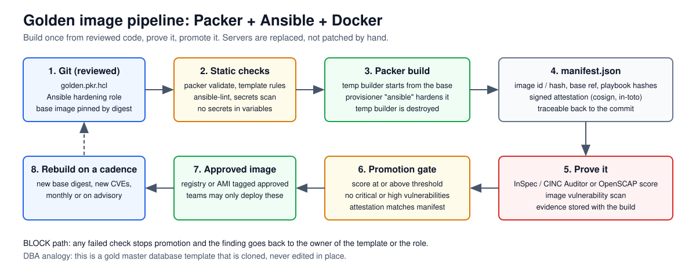
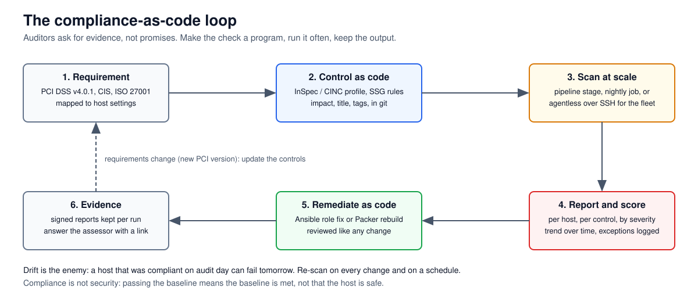

# Chapter 08: IaC, configuration and compliance as code

This chapter merges **[CDP 7] Infrastructure as Code and Its Security**, **[CDP 8] Compliance as code** and **[CDE 6] Infrastructure as Code (IaC) and Its Security** (the Expert version: Ansible security and Packer). You learn what IaC is, how Ansible configures and hardens hosts (and how to keep its secrets safe), how Packer bakes **golden images**, and how **compliance as code** (InSpec/CINC, OpenSCAP) proves that hosts and images meet a standard. Six labs run offline with tests: **no Ansible, Packer, InSpec, OpenSCAP, Docker or cloud is needed**.

> **Safety.** Every lab is a simulation: YAML, HCL, JSON and XML fixtures, fake host "facts", canary strings and FAKE credentials built so they match no real token format. Nothing connects to a host or builds an image. Practise real tools only on systems you own.

> **Unofficial companion.** Your course videos and lab environment are the primary source. Tool status, licences and standards versions are hedged: **verify at the source**.

## Syllabus coverage

Rows follow the source order: CDP 7, then CDP 8, then CDE 6. Where two courses teach the same idea, both rows are kept and point to the same lesson.

| Syllabus item | Where to study | Lab |
|---|---|---|
| [CDP 7] What is Infrastructure as Code and its benefits. | [Lesson 01 section 1](01-iac-and-configuration-management.md#1-what-is-infrastructure-as-code-and-its-benefits); repo [06 Terraform policy](../../06-ai-devsecops/terraform/README.md) | n/a |
| [CDP 7] Platform + Infrastructure Definition + Configuration Management. | [01 section 2](01-iac-and-configuration-management.md#2-platform--infrastructure-definition--configuration-management) (SVG) | n/a |
| [CDP 7] Introduction to Ansible | [Lesson 02 section 1](02-ansible-and-ansible-security.md#1-introduction-to-ansible) | [docker-and-ansible](labs/docker-and-ansible/README.md) |
| [CDP 7] Benefits of Ansible. | [02 section 2](02-ansible-and-ansible-security.md#2-benefits-of-ansible) | n/a |
| [CDP 7] Push and Pull based configuration management systems | [02 section 3](02-ansible-and-ansible-security.md#3-push-and-pull-based-configuration-management) | n/a |
| [CDP 7] Modules, tasks, roles and Playbooks | [02 section 4](02-ansible-and-ansible-security.md#4-modules-tasks-roles-and-playbooks) | [docker-and-ansible](labs/docker-and-ansible/README.md), [ansible-golden-image-hardening](labs/ansible-golden-image-hardening/README.md) |
| [CDP 7] Tools and Services which helps to achieve IaaC | [01 section 3](01-iac-and-configuration-management.md#3-tools-and-services-that-help-achieve-iac); [real-tools/ansible.md](real-tools/ansible.md) | n/a |
| [CDP 7] Hands-On Labs: | [Lab list](#labs) | all six labs |
| [CDP 7] Docker and Ansible | [02 section 4](02-ansible-and-ansible-security.md#4-modules-tasks-roles-and-playbooks) | [docker-and-ansible](labs/docker-and-ansible/README.md) |
| [CDP 7] Using Ansible to create Golden images and harden Infrastructure. | [02 section 4](02-ansible-and-ansible-security.md#4-modules-tasks-roles-and-playbooks); [Lesson 03](03-packer-golden-images.md) (SVG) | [ansible-golden-image-hardening](labs/ansible-golden-image-hardening/README.md), [packer-ansible-golden-image](labs/packer-ansible-golden-image/README.md) |
| [CDP 8] Different approaches to handle compliance requirements at DevOps scale | [Lesson 04 section 1](04-compliance-as-code.md#1-different-approaches-to-compliance-at-devops-scale) (SVG); repo [risk management and ISO 27001](../../cybersecurity-track/04-risk-management-and-iso27001/README.md) | [ansible-pci-dss-hardening](labs/ansible-pci-dss-hardening/README.md) |
| [CDP 8] Using configuration management to achieve compliance. | [04 section 2](04-compliance-as-code.md#2-using-configuration-management-to-achieve-compliance) | [ansible-golden-image-hardening](labs/ansible-golden-image-hardening/README.md), [ansible-pci-dss-hardening](labs/ansible-pci-dss-hardening/README.md) |
| [CDP 8] Manage compliance using Inspec/OpenScap at Scale. | [04 sections 3 to 5](04-compliance-as-code.md#3-inspec-and-cinc-auditor); [real-tools/inspec-cinc.md](real-tools/inspec-cinc.md), [real-tools/openscap.md](real-tools/openscap.md) | [inspec-compliance-profile](labs/inspec-compliance-profile/README.md), [openscap-results](labs/openscap-results/README.md) |
| [CDP 8] Hands-On Labs: | [Lab list](#labs) | [inspec-compliance-profile](labs/inspec-compliance-profile/README.md) |
| [CDP 8] Create a Inspec profile to create compliance checks for your organization | [04 section 3](04-compliance-as-code.md#3-inspec-and-cinc-auditor) | [inspec-compliance-profile](labs/inspec-compliance-profile/README.md) |
| [CDP 8] Use Inspec profile to scale compliance. | [04 section 5](04-compliance-as-code.md#5-manage-compliance-at-scale) | [inspec-compliance-profile](labs/inspec-compliance-profile/README.md) (20-host fleet demo) |
| [CDE 6] Configuration management (Ansible) security | [02 section 5](02-ansible-and-ansible-security.md#5-ansible-security-users-privileges-and-keys) | [docker-and-ansible](labs/docker-and-ansible/README.md) |
| [CDE 6] Users/Privileges/Keys – Ansible Vault vs Tower. | [02 sections 5 and 6](02-ansible-and-ansible-security.md#6-ansible-vault-versus-tower-aap--awx); Tower is now AAP (AWX upstream) | [docker-and-ansible](labs/docker-and-ansible/README.md) |
| [CDE 6] Challenges with Ansible Vault in CI/CD pipeline. | [02 section 7](02-ansible-and-ansible-security.md#7-challenges-with-ansible-vault-in-a-cicd-pipeline); repo [CMCPSE secrets-vault lab](../../cmcpse-course/ch4-defending-and-hardening-mcp-servers/labs/secrets-vault/README.md); [chapter 13](../13-secrets-management/README.md) | [docker-and-ansible](labs/docker-and-ansible/README.md) (ANS-002, ANS-007) |
| [CDE 6] Introduction to Packer | [Lesson 03 section 1](03-packer-golden-images.md#1-introduction-to-packer) | [packer-ansible-golden-image](labs/packer-ansible-golden-image/README.md) |
| [CDE 6] Benefits of Packer. | [03 section 2](03-packer-golden-images.md#2-benefits-of-packer) | n/a |
| [CDE 6] Templates, builders, provisioners, and post processors. | [03 section 3](03-packer-golden-images.md#3-templates-builders-provisioners-and-post-processors) (HCL2) | [packer-ansible-golden-image](labs/packer-ansible-golden-image/README.md) |
| [CDE 6] Packer for continuous security in DevOps Pipelines. | [03 section 4](03-packer-golden-images.md#4-packer-for-continuous-security-in-devops-pipelines) (SVG) | [packer-ansible-golden-image](labs/packer-ansible-golden-image/README.md) |
| [CDE 6] Tools and Services for practicing IaaC ( Packer + Ansible + Docker ) | [03 section 5](03-packer-golden-images.md#5-tools-and-services-for-practising-iac-packer--ansible--docker); [real-tools/packer.md](real-tools/packer.md); BSL note in [03 section 6](03-packer-golden-images.md#6-licence-note-bsl) | [packer-ansible-golden-image](labs/packer-ansible-golden-image/README.md) |
| [CDE 6] Hands-On Labs: | [Lab list](#labs) | [ansible-pci-dss-hardening](labs/ansible-pci-dss-hardening/README.md), [packer-ansible-golden-image](labs/packer-ansible-golden-image/README.md) |
| [CDE 6] Using Ansible to harden on-prem/cloud machines for PCI-DSS | [02 section 8](02-ansible-and-ansible-security.md#8-using-ansible-to-harden-machines-for-pci-dss); [04 section 6](04-compliance-as-code.md#6-pci-dss-v401-note) | [ansible-pci-dss-hardening](labs/ansible-pci-dss-hardening/README.md) |
| [CDE 6] Create hardened Golden images using Packer + Ansible | [Lesson 03](03-packer-golden-images.md#7-lab-hardened-golden-image-with-packer-and-ansible) | [packer-ansible-golden-image](labs/packer-ansible-golden-image/README.md), [ansible-golden-image-hardening](labs/ansible-golden-image-hardening/README.md) |

## Learning order

1. [Lesson 01: IaC and configuration management](01-iac-and-configuration-management.md): what IaC is, the three layers, the tools.
2. [Lesson 02: Ansible and Ansible security](02-ansible-and-ansible-security.md): concepts, push versus pull, keys and privileges, Vault versus Tower/AAP, Vault in CI.
3. Labs [docker-and-ansible](labs/docker-and-ansible/README.md), then [ansible-golden-image-hardening](labs/ansible-golden-image-hardening/README.md), then [ansible-pci-dss-hardening](labs/ansible-pci-dss-hardening/README.md).
4. [Lesson 03: Packer and golden images](03-packer-golden-images.md), then lab [packer-ansible-golden-image](labs/packer-ansible-golden-image/README.md).
5. [Lesson 04: compliance as code](04-compliance-as-code.md), then labs [inspec-compliance-profile](labs/inspec-compliance-profile/README.md) and [openscap-results](labs/openscap-results/README.md).
6. Read the hedged real-tool guides: [Ansible](real-tools/ansible.md), [Packer](real-tools/packer.md), [InSpec/CINC](real-tools/inspec-cinc.md), [OpenSCAP](real-tools/openscap.md).
7. Do the 15 questions below.

## Labs

| Lab | Course exercise | Tests |
|---|---|---|
| [docker-and-ansible](labs/docker-and-ansible/README.md) | Docker and Ansible: playbook linter (become, no_log, pinned images, daemon.json, idempotency) | 12 |
| [ansible-golden-image-hardening](labs/ansible-golden-image-hardening/README.md) | Golden images and hardening: role applier on a fake host with CIS-like checks | 10 |
| [ansible-pci-dss-hardening](labs/ansible-pci-dss-hardening/README.md) | PCI DSS v4.0.1 mapping and coverage report (hedged) | 9 |
| [packer-ansible-golden-image](labs/packer-ansible-golden-image/README.md) | Packer HCL2 validator, simulated build manifest, promotion gate | 13 |
| [inspec-compliance-profile](labs/inspec-compliance-profile/README.md) | InSpec-style profile, runner, 20-host fleet scan | 13 |
| [openscap-results](labs/openscap-results/README.md) | XCCDF/ARF results to a compliance score | 11 |

Run all of them: `.venv/Scripts/python -m pytest devsecops-course/08-iac-configuration-and-compliance-as-code -q`

## Outdated in the syllabus → current

| Syllabus says or implies | Current (Nov 2026; verify at source) |
|---|---|
| **Ansible Tower** | Now **Ansible Automation Platform (AAP)**; **AWX** is the upstream open-source project. Ansible Vault itself is still current. |
| Packer templates in **JSON** | Use **HCL2** (`*.pkr.hcl`); JSON templates are legacy. Packer moved to the **BSL** licence in Aug 2023 (IBM completed the HashiCorp acquisition in 2025). There is **no major Packer fork** (OpenTofu forks Terraform; OpenBao forks Vault). |
| **Inspec** (free) | **InSpec 6 and later need a license key.** **CINC Auditor** is the license-free community build with profile compatibility. |
| PCI-DSS (version unspecified, often 3.2.1) | **PCI DSS v4.0.1** is current; v3.2.1 retired in March 2024; the future-dated v4 requirements applied from 31 March 2025. |
| Compliance as a yearly audit | Continuous: controls as code, scans on every build and on a schedule, evidence retained, exceptions with expiry. |
| Docker host as a long-lived pet | Immutable: rebuild from a golden image and replace. |

## How the three courses overlap here

[CDP 7] and [CDE 6] both teach IaC with Ansible; CDP gives the concepts (push versus pull, roles, playbooks) and the first hardening labs, while CDE adds the **security of the automation itself** (users, keys, Vault versus Tower, Vault in CI/CD) and **Packer**. They are one story here: Ansible configures, Packer bakes, and the same role serves both. [CDP 8] compliance as code is the proof stage for both. Secrets handling that CDE 6 starts (Vault in CI/CD) continues in [chapter 13](../13-secrets-management/README.md). Container hardening that Docker hosts need continues in the Docker chapters ([CSSE ch3](../../csse-course/ch3-attacking-container-supply-chain/README.md)).

## Exam tips

- **Idempotent** is the key word: run twice, second run changes nothing. Use modules, not `shell`.
- **Push versus pull**: Ansible is agentless push; Puppet and Chef are agent pull; `ansible-pull` and scheduled AAP jobs blur the line.
- **Vault versus Tower/AAP**: Vault encrypts data with a shared password; AAP/Tower adds RBAC, a credential store, audit and workflows. Say "Tower is now AAP, AWX is upstream".
- **The vault password is the problem**: where it is stored, who reads it, how it is rotated. The standard answer is an external secrets manager with short-lived identity.
- **Golden image = immutable**: pin the base by digest, provision with Ansible, no secrets baked in, test, sign, promote, rebuild.
- **Packer vocabulary**: source (builder), provisioner, post-processor, manifest. HCL2, not JSON.
- **InSpec vocabulary**: profile, control, impact 0.0 to 1.0, describe, resource, its, should. InSpec 6+ needs a license key; CINC Auditor does not.
- **OpenSCAP vocabulary**: XCCDF, OVAL, SCAP Security Guide, ARF, profile, `oscap xccdf eval`.
- **Enforce versus verify**: CM enforces, scanners verify, from different code.
- **Compliance is not security** and a hardening task is evidence, not proof. Show the gaps.

## 15 exam-style questions

1. What is Infrastructure as Code and why does it help security?

Describing infrastructure in version-controlled text that a tool applies. It gives review, repeatability, drift detection, fast rebuild after compromise, and an audit trail. It also lets you scan the code before anything exists.

2. Distinguish platform, infrastructure definition and configuration management.

Platform: where it runs (cloud accounts, networks; Terraform/OpenTofu). Infrastructure definition: the machine or image (Packer, Dockerfile). Configuration management: how hosts are set up and kept that way (Ansible, Chef, Puppet, Salt).

3. Compare push and pull configuration management.

Push: a control node connects and applies on demand (Ansible default); no agents, but drift between runs and a powerful control node. Pull: agents fetch and apply on a schedule (Puppet, Chef); continuous correction, but agents and a config server to secure.

4. Name Ansible's building blocks.

Inventory, module, task, play, playbook, role, collection, handler (plus variables, templates and facts).

5. Why is idempotency important, and how do you break it by accident?

It makes re-runs safe and lets "changed" mean drift. You break it with `command`/`shell` without `creates` or `changed_when`, appending with `>>`, `state: latest`, and `lineinfile` without `regexp`.

6. How should Ansible users, privileges and keys be set up?

A normal named or service user (not root), `become` only where needed, tightly scoped sudo, per-environment SSH keys or short-lived certificates, host key checking on, a hardened control node, and `no_log` on secret-handling tasks.

7. Ansible Vault versus Tower. What is Tower called now?

Vault encrypts files or variables with a shared password. Tower, now Ansible Automation Platform (AWX is the upstream project), is a controller with RBAC, a credential store where users can run jobs without seeing secrets, workflows and audit logs.

8. What are the main problems with Ansible Vault in CI/CD?

Storing and distributing the vault password, one password unlocking everything, painful rekeying, no per-secret audit or expiry, static long-lived secrets, and leaks through verbose output or missing `no_log`. Mitigate with vault IDs, ephemeral runners and an external secrets manager with short-lived credentials.

9. What is a golden image and how does Packer build one?

An approved, hardened, tested image used as the starting point for servers or containers. Packer starts a temporary machine from a pinned base (source), runs provisioners (Ansible), saves the image, runs post-processors (manifest), and destroys the builder.

10. Which Packer settings are security-relevant?

Base pinned by digest or AMI id, no secrets in variables or template (sensitive variables with no default, injected from CI), the ansible provisioner instead of `curl | sh`, pinned plugin versions, a manifest, and a scan and compliance gate before promotion.

11. What is the licence situation for Packer?

HashiCorp moved Packer (and Terraform, Vault, Consul) to the Business Source License in August 2023; IBM completed the acquisition in 2025 (verify). There is no major Packer fork, unlike OpenTofu and OpenBao. Check the terms before embedding it in a product.

12. What are the parts of an InSpec control?

A control id, impact (0.0 to 1.0, mapped to low/medium/high/critical), title, description and tags, and one or more `describe` blocks that use a resource with `its(...)` and a `should`/`should_not` matcher. Profiles hold controls plus `inspec.yml`.

13. InSpec or CINC Auditor?

InSpec 6 and later require a license key. CINC Auditor is the license-free community build with profile compatibility. Concepts are identical; choose on licence and support needs.

14. How does OpenSCAP differ from InSpec?

OpenSCAP evaluates standards-based XCCDF/OVAL content (the SCAP Security Guide) and can generate remediation; output is XCCDF/ARF with a score. InSpec is a Ruby DSL that makes custom organisational checks easy. Many teams use SSG content for the baseline and InSpec/CINC for custom controls.

15. How do you manage compliance at scale, and what is the catch with PCI DSS?

Scan images in the pipeline and the fleet on a schedule, aggregate results, triage by impact, track exceptions with expiry, keep signed evidence, and watch drift. For PCI DSS v4.0.1 map tasks and controls to requirement numbers, but a technical check is evidence, not proof: many requirements are process or need other controls (anti-malware, file integrity monitoring), and compliance is not security.

## References

- Ansible documentation (playbooks, vault, ansible-lint, Molecule); Red Hat Ansible Automation Platform and AWX project: verify names and versions at the source.
- HashiCorp Packer documentation (HCL2 templates, ansible provisioner, manifest post-processor) and the BSL licence announcement of August 2023.
- InSpec docs (Progress Chef); CINC project (cinc.sh); OpenSCAP and the ComplianceAsCode SCAP Security Guide; CIS Benchmarks; DISA STIGs.
- PCI Security Standards Council document library (PCI DSS v4.0.1).
- NIST SP 800-128 (configuration management) and the XCCDF 1.2 specification.
- Repo: [06 Terraform policy](../../06-ai-devsecops/terraform/README.md), [runtime security and secrets](../../06-ai-devsecops/runtime-security/README.md), [CMCPSE secrets-vault lab](../../cmcpse-course/ch4-defending-and-hardening-mcp-servers/labs/secrets-vault/README.md), [CSSE ch6](../../csse-course/ch6-common-defenses-against-supply-chain-attacks/README.md), [CSSE ch5 cloud](../../csse-course/ch5-attacking-cloud-supply-chain/README.md), [Linux for security analysts](../../cybersecurity-track/01-it-fundamentals/03-linux-for-security-analysts.md), [risk management and ISO 27001](../../cybersecurity-track/04-risk-management-and-iso27001/README.md).
