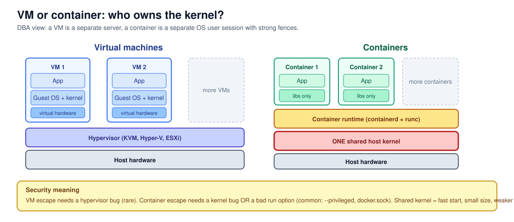
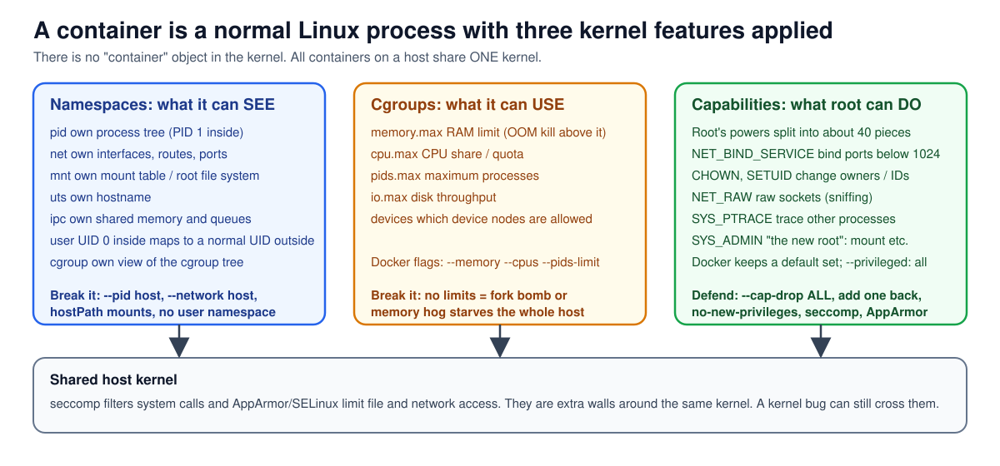

# Lesson 01: What Is a Container? (Containers, VMs and the Kernel Features)

> **Chapter:** 9 · Container Fundamentals · **Time:** ~3 hours
> **You will:** explain what a container is, why it is hard to secure, how it differs from a VM, and name the three kernel features (namespaces, cgroups, capabilities) that build it.

| | |
|---|---|
| **Prerequisites** | Basic Linux; repo [IT fundamentals lesson 04](../../cybersecurity-track/01-it-fundamentals/04-virtualization-containers-cloud-basics.md) |
| **Labs** | [docker-command](labs/docker-command/README.md) (links the csse lab) |
| **Syllabus lines** | What is a container? · Basics of a container and its challenges · Container vs. Virtualization · Container Advantages · Container Disadvantages · Container fundamentals · Namespaces · Cgroup · Capabilities |
| **Reuse** | The csse chapter already teaches this well: [csse lesson 01](../../csse-course/ch3-attacking-container-supply-chain/01-introduction-to-container-technology.md) and [lesson 02 section 4](../../csse-course/ch3-attacking-container-supply-chain/02-attack-surface-and-analysis-of-containers.md#4-kernel-features-namespaces-cgroups-capabilities). Read them. This lesson adds depth and the DBA view. |

## 1. What is a container?

A container is **a normal Linux process (or a small group of processes) that the kernel isolates and limits**. It is not a small VM. There is no second kernel and no hypervisor.

DBA analogy: think of one Oracle server with many OS users. Each user has its own home directory, its own process list view and a quota. They are separated by the operating system, not by separate hardware. A container is that idea taken much further, with packaging: the application, its libraries and its config travel together as an **image**.

The word "container" has three meanings that people mix up. Keep them apart:

- **Image:** the read-only package (layers plus metadata).
- **Container:** a running (or stopped) instance of an image.
- **Container runtime / engine:** the software that starts them (Docker Engine, containerd, Podman, CRI-O).

## 2. Basics of a container and its challenges

A container gives you four things: a **private view** of the system (namespaces), **resource limits** (cgroups), **reduced privileges** (capabilities, seccomp, AppArmor/SELinux) and a **portable file system** (image layers).

Challenges you will meet again and again in this course:

| Challenge | Why it is hard |
|---|---|
| **Shared kernel** | One kernel bug can affect every container on the host. |
| **Defaults are generous** | A default container is root inside, with 14 capabilities and no memory limit. |
| **Images are other people's code** | You run what you pull; old layers keep old packages and secrets. |
| **Ephemeral and many** | Containers start and stop in seconds, so inventory and logging are hard. |
| **Powerful control plane** | The Docker daemon runs as root; its API is the keys to the host. |
| **Visibility** | You must look at the image, the run options, the host and the network, not only the app. |

## 3. Container vs. virtualization

| | Virtual machine | Container |
|---|---|---|
| Kernel | Own guest kernel per VM | **Shared host kernel** |
| Isolation boundary | Hypervisor and virtual hardware | Kernel features (namespaces, cgroups, caps, seccomp) |
| Start time | Seconds to minutes | Often under a second |
| Size | GBs | MBs to hundreds of MBs |
| Density | Tens per host | Hundreds per host |
| Typical escape | Hypervisor bug (rare) | Kernel bug or a **bad run option** (common) |
| Best for | Strong tenant isolation, different OSes | Packaging, scaling, microservices |

Two things are true at once: containers are **not** a security boundary as strong as a VM, and containers are **very good** when you configure them well. Real clouds often put containers inside VMs (Kubernetes nodes are VMs). Sandboxed runtimes such as gVisor and Kata Containers add a stronger wall; they are covered in chapter 11 (hedged: verify at source).

> **Windows and macOS note.** Docker Desktop runs Linux containers inside a small Linux VM. Windows containers exist but use other mechanisms. This course is about Linux containers.

## 4. Container advantages

- **Consistency:** "works on my machine" becomes "works in the image".
- **Speed:** fast start, fast scale out, fast rollback (run the previous image).
- **Efficiency:** many containers share one kernel, so less memory and disk than VMs.
- **Immutable deploys:** you replace the container, you do not patch it by hand. This also helps security: a known-good digest is easy to verify.
- **Ecosystem:** registries, orchestrators, scanners and signing tools all speak the same image format (OCI).

## 5. Container disadvantages

- **Weaker isolation** than VMs because of the shared kernel.
- **Large attack surface around the container:** images, registries, the daemon, the orchestrator, management UIs.
- **State is awkward:** databases need volumes and care (a DBA's first worry; see [manage-data](labs/manage-data/README.md)).
- **Observability gap:** short-lived processes disappear with their logs unless you ship them.
- **Supply chain risk:** an image bundles hundreds of packages you did not choose.
- **Skills:** you must understand Linux, networking and the runtime, not just the app.

## 6. Container fundamentals: the three kernel features

The picture above comes from the sibling course. Read its explanation, then add the depth below.

### 6.1 Namespaces (what the process can see)

A namespace gives a process its own view of one kind of resource.

| Namespace | Isolates | Security point |
|---|---|---|
| `pid` | Process IDs; the container's first process is PID 1 | `--pid=host` shows host processes |
| `net` | Interfaces, routes, iptables, ports | `--network=host` shares the host stack |
| `mnt` | Mount table, root file system | Host paths mounted in are visible |
| `uts` | Hostname | Low risk |
| `ipc` | Shared memory, message queues | `--ipc=host` shares them |
| `user` | UID/GID mapping | Without it, container root is UID 0 on the host; **userns-remap** or rootless fixes this |
| `cgroup` | View of the cgroup tree | Hides host cgroup layout |
| `time` | Clocks (newer kernels) | Rarely relevant |

On a Linux box you can see namespaces as links: `ls -l /proc/<pid>/ns`. Two processes with the same link target share that namespace. `lsns` lists them (hedged: needs root for other users).

### 6.2 Cgroups (what the process can use)

Control groups meter and cap resources: `memory.max`, `cpu.max`, `pids.max`, `io.max`. Docker exposes them as `--memory`, `--cpus`, `--pids-limit`. Without limits one container can starve the host (see the DoS part of [CH10](../10-container-reconnaissance-and-attacks/03-container-host-daemon-and-kernel-attacks.md)). Modern hosts use **cgroup v2** (a single unified tree); older hosts use v1 (one tree per controller). Some old breakout write-ups only apply to v1: always check the version.

### 6.3 Capabilities (what root can do)

Linux splits "root power" into about 40 capabilities. Docker starts containers with a **default set of 14** (for example `CHOWN`, `SETUID`, `NET_BIND_SERVICE`, `NET_RAW`, `KILL`) and drops the rest. Know these:

| Capability | Why it matters |
|---|---|
| `SYS_ADMIN` | "The new root": mounts, many namespace and cgroup operations |
| `SYS_PTRACE` | Inspect and alter other processes |
| `DAC_READ_SEARCH` | Bypass file read permission checks |
| `SYS_MODULE` | Load kernel modules |
| `NET_ADMIN` | Change network configuration |
| `NET_RAW` | Craft raw packets (spoofing); in Docker's default set |

Best practice: `--cap-drop ALL` and add back only what the app needs.

### 6.4 The walls that work with them

- **seccomp** filters system calls (Docker ships a default profile).
- **AppArmor** or **SELinux** restrict file, network and capability use.
- **no-new-privileges** stops a process from gaining rights through SetUID binaries.

## 7. Defend: foundations

1. Run as a **non-root** user and, where you can, use **rootless** mode or user-namespace remapping.
2. Drop capabilities, keep seccomp and AppArmor on, set memory and pids limits.
3. Never use `--privileged`, never mount the Docker socket without a very good reason.
4. Remember the rule from the exam tips: **a container is a process; all its power comes from run options**.

## 8. Hands-on

- Do the [csse docker-commands lab](../../csse-course/ch3-attacking-container-supply-chain/labs/docker-commands/README.md), then the short [docker-command lifecycle exercise](labs/docker-command/README.md).
- With Docker on a lab VM: `docker run --rm -d --name t alpine sleep 300`, then `docker top t`, `ls -l /proc/$(docker inspect -f '{{.State.Pid}}' t)/ns`, `docker inspect t | grep -i cap`.

## 9. Scenario

A teammate says "containers are as safe as VMs because they are isolated". Answer in three sentences: shared kernel, configuration decides, and name two run options that break the isolation.

## 10. References

- NIST SP 800-190 Application Container Security Guide; Linux man pages: `namespaces(7)`, `cgroups(7)`, `capabilities(7)`.
- Docker documentation: runtime privilege and Linux capabilities (verify at docs.docker.com).
- Repo: [06 Docker](../../06-ai-devsecops/docker/README.md), [05 sandboxing](../../05-agent-security/sandboxing/README.md) (process isolation for agents).
