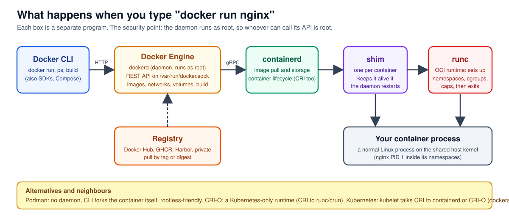

# Lesson 02: Docker Architecture and Its Components

> **Chapter:** 9 · Container Fundamentals · **Time:** ~3 hours
> **You will:** name each part of the Docker stack (CLI, Engine, runtime), follow a `docker run` from keyboard to process, and choose the right way to talk to the ecosystem (CLI, API, SDK, Compose).

| | |
|---|---|
| **Prerequisites** | [Lesson 01](01-what-is-a-container.md) |
| **Labs** | [docker-networking](labs/docker-networking/README.md) · [docker-sdk](labs/docker-sdk/README.md) |
| **Syllabus lines** | Docker architecture and its components · Docker CLI · Docker Engine (Daemon, API) · Docker Runtime (containerd, shim, runc) · Interacting with the container ecosystem |

## 1. The big picture



Docker is not one program. It is a **client**, a **server** and a **runtime**, and each part has a different security role.

## 2. Docker CLI

The `docker` command is a thin **client**. It turns `docker run nginx` into HTTP calls to the daemon. It holds no power by itself: the power is in the socket it can reach. By default it uses the Unix socket `/var/run/docker.sock`. With `DOCKER_HOST` or a **context** it can talk to a remote daemon (over SSH, or TCP with TLS).

Security reading: **access to the socket is access to the daemon**. File permissions on the socket (owner root, group `docker`) decide who is effectively root. See [privilege escalation](../10-container-reconnaissance-and-attacks/03-container-host-daemon-and-kernel-attacks.md#6-privilege-escalation-methods-in-docker).

## 3. The Docker Engine (daemon and API)

`dockerd` is the **daemon**. It runs as root on the host. It owns images, containers, networks and volumes, runs builds, and exposes a **REST API** (on the Unix socket by default, or on TCP if you configure it). Everything the CLI and SDKs do goes through this API.

```text
GET  /_ping           -> "OK"
GET  /version         -> {"Version": "27.x", "ApiVersion": "1.47", ...}
GET  /containers/json -> list of containers
POST /containers/create, POST /containers/{id}/start ...
```

Because the API can create containers with any mount and any privilege, an **unauthenticated TCP API is remote root**. That is why the recon labs scan for it ([remote-docker-api-scan](../10-container-reconnaissance-and-attacks/labs/remote-docker-api-scan/README.md), localhost only).

**Interacting through the SDK.** Docker publishes SDKs (Python `docker` package, Go) that wrap the same API. See [docker-sdk](labs/docker-sdk/README.md): the lab uses an offline mock with the same method names. Hedged real usage:

```python
import docker                       # pip install docker   (verify the current version)
client = docker.from_env()          # uses DOCKER_HOST or the default socket
print(client.version()["Version"])
for c in client.containers.list(all=True):
    print(c.name, c.status, c.attrs["HostConfig"]["Privileged"])
img = client.images.pull("alpine", tag="3.20")
box = client.containers.run("alpine:3.20", "echo hi", detach=True)
```

## 4. Docker runtime: containerd, shim, runc

When the daemon needs a container it hands the job down a chain:

1. **dockerd** asks **containerd** (a separate daemon, a CNCF graduated project) to pull the image and manage the container's lifecycle.
2. containerd starts a **shim** process, one per container. The shim keeps the container's standard streams and exit status alive even if containerd or dockerd restarts.
3. The shim calls **runc**, the reference **OCI runtime**. runc creates the namespaces, applies cgroups, drops capabilities, applies seccomp, then `exec`s your process and exits.

So the final picture is: your process is a child of the **shim**, not of dockerd. That is why `live-restore` can keep containers running across daemon restarts.

| Layer | Standard | Replaceable by |
|---|---|---|
| CLI to Engine | Docker Engine API | SDKs, Compose, Portainer, Podman's Docker-compatible API |
| Engine to runtime | containerd (gRPC) | Kubernetes talks to containerd or CRI-O directly through **CRI** |
| Runtime | OCI runtime spec | runc, crun, **gVisor (runsc)**, **Kata** |

> **Outdated to current.** Older write-ups say "Docker is the Kubernetes runtime". Kubernetes removed **dockershim** in version 1.24; clusters now use containerd or CRI-O. Docker remains the developer CLI and build tool. Verify at source.

## 5. Interacting with the container ecosystem

| You want to... | Use | Note |
|---|---|---|
| Do it by hand | Docker CLI | See [csse COMMANDS.md](../../csse-course/ch3-attacking-container-supply-chain/labs/docker-commands/COMMANDS.md) |
| Script it | SDK or raw API | Same power as the socket |
| Run a multi-container app on one host | Compose | [Lesson 04](04-orchestration-and-alternatives.md) |
| Run many hosts | Swarm or Kubernetes | [Lesson 04](04-orchestration-and-alternatives.md) |
| Look at it in a browser | A management UI (Portainer) | High-value target: see [CH10 lesson 04](../10-container-reconnaissance-and-attacks/04-management-tools-and-owasp-top10.md) |
| Pull, push, sign images | Registry tools, `crane`, `skopeo`, cosign | [Lesson 03](03-images-dockerfile-and-registries.md) |

## 6. Docker networking

By default Docker creates a virtual bridge (`docker0`) and puts containers on it. You choose a **network driver** per container:

| Driver | What it does | Security note |
|---|---|---|
| `bridge` (default `bridge`) | One flat private network; containers reach each other by IP | Flat and no DNS names: avoid for multi-tier apps |
| **user-defined `bridge`** | Own subnet, built-in DNS by container name, isolation between networks | Preferred: one network per tier |
| `host` | No network namespace: shares the host stack | Removes isolation; can reach host localhost services |
| `none` | Only loopback | Good for batch jobs |
| `overlay` | Spans several hosts (Swarm or Kubernetes style) | Optional encryption; plan the control plane |
| `macvlan` | Container gets its own MAC on the LAN | Bypasses the host firewall path; use carefully |

**Published ports.** `-p 8080:80` binds **0.0.0.0** (every interface), exposing the container to the whole network. `-p 127.0.0.1:8080:80` binds loopback only. Docker also writes its own iptables rules, which can bypass a simple host firewall (verify on your host).

Do the [docker-networking lab](labs/docker-networking/README.md): it calculates who reaches whom and what is exposed.

## 7. Defend

- Keep the API on the Unix socket. If remote access is needed: SSH, or TLS on 2376 with client certificates.
- Restrict who is in the `docker` group; prefer **rootless** Docker or Podman.
- One user-defined network per tier; publish only what the outside needs, bound to a specific address.
- Pin runtime versions and patch containerd and runc (they have had serious bugs; verify current advisories).

## 8. Hands-on

[docker-networking](labs/docker-networking/README.md) and [docker-sdk](labs/docker-sdk/README.md). On a lab VM: `docker version` (see Client and Server), `docker info | grep -i runtime`, `ps -ef | grep -E 'dockerd|containerd'`.

## 9. Scenario

A CI job needs to build images and mounts `/var/run/docker.sock` into the build container. Explain the risk and give two alternatives (rootless or remote builder, daemonless build tools such as BuildKit rootless or kaniko; verify tool status).

## 10. References

- Docker docs: Docker Engine overview, daemon socket option, protect the daemon socket.
- OCI Runtime Specification; containerd and runc project docs; Kubernetes docs on dockershim removal.
- Repo: [csse lesson 01 section 3.3](../../csse-course/ch3-attacking-container-supply-chain/01-introduction-to-container-technology.md#33-the-runtime-stack).
