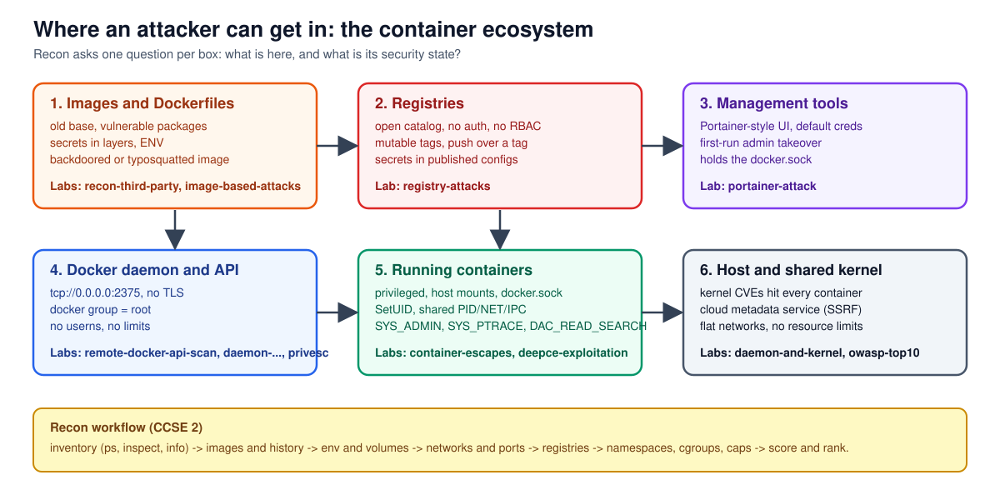

# Lesson 01: Container Reconnaissance

> **Chapter:** 10 · Container Reconnaissance and Attacks · **Time:** ~5 hours
> **You will:** map the attack surface of a container ecosystem, build an inventory of containers and their security state, read images, Dockerfiles, volumes, networks, ports and registries as an assessor, and analyse the surface with native and third-party tools.

| | |
|---|---|
| **Prerequisites** | [Chapter 9](../09-container-fundamentals/README.md) |
| **Labs** | [recon-builtin-tools](labs/recon-builtin-tools/README.md) · [recon-third-party-image-inspection](labs/recon-third-party-image-inspection/README.md) · [remote-docker-api-scan](labs/remote-docker-api-scan/README.md) · [extract-secrets-from-container](labs/extract-secrets-from-container/README.md) · [snapshot-and-restore](labs/snapshot-and-restore/README.md) · [inspect-daemon-activity](labs/inspect-daemon-activity/README.md) |
| **Syllabus lines** | Overview of Container Security · Attack surface of the container ecosystem · Identifying the components and their security state · Get an inventory of containers · Docker Images · Dockerfile and Environment variables · Docker volumes · Docker Networking · Ports used/Port forwarding · Docker Registries · Exhaustive review of Namespaces, cgroups and capabilities · Analysis of the attack surface · Using native tools · Using third-party tools |
| **Reuse** | csse [lesson 02](../../csse-course/ch3-attacking-container-supply-chain/02-attack-surface-and-analysis-of-containers.md) teaches the same ideas; this lesson goes deeper and is organised the way the CCSE syllabus asks. |

> **Safety and ethics.** Recon on systems you do not own or have written permission for is illegal in many places. Every lab here is offline or localhost-only. The remote scan lab refuses any non-loopback target.

## 1. Why it matters

You cannot defend what you have not listed. Recon is the first step for an attacker and for a defender. DBA analogy: before tuning a database you read `V$` views and the AWR report; before securing containers you read `docker ps`, `inspect` and `info`. The goal: **a complete inventory with a security state and a ranked list of what to fix first**.

## 2. Overview of container security

Container security has layers. A weakness in any layer can undo the rest.

| Layer | Question | Example weakness |
|---|---|---|
| **Image** | What is inside? | Old packages, baked-in secrets, backdoor |
| **Build and registry** | Where does it come from? | Mutable tags, open registry |
| **Host and kernel** | What does everything share? | Unpatched kernel, no hardening |
| **Daemon and API** | Who controls it? | Open TCP API, `docker` group |
| **Runtime config** | How is this container run? | `--privileged`, host mounts, root |
| **Network** | Who can reach it? | Flat bridge, published `0.0.0.0` |
| **Orchestrator and tools** | What manages it? | Exposed dashboard, weak RBAC |
| **Application** | Is the app itself safe? | OWASP Top 10 flaws |

## 3. Attack surface of the container ecosystem

The picture shows six zones and the lab for each. The sibling course has its own view: [csse attack-surface SVG](../../csse-course/ch3-attacking-container-supply-chain/02-attack-surface-and-analysis-of-containers.md#3-attack-surface-of-the-container-ecosystem). Use both as a checklist when you scope an assessment.

## 4. Identifying the components and their security state; getting an inventory

Start with a table: for every container, who, what, how and where.

| Question | Where to find it | `docker inspect` field |
|---|---|---|
| What image, which exact version? | `docker ps`, `docker image inspect` | `Image`, `Config.Image` |
| Who runs it (user)? | inspect | `Config.User` (empty = root) |
| How privileged? | inspect | `HostConfig.Privileged`, `CapAdd`, `CapDrop`, `SecurityOpt` |
| What host data can it touch? | inspect | `HostConfig.Binds`, `Mounts` |
| Which namespaces are shared? | inspect | `NetworkMode`, `PidMode`, `IpcMode` |
| What limits exist? | inspect | `HostConfig.Memory`, `PidsLimit`, `NanoCpus` |
| What does it know? | inspect | `Config.Env` |
| Who can reach it? | `docker ps`, `docker port` | `NetworkSettings.Ports` |

Include **stopped** containers (`docker ps -a`): their layers, logs and env remain. Include the **host**: `docker info` (rootless? security options, cgroup version, runtimes, insecure registries). Then **score** each container: privileged is worse than a socket mount is worse than root user is worse than no memory limit. The [recon-builtin-tools lab](labs/recon-builtin-tools/README.md) does exactly this over JSON fixtures and ranks the containers.

## 5. Docker images, Dockerfile and environment variables

- **Images:** `docker images --digests`, `docker image inspect`, `docker history --no-trunc`. Look for: old base images, `latest` tags, unknown registries, huge size (a toolbox inside), an entrypoint that downloads and runs something, exposed ports you did not expect.
- **Dockerfile:** if you have it, read it (lesson 03 of chapter 9 lists the red flags). If you do not, `docker history` is the Dockerfile as the builder ran it, with the `CreatedBy` column showing each step. Tools such as Dive (below) make it easier.
- **Environment variables:** `Config.Env` in the image (defaults set with `ENV`) and in the container (set at run time). Secrets here are visible to anyone with `docker inspect`, to the process via `/proc/<pid>/environ`, and in crash dumps. Names such as `PASSWORD`, `TOKEN`, `KEY`, `SECRET` deserve a look; `*_FILE` names usually point to a file secret, which is the better pattern. Do the [extract-secrets-from-container lab](labs/extract-secrets-from-container/README.md).

## 6. Docker volumes, networking and ports

- **Volumes and mounts:** `docker volume ls`, `docker inspect -f '{{json .Mounts}}'`. Red flags: bind mounts of `/`, `/etc`, `/var/lib/docker`, the Docker socket; read-write host mounts; unused volumes that still hold old data. See [manage-data](../09-container-fundamentals/labs/manage-data/README.md).
- **Networking:** `docker network ls`, `docker network inspect`. Look for many containers on the default `bridge` (flat), `host` network mode, `icc` enabled, overlay networks that span hosts. See [docker-networking](../09-container-fundamentals/labs/docker-networking/README.md).
- **Ports and port forwarding:** `docker ps` shows `0.0.0.0:8080->80/tcp` (exposed to the whole network) versus `127.0.0.1:...` (local only). On the host, `ss -ltnp` shows what is listening and `iptables -t nat -L DOCKER` shows the forwarding rules Docker added. **Every published port is a door;** list them all and ask who needs each.

## 7. Docker registries

Find out **where images come from and where they go**: `docker info` (configured and insecure registries), `~/.docker/config.json` (stored credentials: protect it), CI variables, Compose and Kubernetes manifests. Questions: Is it public or private? Is it TLS only? Is there authentication and role-based access? Are tags immutable? Is scanning on push enabled? Is the catalog readable by anyone? The attack side is in [lesson 02 section 5](02-container-attack-matrix-image-and-registry-attacks.md#5-registry-based-attacks) and [registry-attacks](labs/registry-attacks/README.md).

**Remote Docker API discovery.** A related recon question is whether a host exposes the Docker API on the network (TCP 2375 plain, 2376 TLS). An exposed, unauthenticated API is remote root. The [remote-docker-api-scan lab](labs/remote-docker-api-scan/README.md) shows the probe (`/_ping`, `/version`, `/containers/json`) against **localhost mocks only**. Only scan hosts you own.

## 8. Attack surface analysis with native tools

Native tools ship with Docker and the OS. They are always there, so attackers use them too ("living off the land").

| Tool | What it tells you |
|---|---|
| `docker ps -a`, `docker inspect`, `docker info` | The inventory and security state (section 4) |
| `docker history`, `docker image inspect` | How the image was built; env, ports, user |
| `docker diff NAME` | Files changed in the writable layer (what the container did) |
| `docker top`, `docker stats` | Processes and live resource use |
| `docker logs`, `docker events` | What the app and the daemon did; see [inspect-daemon-activity](labs/inspect-daemon-activity/README.md) |
| `docker commit`, `docker export`, `docker save` | Snapshots for analysis; see [snapshot-and-restore](labs/snapshot-and-restore/README.md) |
| `docker system df` | Disk use and unused data |
| Host tools: `ps`, `ss`, `lsns`, `/proc` | The real process, network and namespace view |

### 8.1 Exhaustive review of namespaces, cgroups and capabilities

For each running container, check all three, not just one:

- **Namespaces:** compare the container's namespace links with the host's. `ls -l /proc/<pid>/ns` for the container's main PID (`docker inspect -f '{{.State.Pid}}' NAME`) and for PID 1. If a link target is identical to the host's, that namespace is **shared**. Also check `PidMode`, `NetworkMode`, `IpcMode`, `UsernsMode` in inspect. Is a **user namespace** in use? If not, container root is UID 0 on the host.
- **Cgroups:** which version (`stat -fc %T /sys/fs/cgroup` returns `cgroup2fs` for v2)? Are `memory`, `pids` and `cpu` limits set (`docker inspect` shows `Memory`, `PidsLimit`, `NanoCpus`)? Unset means one container can starve the host.
- **Capabilities:** what is the effective set? In the container, `grep Cap /proc/self/status` shows hex masks; decode with `capsh --decode=<mask>` (hedged: needs `libcap`). Compare to Docker's default 14. Extras such as `SYS_ADMIN`, `SYS_PTRACE`, `DAC_READ_SEARCH`, `NET_ADMIN`, or the full mask (privileged) are findings. Also check `NoNewPrivs` and `Seccomp` lines in `/proc/self/status` (`Seccomp: 2` means a filter is active; `0` means none).

The [deepce-exploitation lab](labs/deepce-exploitation/README.md) decodes these fields from a fixture so you see what the numbers mean.

## 9. Attack surface analysis with third-party tools

Third-party tools automate and visualise. **Hedged: tool status changes, verify maintenance and licence at the project page.**

| Tool | Purpose | Notes |
|---|---|---|
| **Dive** | Explore image layers, see wasted space and the files each layer adds or removes | Great for "where did my secret go?" |
| **Trivy** | Scan images, file systems, IaC and Kubernetes for vulnerabilities, misconfigurations and secrets | Widely used; see [csse trivy guide](../../csse-course/ch3-attacking-container-supply-chain/real-tools/trivy.md) |
| **Grype** (with **Syft** for SBOMs) | Vulnerability scanning against an SBOM or image | Pairs well with SBOM workflows |
| **amicontained** | From inside a container, reports container runtime, namespaces, capabilities, seccomp and blocked syscalls | Small Go tool; check maintenance |
| **deepce** | Docker enumeration and escape checks from inside a container | Shell script; check maintenance |
| **CDK** | Container penetration toolkit (enumeration and exploitation for authorised testing) | Use only in labs you own |
| **docker-bench-security** | Runs CIS Docker Benchmark checks on a host | Verify the current benchmark version |
| **Dockle** | Lints built images against CIS-style and best-practice rules | Complements Hadolint (Dockerfile) |

Do the [recon-third-party-image-inspection lab](labs/recon-third-party-image-inspection/README.md): a Dive-like layer efficiency analysis, a secret finder across all layers and a Trivy-like package check, over fixtures. The real commands are in [real-tools/recon-tools.md](real-tools/recon-tools.md).

**Putting the analysis together:** (1) inventory and score; (2) image findings; (3) host and daemon findings; (4) network and port exposure; (5) registry findings; (6) a ranked list, worst first, with the fix. Map each finding to the [Container Attack Matrix](02-container-attack-matrix-image-and-registry-attacks.md#2-the-container-attack-matrix) so the report speaks in tactics.

## 10. Defend

- Make the inventory a **scheduled job**, not a one-off.
- Fail builds on privileged mode, socket mounts and unpinned images (policy as code).
- Keep the daemon API off the network; alert on any new listener on 2375/2376.
- Remove unused images, volumes and stopped containers.
- Centralise logs and Docker events; see chapter 12.

## 11. Hands-on

Do the six labs in the order of the [chapter README](README.md#learning-order). Then run the same questions on a lab VM with real Docker.

## 12. Scenario

You are handed `docker inspect` output for 40 containers and told "find the five to fix this week". Describe the three fields you sort on first, the two host settings you check next, and how you justify the order in your report.

## 13. References

- NIST SP 800-190; CIS Docker Benchmark; OWASP Docker Security Cheat Sheet.
- Dive, Trivy, Grype, Syft, amicontained, deepce, CDK, docker-bench-security, Dockle project pages (verify status).
- Repo: csse [lesson 02](../../csse-course/ch3-attacking-container-supply-chain/02-attack-surface-and-analysis-of-containers.md), [cybersecurity-track 09 recon](../../cybersecurity-track/09-pentesting-fundamentals/02-recon-and-scanning.md).
