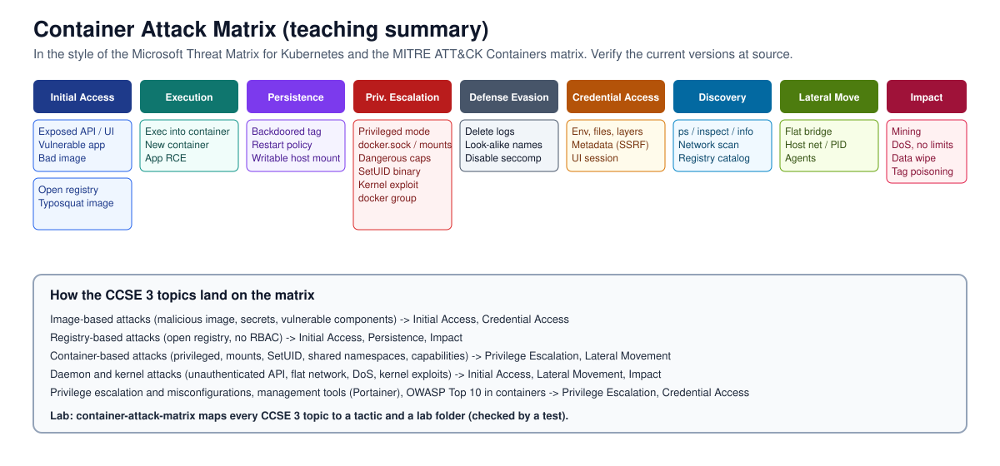

# Lesson 02: The Container Attack Matrix, Image-based and Registry-based Attacks

> **Chapter:** 10 · Container Reconnaissance and Attacks · **Time:** ~5 hours
> **You will:** place container attacks on a tactics matrix, explain how malicious images, leaked secrets, vulnerable components and weak registries are attacked, and defend against each.

| | |
|---|---|
| **Prerequisites** | [Lesson 01](01-container-reconnaissance.md) |
| **Labs** | [container-attack-matrix](labs/container-attack-matrix/README.md) · [image-based-attacks](labs/image-based-attacks/README.md) · [extract-secrets-from-container](labs/extract-secrets-from-container/README.md) · [registry-attacks](labs/registry-attacks/README.md) · csse: [malicious-image](../../csse-course/ch3-attacking-container-supply-chain/labs/malicious-image/README.md), [backdoor-docker-image](../../csse-course/ch3-attacking-container-supply-chain/labs/backdoor-docker-image/README.md), [attack-docker-registry](../../csse-course/ch3-attacking-container-supply-chain/labs/attack-docker-registry/README.md) |
| **Syllabus lines** | Container Attack Matrix · Image-based attacks · Malicious Images · Extracting passwords, tokens, TLS certs, etc. · Exploiting vulnerable components · Registry-based attacks · Insecure Docker registries · Open Docker registries · Lack of authorization (RBAC) |
| **Reuse** | csse [lesson 03](../../csse-course/ch3-attacking-container-supply-chain/03-attacking-the-container-supply-chain.md) covers malicious images, typosquatting, backdoors and registry attacks. Read it; this lesson organises the same ground by the CCSE topics and adds secrets, components and RBAC. |

> **Safety.** Concepts and analysis only. The labs use fixtures, canaries and in-process objects. No exploit code, no scanning of real systems.

## 1. Why it matters

An image is code that other people run as-is, and a registry decides which image a name means. Attackers go where one change reaches many victims: a poisoned base image, an open registry, a leaked token inside a layer.

## 2. The Container Attack Matrix



A **matrix** lists attacker goals (**tactics**) as columns and the ways to reach each goal (**techniques**) as cells. Two well-known public matrices you should know (names and contents change, **verify at source**):

- **Microsoft's Threat Matrix for Kubernetes**: tactics such as Initial Access, Execution, Persistence, Privilege Escalation, Defense Evasion, Credential Access, Discovery, Lateral Movement, Collection, Impact. Techniques include "exposed Docker daemon", "compromised image in registry", "privileged container", "mount service principal" and "access cloud resources". It was modelled on MITRE ATT&CK.
- **MITRE ATT&CK Containers matrix**: the container-specific part of ATT&CK for Enterprise, with techniques such as "Deploy Container", "Escape to Host", "Container Administration Command", "Build Image on Host", "Container and Resource Discovery", "Resource Hijacking" and "Network Denial of Service".

Use a matrix three ways: **vocabulary** for reports ("Privilege Escalation by host mount"), **coverage** (which tactics have you no detection for?), and **planning** (which tactic would a pen test cover?). The [container-attack-matrix lab](labs/container-attack-matrix/README.md) keeps a teaching summary, maps findings from the other labs to tactics, and holds a test that **every CCSE 3 topic and exercise points to a real lab** (the course says every topic has an exercise).

| CCSE 3 topic group | Tactics (main) | Lesson | Lab |
|---|---|---|---|
| Image-based attacks | Initial Access, Credential Access | this lesson | [image-based-attacks](labs/image-based-attacks/README.md), [extract-secrets](labs/extract-secrets-from-container/README.md), csse [malicious-image](../../csse-course/ch3-attacking-container-supply-chain/labs/malicious-image/README.md) |
| Registry-based attacks | Initial Access, Persistence, Impact | this lesson | [registry-attacks](labs/registry-attacks/README.md), csse [attack-docker-registry](../../csse-course/ch3-attacking-container-supply-chain/labs/attack-docker-registry/README.md) |
| Container-based attacks | Privilege Escalation, Lateral Movement | [03](03-container-host-daemon-and-kernel-attacks.md) | [container-escapes](labs/container-escapes/README.md) |
| Docker host (daemon) / kernel attacks | Initial Access, Lateral Movement, Impact | [03](03-container-host-daemon-and-kernel-attacks.md) | [daemon-and-kernel-attacks](labs/daemon-and-kernel-attacks/README.md), [remote-docker-api-scan](labs/remote-docker-api-scan/README.md) |
| Privilege escalation, misconfigurations | Privilege Escalation | [03](03-container-host-daemon-and-kernel-attacks.md) | [privilege-escalation-and-misconfig](labs/privilege-escalation-and-misconfig/README.md) |
| Management tools (Portainer) | Initial Access, Credential Access | [04](04-management-tools-and-owasp-top10.md) | [portainer-attack](labs/portainer-attack/README.md) |
| OWASP Top 10 in containerized apps | Initial Access, Credential Access | [04](04-management-tools-and-owasp-top10.md) | [owasp-top10-in-containers](labs/owasp-top10-in-containers/README.md) |

## 3. Image-based attacks

An image-based attack uses the **image itself** as the vehicle: either the image is hostile, or it contains something an attacker can take, or it contains a flaw an attacker can reach.

### 3.1 Malicious images

A malicious image looks useful (a tool, a base, a "free" GPU or CUDA image) but contains code that harms the runner: a cryptominer, a reverse shell, a credential stealer, a backdoored binary. Typical signs you can see **without running it**: an entrypoint that downloads and pipes a script to a shell, history steps that fetch binaries or add cron jobs, unknown hosts and unusual ports, baked-in SSH keys, hidden binaries, root user, mining strings. Variants: **typosquatting** (`nginxx` for `nginx`), **name confusion**, **backdooring** a popular image by re-pushing a tag with an extra layer.

Study these with the sibling labs instead of repeating them: [csse malicious-image](../../csse-course/ch3-attacking-container-supply-chain/labs/malicious-image/README.md), [csse backdoor-docker-image](../../csse-course/ch3-attacking-container-supply-chain/labs/backdoor-docker-image/README.md) and [csse typosquatting-image](../../csse-course/ch3-attacking-container-supply-chain/labs/typosquatting-image/README.md). Defence: official or verified publishers, pin by **digest**, verify signatures (cosign or Notation), scan, inspect history, run untrusted images only in a disposable sandbox.

### 3.2 Exploiting vulnerable components

Every image carries packages: the OS base, language libraries, the web framework. Known vulnerabilities in them are the commonest way into a container ("exploiting vulnerable components", OWASP A06). The attacker reasons like this:

1. **Fingerprint:** which software and version is on the exposed port? (Banners, error pages, a public SBOM, or the image history if it is public.)
2. **Match:** is there a known flaw for that version?
3. **Reach:** is the flawed component actually reachable from where I am (network port, uploaded file parser) or only from inside?
4. **Land:** what do I get? Code running as which user, with which capabilities and mounts?

Step 4 is where container configuration matters: the same remote-code bug is a **container compromise** if the container is non-root and unprivileged, and a **host compromise** if it is root with `docker.sock` mounted. The [image-based-attacks lab](labs/image-based-attacks/README.md) builds this **exploit-path analysis** (entry, flaw, privilege, impact) and a priority (FIX NOW, FIX SOON, BACKLOG), over fixture data with fake vulnerability IDs. No exploit code is involved.

Defence: scan in CI and on a schedule, rebuild on base image updates, use small bases, prioritise by reachability and exposure (not CVSS alone; consider exploited-in-the-wild lists and EPSS), and limit the blast radius (non-root, drop caps, no socket).

## 4. Extracting passwords, tokens, TLS certs, etc.

Secrets leak from containers in four places. An attacker with image access (pull rights) or container access finds them without running anything.

| Where | How it is found | Why it happens |
|---|---|---|
| **Image layers and history** | `docker history --no-trunc`, `docker save` and read the layer tars | `ENV` or `ARG` secrets, `COPY` of `.env` or keys, a later `rm` that does not erase |
| **Environment variables** | `docker inspect`, `docker exec ... env`, `/proc/1/environ` | The easy way to pass config |
| **Files in the container** | `docker cp`, a shell inside, a mounted volume | TLS private keys, `config.yml` with passwords, `.git/config` with credentials in a URL, cloud credential files |
| **Mounted secrets and host mounts** | Read the mount | Over-broad bind mounts expose host secrets |

TLS material deserves extra care: a leaked **private key** lets an attacker impersonate your service and decrypt captured traffic (unless forward secrecy). A certificate alone is public.

Do the [extract-secrets-from-container lab](labs/extract-secrets-from-container/README.md). Everything there is a **canary**: the token and the fake key are built at run time from pieces so no secret-shaped string lives in the repo.

Defence: BuildKit **secret mounts** at build time; **file-based secrets** (Docker/Compose secrets, Kubernetes Secrets with encryption at rest, or a secret manager such as Vault, covered in chapter 13); multi-stage builds; `.dockerignore`; secret scanning of images in CI (Trivy, TruffleHog); **rotate** anything that ever reached a layer.

## 5. Registry-based attacks

A registry is a service. If it is weak, an attacker can read your images, steal secrets and **replace images that others will deploy**.

### 5.1 Insecure Docker registries

"Insecure" covers several mistakes: **plain HTTP** (credentials and layers can be intercepted or altered), clients configured with `insecure-registries` that skip TLS checks, no scanning, no audit logs, shared admin credentials, registry reachable from the internet. Recon clue: `docker info` lists insecure registries; `/etc/docker/daemon.json` too.

### 5.2 Open Docker registries

An **open** registry has no authentication. The Registry v2 API then gives anyone:

```text
GET /v2/_catalog              -> all repositories
GET /v2/<repo>/tags/list      -> all tags
GET /v2/<repo>/manifests/<t>  -> the manifest and config (env, history, user)
GET /v2/<repo>/blobs/<digest> -> the layers (secrets inside)
```

Search engines and scanners index exposed registries at internet scale, so "nobody knows our hostname" is not a defence. If pushes are allowed, the attacker can also **push over an existing tag** (the next deploy runs the attacker's image) or delete images.

### 5.3 Lack of authorization (RBAC)

Authentication proves **who**; authorization (RBAC) decides **what**. A registry with login but no roles lets every authenticated user, including a read-only developer or a stolen low-value token, push, overwrite and delete anything. Good design: separate pull and push identities, per-repository or per-project scopes, robot accounts for CI limited to its own repos, **immutable tags** for releases, deletion limited to admins, and an audit log.

The [registry-attacks lab](labs/registry-attacks/README.md) runs the same attacker steps against three modes (open, authenticated without RBAC, RBAC with immutable tags) and prints what works. For token scopes and TLS details use the [csse attack-docker-registry lab](../../csse-course/ch3-attacking-container-supply-chain/labs/attack-docker-registry/README.md).

Defence checklist: TLS only; authentication; RBAC with least privilege; immutable release tags; **scan on push** and block critical findings; sign images and verify at deploy; network restrict the registry; keep an audit trail; never put secrets in images that go to a registry. Harbor (CNCF graduated) provides most of these (verify at source).

## 6. Defend (summary)

| Attack | Best controls |
|---|---|
| Malicious or backdoored image | Digest pins, signatures, trusted sources, scanning, sandboxed first run |
| Vulnerable component | CI and scheduled scans, rebuilds, small bases, reachability-based priority |
| Secret leakage | No secrets in images, secret mounts, file secrets, scanning, rotation |
| Open or weak registry | TLS, auth, RBAC, immutable tags, scan on push, audit |

## 7. Hands-on

[container-attack-matrix](labs/container-attack-matrix/README.md), [image-based-attacks](labs/image-based-attacks/README.md), [extract-secrets-from-container](labs/extract-secrets-from-container/README.md), [registry-attacks](labs/registry-attacks/README.md), plus the csse malicious-image, backdoor and registry labs.

## 8. Scenario

A scan of your registry shows `payments/api:2.1` was re-pushed last night and its digest changed. Walk through: what you check first, how you prove whether it was malicious, what you rotate, and which three controls would have prevented it.

## 9. References

- Microsoft Security blog: Threat matrix for Kubernetes; MITRE ATT&CK Containers matrix (attack.mitre.org). Verify the current versions.
- OCI Distribution Specification; Harbor docs; OWASP Docker Security Cheat Sheet; NIST SP 800-190.
- Repo: csse [lesson 03](../../csse-course/ch3-attacking-container-supply-chain/03-attacking-the-container-supply-chain.md), [caisp ch4 AI attacks and defenses in DevOps](../../caisp-course/ch4-ai-attacks-and-defenses-devops/README.md).
