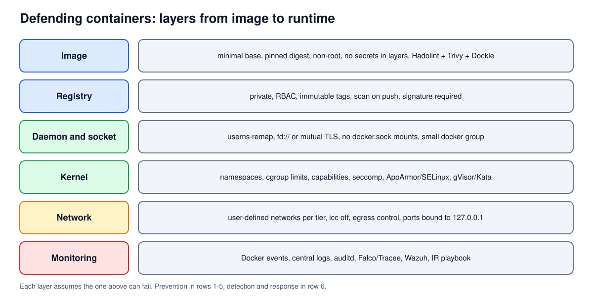

# Lesson 01: Docker Basics and the Threat Picture (CDE 7 foundations)

> **Chapter:** 11 · Defending Containers at Scale · **Time:** ~2 hours
> **You will:** place Docker next to Vagrant, name the main container threats (image vulnerabilities, DoS, privilege escalation, misconfiguration) and know which later lesson fixes each.

| | |
|---|---|
| **Prerequisites** | [Chapter 09 container fundamentals](../09-container-fundamentals/README.md); [Chapter 10 attacks](../10-container-reconnaissance-and-attacks/README.md) |
| **Labs** | [audit-docker-daemon-host](labs/audit-docker-daemon-host/README.md) |
| **Syllabus lines** | [CDE 7] What is Docker · Docker vs Vagrant · Basics of Docker and its challenges · Vulnerabilities in images (Public and Private) · Denial of service attacks · Privilege escalation methods in Docker. · Security misconfigurations. · Capabilities and namespaces in Docker. |

## 1. Why it matters

Chapter 10 showed how containers are attacked. This chapter is the other half: how you defend them *at scale*, across hundreds of hosts and thousands of images. The CDE course opens with a short foundation; this lesson keeps it short and links the deep material.

## 2. What is Docker

Docker is a platform that packages an application with its dependencies as an **image** and runs it as a **container**: an isolated process on the host's shared kernel. Parts: CLI, daemon (`dockerd`, API), runtime (containerd and runc), images and registries. Full tour: [Chapter 09](../09-container-fundamentals/README.md) and [csse ch3 lesson 01](../../csse-course/ch3-attacking-container-supply-chain/01-introduction-to-container-technology.md).

## 3. Docker vs Vagrant

| | Docker | Vagrant |
|---|---|---|
| Unit | container (process on shared kernel) | full virtual machine (own kernel) |
| Start time | seconds or less | minutes |
| Isolation | weaker (kernel shared) | stronger (hypervisor boundary) |
| Typical use | app packaging, CI, microservices | reproducible dev VMs, testing OS-level changes, kernel work |
| Security note | one kernel bug can affect every container | VM escape is rarer but a bigger prize |

Vagrant is a **wrapper** that drives a VM provider (VirtualBox, libvirt, VMware, Hyper-V); it is not an isolation technology itself. The DBA analogy: a container is a separate schema on the same instance, a VM is a separate instance on its own server. Sandboxed runtimes (gVisor, Kata) in [lesson 03](03-daemon-host-and-kernel-hardening.md#2-user-namespace-remapping-and-sandboxed-runtimes) sit between the two.

## 4. Basics of Docker and its challenges

- **Shared kernel:** isolation is only as strong as namespaces, cgroups, capabilities, seccomp and LSM policy.
- **The daemon is root.** Whoever can talk to it controls the host.
- **Images are supply chain:** layers from strangers, tags that move.
- **Speed hides drift:** containers are created, changed and forgotten faster than humans can review.
- **Defaults favour convenience:** no resource limits, writable root filesystem, root user, default bridge with open traffic between containers.

## 5. Capabilities and namespaces in Docker

| Kernel feature | Limits | Docker flag you will meet |
|---|---|---|
| **Namespaces** (pid, net, mnt, uts, ipc, user, cgroup) | what a process can **see** | `--pid=host`, `--network=host`, `--userns` (sharing them weakens isolation) |
| **cgroups** | what it can **use** | `--memory`, `--cpus`, `--pids-limit` |
| **Capabilities** | what **root inside** can do | `--cap-drop ALL`, `--cap-add`, `--privileged` (all of them) |
| **Seccomp / AppArmor / SELinux** | which syscalls and files | `--security-opt seccomp=...`, `apparmor=...` |

Docker drops most capabilities by default (it keeps a small set such as `NET_BIND_SERVICE`, `CHOWN`, `SETUID`; verify the list for your version). Exercising it: [csse ch3 docker-commands](../../csse-course/ch3-attacking-container-supply-chain/labs/docker-commands/README.md).

## 6. Vulnerabilities in images (public and private)

- **Public images** (Docker Hub and others): unknown maintainers, stale tags, typosquats, embedded miners. Prefer Docker Official Images, Verified Publishers and your own base.
- **Private images** (your registry): not safer by magic. They carry your app's dependencies, leaked secrets in layers, and old base images nobody rebuilt.
- Both need scanning, an SBOM and a rebuild schedule: [lesson 02](02-secure-images-linting-and-scanning.md).

## 7. Denial of service

A container without limits can eat the host. Fork bombs, memory leaks, disk fill (logs, writable layer), too many open files, noisy network.

| Cause | Control |
|---|---|
| unlimited memory / CPU | `--memory`, `--cpus` |
| fork bomb | `--pids-limit` |
| log growth | log driver with rotation (`max-size`, `max-file`) or a remote driver |
| disk fill | storage quotas, `--storage-opt` (driver dependent), separate partition for `/var/lib/docker` |
| runaway restarts | `--restart on-failure:5`, not `always` |

Check yourself with [cis-docker-compliance](labs/cis-docker-compliance/README.md) (checks 5.10, 5.11, 5.28, 5.14 in CIS-style numbering).

## 8. Privilege escalation methods in Docker

From [Chapter 10](../10-container-reconnaissance-and-attacks/README.md): `--privileged`; mounted `docker.sock`; membership of the `docker` group (root-equivalent); dangerous capabilities (`SYS_ADMIN`, `SYS_PTRACE`); host PID/network namespaces; writable host mounts (`/`, `/etc`); setuid binaries; kernel exploits. Each has a matching control in lessons 02 to 04 and a detection in [Chapter 12](../12-container-security-monitoring/README.md).

## 9. Security misconfigurations

The most common real-world cause. Classic list: Docker API on TCP without TLS; `docker.sock` mode 0666; running as root; no `no-new-privileges`; `seccomp=unconfined`; default bridge with `icc` on; secrets in `ENV`; `latest` tags; writable root filesystem; no resource limits. The [CIS Docker Benchmark](https://www.cisecurity.org/benchmark/docker) is the checklist; docker-bench-security automates it ([lesson 03 section 6](03-daemon-host-and-kernel-hardening.md#6-dynamic-analysis-docker-bench-and-the-cis-benchmark)).

## 10. Map: threat to defence

| Threat | Lesson | Lab |
|---|---|---|
| vulnerable or malicious image | [02](02-secure-images-linting-and-scanning.md) | [trivy-vuln-scan](labs/trivy-vuln-scan/README.md) |
| leaked secret in a layer | [02](02-secure-images-linting-and-scanning.md), [04](04-trust-registries-and-cicd.md) | [dive-dockle-forensics](labs/dive-dockle-forensics/README.md) |
| exposed or weak daemon | [03](03-daemon-host-and-kernel-hardening.md) | [userns-remap-and-socket](labs/userns-remap-and-socket/README.md) |
| kernel-level escape | [03](03-daemon-host-and-kernel-hardening.md) | [seccomp-apparmor-custom-policy](labs/seccomp-apparmor-custom-policy/README.md) |
| tampered or untrusted image | [04](04-trust-registries-and-cicd.md) | [sign-container-images](labs/sign-container-images/README.md) |
| runtime abuse | [Chapter 12](../12-container-security-monitoring/README.md) | [falco-runtime-rules](../12-container-security-monitoring/labs/falco-runtime-rules/README.md) |

## 11. Quick check

1. Why is Vagrant "stronger isolation" but slower? (Own kernel per VM.)
2. Name three signs of an unlimited container that can cause DoS.
3. Which Docker flag gives a container every capability?

## 12. References

- NIST SP 800-190, Application Container Security Guide.
- Docker docs: security, resource constraints (verify current pages).
- CIS Docker Benchmark.
