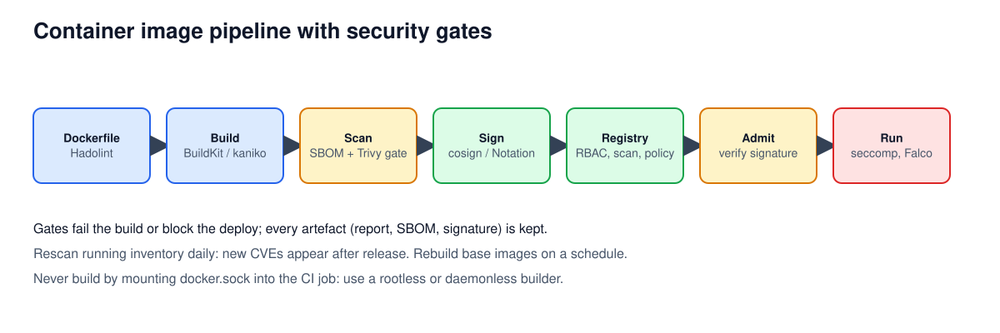

# Lesson 02: Secure Images, Dockerfile Linting and Image Scanning

> **Chapter:** 11 · Defending Containers at Scale · **Time:** ~4 hours
> **You will:** build small, pinned, non-root images; lint Dockerfiles with Hadolint-style rules; scan images (SCA) and choose a scanner with clear criteria.

| | |
|---|---|
| **Prerequisites** | [Lesson 01](01-docker-basics-and-threats.md); repo [06 Docker](../../06-ai-devsecops/docker/README.md) |
| **Labs** | [hadolint-static-analysis](labs/hadolint-static-analysis/README.md) · [trivy-vuln-scan](labs/trivy-vuln-scan/README.md) · [trivy-apis](labs/trivy-apis/README.md) · [trivy-in-gitlab-ci](labs/trivy-in-gitlab-ci/README.md) · [distroless-mini-image](labs/distroless-mini-image/README.md) |
| **Syllabus lines** | [CCSE 4] Container image security · Building secure container images · Choosing base images · Distroless images · Scratch images · Security Linting of Dockerfiles · Static Analysis(SCA) of container images · Scan for vulnerabilities in container · Choosing the right container scanner tool for your needs · [CDE 7] Vulnerabilities in images (Public and Private) · Static Analysis of container(Docker) images. |

## 1. Why it matters

An image is a frozen copy of everything an attacker can use. The cheapest defence is **less stuff**, then **known stuff** (scanned, inventoried), then **trusted stuff** ([lesson 04](04-trust-registries-and-cicd.md)). This lesson reuses the deeper material in [csse ch3 lesson 04](../../csse-course/ch3-attacking-container-supply-chain/04-securing-container-applications.md) and adds linting and scanner choice.

## 2. Base images, distroless and scratch

| Base | Contains | Good for | Cost |
|---|---|---|---|
| Full (`ubuntu`, `python:3.12`) | whole OS, compilers, tools | quick starts | large surface, many CVEs |
| Slim (`-slim`) | trimmed OS | most apps | shell and apt still there |
| Alpine | musl libc, busybox, apk | small images | musl differences can bite |
| **Distroless** | runtime + app only, no shell, no package manager | production services | hard to debug; use debug variants or ephemeral debug containers |
| **Scratch** | literally empty | static binaries (Go, Rust musl) | you bring everything, even CA certificates and timezone data |

Rules: choose the smallest image that runs the app; **pin by digest** (`image@sha256:...`) and update by pull request; use your own **golden base** rebuilt on a schedule. Distroless is not a cure: it removes tools, it does not patch your app. Numbers on attack surface: [distroless-mini-image](labs/distroless-mini-image/README.md). Build walk-through: [csse ch3 secure-mini-image](../../csse-course/ch3-attacking-container-supply-chain/labs/secure-mini-image/README.md).

## 3. Building secure container images

| Practice | Why |
|---|---|
| Multi-stage builds: compile in one stage, copy only the artifact | no compilers or build secrets in the final image |
| Non-root numeric `USER` | limits every exploit |
| No secrets in `ENV`, `ARG` or `COPY`; use BuildKit `--mount=type=secret` | **layers never forget** (see [dive-dockle-forensics](labs/dive-dockle-forensics/README.md)) |
| `.dockerignore` for `.git`, `.env`, caches | keeps secrets out of the build context |
| Verify downloads by checksum or signature; no `curl` piped to `sh` | supply chain |
| `COPY`, not `ADD` | `ADD` can fetch URLs and unpack archives silently |
| One process, minimal `EXPOSE`, a `HEALTHCHECK` | smaller surface, orchestrator can restart |
| Generate an SBOM and sign the image | [lesson 04](04-trust-registries-and-cicd.md) |

DBA analogy: a production Oracle install with only the components you use, installed by a script, not by someone clicking through a wizard.

## 4. Linting Dockerfiles (Hadolint)

**Hadolint** is a Dockerfile linter (a static binary). It parses the Dockerfile into an AST and applies rules with ids `DLxxxx` (Dockerfile) and, for the shell inside `RUN`, `SCxxxx` rules from ShellCheck. Typical rules (ids and wording shift between versions: verify at source): `DL3006` tag the base image, `DL3007` no `latest`, `DL3008` pin apt versions, `DL3002` do not end as root, `DL3020` use `COPY`, `DL3025` JSON form for `CMD`, `DL4006` `pipefail`.

Use it three ways: in the editor (instant feedback), as a **pre-commit hook** (note the CDE view: hooks are advisory, see [Chapter 05](../05-static-analysis-and-secrets/README.md)), and as a **CI gate** with `--failure-threshold`. Output **SARIF** so GitHub/GitLab security views show findings inline. Ignore rules only with a comment that says why. Hadolint finds *bad practice in text*; it cannot see what is inside the base image: that is the scanner's job. Lab: [hadolint-static-analysis](labs/hadolint-static-analysis/README.md); the repo's simpler linter: [06 Docker](../../06-ai-devsecops/docker/README.md).

## 5. SCA of images and choosing a scanner

**Static analysis of images (SCA)** reads the image layers (OS packages, language lockfiles, sometimes binaries) and matches versions against vulnerability databases. It does **not** run the image. It also finds secrets and misconfigurations in modern tools.

| Scanner | Notes (Nov 2026; verify at source) |
|---|---|
| **Trivy** (Aqua, open source) | one tool for OS and language packages, IaC, secrets, licences, SBOM; client/server mode; Kubernetes operator |
| **Grype** (Anchore) | image/SBOM scanner, pairs with Syft for SBOMs |
| **Snyk Container** | commercial; base-image upgrade advice, developer workflow |
| **Docker Scout** | Docker's service, integrated with Docker Desktop and Hub; plan limits apply |
| Clair, cloud registry scanners, other commercial tools | exist; check status and fit |

**How to choose:** (1) coverage: OS **and** language packages, distro-specific data (a Debian backport fix is not the same as an upstream fix); (2) data freshness and sources (NVD, distro trackers, GitHub advisories, OSV); (3) false-positive handling: VEX, ignore files with expiry, "unfixed" filtering; (4) speed and CI fit (cache, client/server); (5) SBOM in and out (CycloneDX, SPDX); (6) licence and cost; (7) air-gapped support; (8) accuracy on **your** images: run two scanners on 20 of your own and compare.

**Gating:** fail on `CRITICAL` (and `HIGH` with a fix available) for new images, report the rest; scan again on a schedule because new CVEs appear after release. Do not trust "no findings" as "no vulnerabilities". Labs: [trivy-vuln-scan](labs/trivy-vuln-scan/README.md) (report parser and gate), [trivy-apis](labs/trivy-apis/README.md) (client/server concept and mock API), [trivy-in-gitlab-ci](labs/trivy-in-gitlab-ci/README.md) (pipeline job and validator). Real-scan walk-through: [csse ch6 trivy-docker-scan](../../csse-course/ch6-common-defenses-against-supply-chain-attacks/labs/trivy-docker-scan/README.md).

## 6. Hands-on

1. Lint the bad Dockerfile, fix to zero findings.
2. Parse the Trivy report, apply three different gates, explain each.
3. Validate the bad GitLab CI file and fix its six smells.
4. Rank base images and defend your pick.

## 7. Quick check

1. Why does `RUN rm secret` not remove the secret? (Earlier layer keeps it.)
2. Hadolint or Trivy: which finds `curl | sh` and which finds an old `openssl`? (Hadolint; Trivy.)
3. Name three scanner-choice criteria beyond price.

## 8. References

- Hadolint: https://github.com/hadolint/hadolint
- Trivy docs: https://trivy.dev
- Grype and Syft: https://github.com/anchore
- Docker best practices for building: docs.docker.com (verify current).
