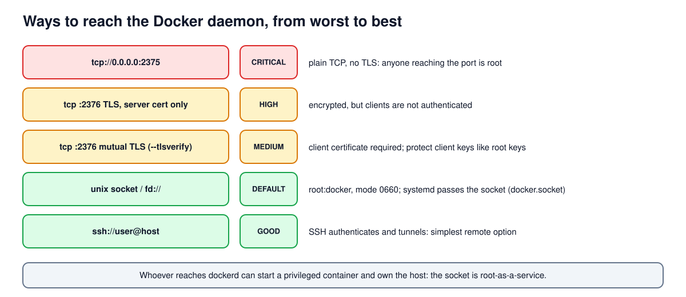

# Lesson 03: Daemon, Host and Kernel Hardening

> **Chapter:** 11 · Defending Containers at Scale · **Time:** ~5 hours
> **You will:** remap users, choose a sandboxed runtime, secure the Docker socket (fd, TCP, TLS), audit host and daemon with the CIS benchmark, write seccomp and AppArmor policy, segregate networks and apply the small flags that matter.

| | |
|---|---|
| **Prerequisites** | [Lesson 01](01-docker-basics-and-threats.md); [csse ch3 lesson 04 section 5](../../csse-course/ch3-attacking-container-supply-chain/04-securing-container-applications.md) |
| **Labs** | [userns-remap-and-socket](labs/userns-remap-and-socket/README.md) · [cis-docker-compliance](labs/cis-docker-compliance/README.md) · [audit-docker-daemon-host](labs/audit-docker-daemon-host/README.md) · [seccomp-apparmor-custom-policy](labs/seccomp-apparmor-custom-policy/README.md) |
| **Syllabus lines** | [CCSE 4] Docker Daemon security configurations · Docker user remapping · Docker runtime security (gVisor, Kata) · Docker socket configuration · fd · TCP socket · TLS authentication · Dynamic Analysis of the container hosts and daemons · Docker host security configurations · Kernel Hardening using Seccomp and AppArmor · Custom policy creation using Seccomp and AppArmor · Network Security in containers · Segregating networks · Miscellaneous Docker Security Configurations · [CDE 7] Kernel Hardening using SecComp and AppArmor. · Dynamic Analysis of container hosts and daemons. · Segregating Networks. |

## 1. Why it matters

Image hygiene does not help if the host or daemon is open. `dockerd` runs as root; its API is root-as-a-service. Think of it as the Oracle listener plus the `SYSDBA` password: whoever reaches it owns the box.

## 2. User namespace remapping and sandboxed runtimes

**User namespace remapping** (`"userns-remap": "default"` in `daemon.json`): UID 0 inside a container maps to an unprivileged range on the host (for example 165536+). If an attacker escapes, they are `nobody`-like, not root. Needs `/etc/subuid` and `/etc/subgid` entries for `dockremap`; images live under `/var/lib/docker/<uid>.<gid>`; it conflicts with `--privileged`, host namespaces and some volume setups. **Rootless Docker/Podman** goes further: the daemon itself is not root. Lab: [userns-remap-and-socket](labs/userns-remap-and-socket/README.md).

**Sandboxed runtimes** add a second wall:

| Runtime | How | Trade-off |
|---|---|---|
| **gVisor** (`runsc`) | a user-space kernel intercepts syscalls | some syscalls/features unsupported; I/O overhead |
| **Kata Containers** | each container (or pod) in a lightweight VM | needs virtualization; higher memory/start cost |

Register them in `daemon.json` `"runtimes"` and run with `--runtime=runsc` (check the current docs). Use them for untrusted code (CI jobs from forks, customer plugins), not necessarily for everything.

## 3. The Docker socket: unix, fd, TCP and TLS

| Way in | What it is | Verdict |
|---|---|---|
| **unix socket** `/var/run/docker.sock` | local file, `root:docker`, mode `0660` | the default; membership of group `docker` = root |
| **`fd://`** | systemd opens the socket (`docker.socket` unit) and passes the **file descriptor** to `dockerd` | same socket, permissions set in the unit (`SocketMode`, `SocketGroup`); preferred on systemd hosts |
| **TCP** `tcp://0.0.0.0:2375` | plaintext API | **never**: anyone reaching the port is root |
| **TCP + TLS** `:2376` | server cert only | encrypts but does not authenticate clients |
| **TCP + mutual TLS** (`--tlsverify`, CA, server and client certs) | the daemon verifies each client certificate | acceptable when remote access is required; protect client keys like root keys |
| **SSH** `docker -H ssh://user@host` | SSH authenticates and tunnels | simplest remote option |

Port 2375/2376 are conventions. A leaked client certificate is a root credential: short lifetimes, an allow-list of CNs, revocation plan. Never mount the socket into a container (it hands over the host); in CI use rootless builders. Lab: [userns-remap-and-socket](labs/userns-remap-and-socket/README.md), and the exploit side in [csse ch3 unsecured-docker-daemon](../../csse-course/ch3-attacking-container-supply-chain/labs/unsecured-docker-daemon/README.md).

## 4. Docker host security configurations

OS hardening applies: a minimal host OS built for containers, automatic security updates, a separate partition for `/var/lib/docker`, SSH hardened, a small `docker` group (every member is root-equivalent), `auditd` rules on Docker files ([Chapter 12](../12-container-security-monitoring/labs/auditd-docker/README.md)), file ownership and permissions on `docker.service`, `docker.socket`, `daemon.json`, TLS keys. Keep the kernel patched: shared kernel means every kernel bug is a container bug.

## 5. Kernel hardening: seccomp and AppArmor

**Seccomp** filters **syscalls**. Docker's default profile allows most calls and blocks a few dozen risky ones (numbers vary by version). **AppArmor** is a Linux Security Module that restricts **files, capabilities and network** per profile (`docker-default`); **SELinux** is the RHEL-family equivalent. Never run `seccomp=unconfined` or `--privileged` to "make it work".

**Custom policy creation**, the careful way:

1. **Observe**: run the app and its tests under `strace -f` (or an audit/log seccomp action) to collect syscalls and file accesses.
2. **Generate an allowlist**: default deny, allow the observed set plus runtime needs; refuse dangerous calls (`ptrace`, `mount`, `unshare`, `bpf`, `kexec_load`, `init_module`) unless justified.
3. **Test in complain/audit mode** against your full test suite and a failure-path run (error handling uses different syscalls).
4. **Enforce**, keep the profile in Git, review changes.

Danger: a profile learned from one happy-path run breaks rare code paths in production. Lab: [seccomp-apparmor-custom-policy](labs/seccomp-apparmor-custom-policy/README.md); fixed-profile demos: [csse ch3 labs](../../csse-course/ch3-attacking-container-supply-chain/labs/minimize-misconfigurations/README.md).

## 6. Dynamic analysis: docker-bench and the CIS benchmark

**Dynamic analysis of hosts and daemons** inspects the **running** configuration, not the files you meant to deploy: `docker info`, `docker inspect`, the effective `daemon.json`, file permissions, listening sockets. **docker-bench-security** is a shell script that checks a host against the **CIS Docker Benchmark**, which is organised in sections: 1 host, 2 daemon, 3 configuration files, 4 images and build, 5 container runtime, 6 operations, 7 Swarm (numbering varies by benchmark version: verify). Each check is PASS, WARN or INFO.

Good practice: run it on a schedule, store the output, track the **score** and the trend, fix by severity, and justify every accepted risk. Treat the benchmark as a baseline, not a certificate. Labs: [cis-docker-compliance](labs/cis-docker-compliance/README.md) (whole-benchmark view with a score) and [audit-docker-daemon-host](labs/audit-docker-daemon-host/README.md) (CDE 7: same engine, a build-server scenario, and a `docker info` cross-check).

## 7. Network security and segregating networks

- Put each tier on its **own user-defined network** (web, app, db); only the web tier publishes ports.
- Use `--internal` networks for backends that must not reach the internet.
- On the default bridge set `"icc": false`; prefer user-defined bridges where containers resolve each other by name.
- Publish ports to a specific address (`-p 127.0.0.1:8080:80`), not `0.0.0.0`. **Docker edits iptables itself and can bypass host firewalls like ufw**; use the `DOCKER-USER` chain for your own rules.
- Avoid `--network host`; add egress control (a proxy or firewall) so a compromised container cannot call a miner pool.
- In Kubernetes use NetworkPolicy (default deny).

DBA analogy: separate listeners and subnets for the database tier, with only the app servers allowed to connect.

## 8. Miscellaneous Docker security configurations

| Flag / setting | Effect |
|---|---|
| `--security-opt no-new-privileges` (or daemon default) | blocks setuid escalation |
| `--read-only` + `--tmpfs /tmp` | immutable root filesystem |
| `--cap-drop ALL --cap-add NET_BIND_SERVICE` | least capability |
| `--memory`, `--cpus`, `--pids-limit` | resource and fork-bomb limits |
| `--user 10001:10001` | non-root |
| `--restart on-failure:5` | bounded restarts |
| log driver (`local`, `syslog`, `fluentd`, `gelf`) with rotation | logs survive the container ([Chapter 12](../12-container-security-monitoring/01-monitoring-logs-and-incident-response.md)) |
| `live-restore`, `userland-proxy: false` | daemon restarts without killing containers; fewer proxy processes |
| `--init` | proper signal handling and zombie reaping |

Verify each flag in the docs for your version.

## 9. Hands-on

1. Audit the insecure bundle; get it to 100%.
2. Generate a seccomp profile from the strace fixture; try to sneak in `ptrace`.
3. Expire the client certificate in the userns/socket lab.

## 10. Quick check

1. What does `fd://` mean? (Systemd passes an already-open socket.)
2. Why is mutual TLS better than TLS alone? (Authenticates the client.)
3. Why not trust a seccomp profile learned from one run?

## 11. References

- CIS Docker Benchmark; docker-bench-security: https://github.com/docker/docker-bench-security
- Docker docs: "Protect the Docker daemon socket", "Isolate containers with a user namespace", seccomp, AppArmor (verify current pages).
- gVisor: https://gvisor.dev · Kata: https://katacontainers.io
