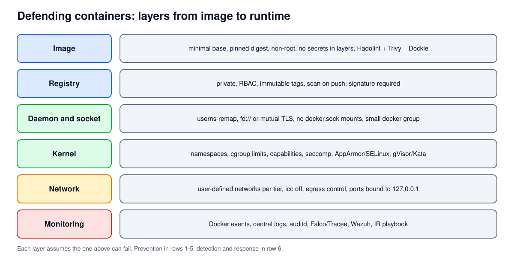

# Chapter 11: Defending Containers at Scale

This chapter merges **[CCSE 4] Defending Containers and Containerized Apps at Scale** and **[CDE 7] Container (Docker) Security**. You learn how to make images small, linted, scanned and signed; how to harden the Docker daemon, socket, host and kernel (user namespaces, TLS, seccomp, AppArmor, network segregation); how to audit against the CIS Docker Benchmark; and how to harden registries and CI/CD. Twelve labs run offline with fixtures and tests: **Docker is not required**.

> **Safety.** Every lab is a simulation: Dockerfiles, Trivy JSON, `daemon.json`, `docker inspect` bundles, strace captures, audit-style fixtures, canary strings, `.example`/`.invalid` domains and fictional CVE ids (`CVE-2099-xxxx`). The one local server (a mock Trivy API) binds to **127.0.0.1** on a random port. Nothing is pulled, executed or sent over a network. Never audit or scan hosts and registries you do not own.

> **Unofficial companion.** Your course videos and lab environment are the primary source. Tool status and numbers here are hedged: **verify at the source**.

## Syllabus coverage

Every line of both source chapters, verbatim and in source order.

| Syllabus item | Where to study | Lab |
|---|---|---|
| **[CCSE 4] Defending Containers and Containerized Apps at Scale** (chapter heading) | this chapter | see below |
| [CCSE 4] Container image security | [Lesson 02 section 1-3](02-secure-images-linting-and-scanning.md#1-why-it-matters) | [distroless-mini-image](labs/distroless-mini-image/README.md) |
| [CCSE 4] Building secure container images | [Lesson 02 section 3](02-secure-images-linting-and-scanning.md#3-building-secure-container-images) | [dive-dockle-forensics](labs/dive-dockle-forensics/README.md) |
| [CCSE 4] Choosing base images | [Lesson 02 section 2](02-secure-images-linting-and-scanning.md#2-base-images-distroless-and-scratch) | [distroless-mini-image](labs/distroless-mini-image/README.md) |
| [CCSE 4] Distroless images | [Lesson 02 section 2](02-secure-images-linting-and-scanning.md#2-base-images-distroless-and-scratch) | [distroless-mini-image](labs/distroless-mini-image/README.md) |
| [CCSE 4] Scratch images | [Lesson 02 section 2](02-secure-images-linting-and-scanning.md#2-base-images-distroless-and-scratch) | [distroless-mini-image](labs/distroless-mini-image/README.md) |
| [CCSE 4] Security Linting of Dockerfiles | [Lesson 02 section 4](02-secure-images-linting-and-scanning.md#4-linting-dockerfiles-hadolint) | [hadolint-static-analysis](labs/hadolint-static-analysis/README.md) |
| [CCSE 4] Static Analysis(SCA) of container images | [Lesson 02 section 5](02-secure-images-linting-and-scanning.md#5-sca-of-images-and-choosing-a-scanner) | [trivy-vuln-scan](labs/trivy-vuln-scan/README.md) |
| [CCSE 4] Scan for vulnerabilities in container | [Lesson 02 section 5](02-secure-images-linting-and-scanning.md#5-sca-of-images-and-choosing-a-scanner) | [trivy-vuln-scan](labs/trivy-vuln-scan/README.md), [trivy-apis](labs/trivy-apis/README.md) |
| [CCSE 4] Choosing the right container scanner tool for your needs | [Lesson 02 section 5](02-secure-images-linting-and-scanning.md#5-sca-of-images-and-choosing-a-scanner) | [trivy-vuln-scan](labs/trivy-vuln-scan/README.md) |
| [CCSE 4] Docker Daemon security configurations | [Lesson 03 section 2-3](03-daemon-host-and-kernel-hardening.md#2-user-namespace-remapping-and-sandboxed-runtimes) | [userns-remap-and-socket](labs/userns-remap-and-socket/README.md) |
| [CCSE 4] Docker user remapping | [Lesson 03 section 2](03-daemon-host-and-kernel-hardening.md#2-user-namespace-remapping-and-sandboxed-runtimes) | [userns-remap-and-socket](labs/userns-remap-and-socket/README.md) |
| [CCSE 4] Docker runtime security (gVisor, Kata) | [Lesson 03 section 2](03-daemon-host-and-kernel-hardening.md#2-user-namespace-remapping-and-sandboxed-runtimes) (gVisor, Kata: concept; guide in [real-tools](real-tools/README.md)) | n/a (concept) |
| [CCSE 4] Docker socket configuration | [Lesson 03 section 3](03-daemon-host-and-kernel-hardening.md#3-the-docker-socket-unix-fd-tcp-and-tls) | [userns-remap-and-socket](labs/userns-remap-and-socket/README.md) |
| [CCSE 4] fd | [Lesson 03 section 3](03-daemon-host-and-kernel-hardening.md#3-the-docker-socket-unix-fd-tcp-and-tls) (`fd://` = systemd socket activation) | [userns-remap-and-socket](labs/userns-remap-and-socket/README.md) |
| [CCSE 4] TCP socket | [Lesson 03 section 3](03-daemon-host-and-kernel-hardening.md#3-the-docker-socket-unix-fd-tcp-and-tls) | [userns-remap-and-socket](labs/userns-remap-and-socket/README.md) |
| [CCSE 4] TLS authentication | [Lesson 03 section 3](03-daemon-host-and-kernel-hardening.md#3-the-docker-socket-unix-fd-tcp-and-tls) (mutual TLS) | [userns-remap-and-socket](labs/userns-remap-and-socket/README.md) |
| [CCSE 4] Dynamic Analysis of the container hosts and daemons | [Lesson 03 section 6](03-daemon-host-and-kernel-hardening.md#6-dynamic-analysis-docker-bench-and-the-cis-benchmark) | [cis-docker-compliance](labs/cis-docker-compliance/README.md), [audit-docker-daemon-host](labs/audit-docker-daemon-host/README.md) |
| [CCSE 4] Docker host security configurations | [Lesson 03 section 4](03-daemon-host-and-kernel-hardening.md#4-docker-host-security-configurations) | [cis-docker-compliance](labs/cis-docker-compliance/README.md) |
| [CCSE 4] Kernel Hardening using Seccomp and AppArmor | [Lesson 03 section 5](03-daemon-host-and-kernel-hardening.md#5-kernel-hardening-seccomp-and-apparmor) | [seccomp-apparmor-custom-policy](labs/seccomp-apparmor-custom-policy/README.md) |
| [CCSE 4] Custom policy creation using Seccomp and AppArmor | [Lesson 03 section 5](03-daemon-host-and-kernel-hardening.md#5-kernel-hardening-seccomp-and-apparmor) | [seccomp-apparmor-custom-policy](labs/seccomp-apparmor-custom-policy/README.md) |
| [CCSE 4] Network Security in containers | [Lesson 03 section 7](03-daemon-host-and-kernel-hardening.md#7-network-security-and-segregating-networks) | [cis-docker-compliance](labs/cis-docker-compliance/README.md) |
| [CCSE 4] Segregating networks | [Lesson 03 section 7](03-daemon-host-and-kernel-hardening.md#7-network-security-and-segregating-networks) | [cis-docker-compliance](labs/cis-docker-compliance/README.md) |
| [CCSE 4] Miscellaneous Docker Security Configurations | [Lesson 03 section 8](03-daemon-host-and-kernel-hardening.md#8-miscellaneous-docker-security-configurations) | [cis-docker-compliance](labs/cis-docker-compliance/README.md) |
| [CCSE 4] Content Trust and Integrity checks | [Lesson 04 section 1](04-trust-registries-and-cicd.md#1-content-trust-and-integrity-checks-dct-is-retired) (DCT retired; cosign/Notation) | [sign-container-images](labs/sign-container-images/README.md) |
| [CCSE 4] Docker Registry security configurations | [Lesson 04 section 3](04-trust-registries-and-cicd.md#3-registry-security) | [harbor-secure-by-default](labs/harbor-secure-by-default/README.md) |
| [CCSE 4] Private vs. Public Registries | [Lesson 04 section 2](04-trust-registries-and-cicd.md#2-private-vs-public-registries) | [harbor-secure-by-default](labs/harbor-secure-by-default/README.md) |
| [CCSE 4] Authentication and Authorization (RBAC) | [Lesson 04 section 3](04-trust-registries-and-cicd.md#3-registry-security) | [harbor-secure-by-default](labs/harbor-secure-by-default/README.md) |
| [CCSE 4] Built-in Image scanning capabilities | [Lesson 04 section 3](04-trust-registries-and-cicd.md#3-registry-security) | [harbor-secure-by-default](labs/harbor-secure-by-default/README.md) |
| [CCSE 4] Policy enforcement | [Lesson 04 section 3](04-trust-registries-and-cicd.md#3-registry-security) | [harbor-secure-by-default](labs/harbor-secure-by-default/README.md) |
| [CCSE 4] DevOps CI/CD Integration | [Lesson 04 section 4](04-trust-registries-and-cicd.md#4-devops-cicd-integration) | [trivy-in-gitlab-ci](labs/trivy-in-gitlab-ci/README.md) |
| [CCSE 4] Docker Tools, Techniques, and Tactics | [Lesson 04 section 5](04-trust-registries-and-cicd.md#5-tools-techniques-and-tactics-dive-and-dockle) | [dive-dockle-forensics](labs/dive-dockle-forensics/README.md) |
| [CCSE 4] Tools | [Lesson 04 section 5](04-trust-registries-and-cicd.md#5-tools-techniques-and-tactics-dive-and-dockle) | [dive-dockle-forensics](labs/dive-dockle-forensics/README.md) |
| [CCSE 4] Dive (Forensic) | [Lesson 04 section 5](04-trust-registries-and-cicd.md#5-tools-techniques-and-tactics-dive-and-dockle) | [dive-dockle-forensics](labs/dive-dockle-forensics/README.md) |
| [CCSE 4] Dockle | [Lesson 04 section 5](04-trust-registries-and-cicd.md#5-tools-techniques-and-tactics-dive-and-dockle) | [dive-dockle-forensics](labs/dive-dockle-forensics/README.md) |
| [CCSE 4] Techniques | [Lesson 04 section 5](04-trust-registries-and-cicd.md#5-tools-techniques-and-tactics-dive-and-dockle) | [dive-dockle-forensics](labs/dive-dockle-forensics/README.md) |
| [CCSE 4] Tactics | [Lesson 04 section 5](04-trust-registries-and-cicd.md#5-tools-techniques-and-tactics-dive-and-dockle) | [dive-dockle-forensics](labs/dive-dockle-forensics/README.md) |
| [CCSE 4] Hands-On Exercises: | Header line: the labs below | see the next rows |
| [CCSE 4] Static Analysis using Hadolint | [Lesson 02 section 4](02-secure-images-linting-and-scanning.md#4-linting-dockerfiles-hadolint) | [hadolint-static-analysis](labs/hadolint-static-analysis/README.md) |
| [CCSE 4] Scanning Docker for Vulnerabilities With Trivy | [Lesson 02 section 5](02-secure-images-linting-and-scanning.md#5-sca-of-images-and-choosing-a-scanner) | [trivy-vuln-scan](labs/trivy-vuln-scan/README.md) |
| [CCSE 4] Embedding Trivy Scanning in GitLab CI | [Lesson 04 section 4](04-trust-registries-and-cicd.md#4-devops-cicd-integration) | [trivy-in-gitlab-ci](labs/trivy-in-gitlab-ci/README.md) |
| [CCSE 4] Build a Secure, Miniature Image With Distroless To Minimize Attack Footprint | [Lesson 02 section 2](02-secure-images-linting-and-scanning.md#2-base-images-distroless-and-scratch); [csse ch3 secure-mini-image](../../csse-course/ch3-attacking-container-supply-chain/labs/secure-mini-image/README.md) | [distroless-mini-image](labs/distroless-mini-image/README.md) |
| [CCSE 4] Minimize Docker Security Misconfigurations With CIS Compliance | [Lesson 03 section 6](03-daemon-host-and-kernel-hardening.md#6-dynamic-analysis-docker-bench-and-the-cis-benchmark) | [cis-docker-compliance](labs/cis-docker-compliance/README.md) |
| [CCSE 4] Securing Container Images by Default Using Harbor | [Lesson 04 section 3](04-trust-registries-and-cicd.md#3-registry-security) | [harbor-secure-by-default](labs/harbor-secure-by-default/README.md) |
| [CCSE 4] Signing Container Images for Trust | [Lesson 04 section 1](04-trust-registries-and-cicd.md#1-content-trust-and-integrity-checks-dct-is-retired) | [sign-container-images](labs/sign-container-images/README.md) |
| **[CDE 7] Container (Docker) Security** (chapter heading) | this chapter | see below |
| [CDE 7] What is Docker | [Lesson 01 section 2](01-docker-basics-and-threats.md#2-what-is-docker) | n/a (concept) |
| [CDE 7] Docker vs Vagrant | [Lesson 01 section 3](01-docker-basics-and-threats.md#3-docker-vs-vagrant) | n/a (concept) |
| [CDE 7] Basics of Docker and its challenges | [Lesson 01 section 4](01-docker-basics-and-threats.md#4-basics-of-docker-and-its-challenges) | n/a; see [csse ch3 docker-commands](../../csse-course/ch3-attacking-container-supply-chain/labs/docker-commands/README.md) |
| [CDE 7] Vulnerabilities in images (Public and Private) | [Lesson 01 section 6](01-docker-basics-and-threats.md#6-vulnerabilities-in-images-public-and-private); [Lesson 02 section 5](02-secure-images-linting-and-scanning.md#5-sca-of-images-and-choosing-a-scanner) | [trivy-vuln-scan](labs/trivy-vuln-scan/README.md) |
| [CDE 7] Denial of service attacks | [Lesson 01 section 7](01-docker-basics-and-threats.md#7-denial-of-service) | [cis-docker-compliance](labs/cis-docker-compliance/README.md) (limits checks) |
| [CDE 7] Privilege escalation methods in Docker. | [Lesson 01 section 8](01-docker-basics-and-threats.md#8-privilege-escalation-methods-in-docker); attacks in [chapter 10](../10-container-reconnaissance-and-attacks/README.md) | [cis-docker-compliance](labs/cis-docker-compliance/README.md) |
| [CDE 7] Security misconfigurations. | [Lesson 01 section 9](01-docker-basics-and-threats.md#9-security-misconfigurations); [Lesson 03 section 6](03-daemon-host-and-kernel-hardening.md#6-dynamic-analysis-docker-bench-and-the-cis-benchmark) | [cis-docker-compliance](labs/cis-docker-compliance/README.md) |
| [CDE 7] Container Security | This chapter (lessons 01 to 04) | all labs |
| [CDE 7] Content Trust and Integrity checks. | [Lesson 04 section 1](04-trust-registries-and-cicd.md#1-content-trust-and-integrity-checks-dct-is-retired) (DCT retired; cosign/Notation) | [sign-container-images](labs/sign-container-images/README.md) |
| [CDE 7] Capabilities and namespaces in Docker. | [Lesson 01 section 5](01-docker-basics-and-threats.md#5-capabilities-and-namespaces-in-docker) | [seccomp-apparmor-custom-policy](labs/seccomp-apparmor-custom-policy/README.md) |
| [CDE 7] Segregating Networks. | [Lesson 03 section 7](03-daemon-host-and-kernel-hardening.md#7-network-security-and-segregating-networks) | [cis-docker-compliance](labs/cis-docker-compliance/README.md) |
| [CDE 7] Kernel Hardening using SecComp and AppArmor. | [Lesson 03 section 5](03-daemon-host-and-kernel-hardening.md#5-kernel-hardening-seccomp-and-apparmor) | [seccomp-apparmor-custom-policy](labs/seccomp-apparmor-custom-policy/README.md) |
| [CDE 7] Static Analysis of container(Docker) images. | [Lesson 02 section 4-5](02-secure-images-linting-and-scanning.md#5-sca-of-images-and-choosing-a-scanner) | [hadolint-static-analysis](labs/hadolint-static-analysis/README.md), [trivy-vuln-scan](labs/trivy-vuln-scan/README.md) |
| [CDE 7] Dynamic Analysis of container hosts and daemons. | [Lesson 03 section 6](03-daemon-host-and-kernel-hardening.md#6-dynamic-analysis-docker-bench-and-the-cis-benchmark) | [audit-docker-daemon-host](labs/audit-docker-daemon-host/README.md) |
| [CDE 7] Hands-On Labs: | Header line: the labs below | see the next rows |
| [CDE 7] Scanning docker images using Trivy and its APIs. | [Lesson 02 section 5](02-secure-images-linting-and-scanning.md#5-sca-of-images-and-choosing-a-scanner) (client/server and API concept) | [trivy-vuln-scan](labs/trivy-vuln-scan/README.md), [trivy-apis](labs/trivy-apis/README.md) |
| [CDE 7] Auditing Docker daemon and host for security issues. | [Lesson 03 section 6](03-daemon-host-and-kernel-hardening.md#6-dynamic-analysis-docker-bench-and-the-cis-benchmark) | [audit-docker-daemon-host](labs/audit-docker-daemon-host/README.md) |

## Outdated in the syllabus → current

| Syllabus wording | What to know now (Nov 2026; verify at source) |
|---|---|
| **Content Trust** (Docker Content Trust, Notary v1) | **Retired.** Announced 29 Jul 2025; the notary.docker.io service is planned to shut down on 8 Dec 2026. Use **cosign (Sigstore)** or **Notation (Notary Project)**. Know DCT as legacy for the exam. |
| "Docker runtime security (gVisor, Kata)" | Still current. gVisor (`runsc`) is a user-space kernel; Kata runs each container in a lightweight VM. Docker Engine uses containerd + runc by default; Kubernetes uses containerd or CRI-O (dockershim removed in 1.24). |
| "Apparmor" / "SecComp" | Spelling: **AppArmor**, **seccomp**. SELinux is the RHEL-family equivalent of AppArmor. Docker's default seccomp profile evolves with versions: check yours. |
| Third-party tools unnamed (Dive, Dockle, Hadolint, Trivy) | All still exist; check maintenance cadence. Trivy, Grype, Snyk Container and Docker Scout are the common scanners. |
| CIS benchmark ids | Section numbers (for example 2.8 userns, 5.31 docker.sock) change between benchmark versions. Use ids from **your** version. |
| "Docker vs Vagrant" | Vagrant (HashiCorp, now under IBM; BSL licence since 2023, verify) is a VM workflow tool; still used, less central than containers. The security point is unchanged: containers share a kernel, VMs do not. |
| Docker Swarm | Still in Docker Engine; Docker Inc. is not actively developing it and Kubernetes is the default for new work. Swarm security (CIS section 7) is a legacy topic. |

## How the three courses overlap here

- **[CCSE 4]** is the long, practical course: image, daemon, kernel, registry, CI/CD.
- **[CDE 7]** is a short foundation plus two labs (Trivy and APIs, auditing daemon and host). Every CDE line points into the same four lessons, and the two labs (`trivy-apis`, `audit-docker-daemon-host`) share code with the CCSE labs instead of repeating them.
- **[CDP]** contributes the pipeline view (gates in CI) from [chapter 02](../02-tools-pipelines-and-secure-sdlc/README.md).
- Attacks that these controls stop are in [chapter 10](../10-container-reconnaissance-and-attacks/README.md); detection when they fail is [chapter 12](../12-container-security-monitoring/README.md).

## Learning order

1. [Lesson 01](01-docker-basics-and-threats.md): the CDE 7 foundations and the threat map.
2. [Lesson 02](02-secure-images-linting-and-scanning.md) with the five image labs: `distroless-mini-image`, `hadolint-static-analysis`, `trivy-vuln-scan`, `trivy-apis`, `trivy-in-gitlab-ci`.
3. [Lesson 03](03-daemon-host-and-kernel-hardening.md) with `userns-remap-and-socket`, `cis-docker-compliance`, `audit-docker-daemon-host`, `seccomp-apparmor-custom-policy`.
4. [Lesson 04](04-trust-registries-and-cicd.md) with `sign-container-images`, `harbor-secure-by-default`, `dive-dockle-forensics`.
5. Read the [real-tools guide](real-tools/README.md), then the exam tips and Q&As below.

## Overlap with existing material (link, do not repeat)

| Topic | Existing lab or lesson |
|---|---|
| Distroless build | [csse ch3 secure-mini-image](../../csse-course/ch3-attacking-container-supply-chain/labs/secure-mini-image/README.md) |
| daemon.json, misconfig, seccomp/AppArmor demos | [csse ch3](../../csse-course/ch3-attacking-container-supply-chain/README.md) (unsecured-docker-daemon, minimize-misconfigurations) |
| Trivy, Harbor, signing, Syft in CI | [csse ch6](../../csse-course/ch6-common-defenses-against-supply-chain-attacks/README.md) |
| Dockerfile linter (simple) | [06-ai-devsecops/docker](../../06-ai-devsecops/docker/README.md) |
| Runtime monitoring concepts | [06-ai-devsecops/runtime-security](../../06-ai-devsecops/runtime-security/README.md) |

## Lab index

| Lab | Course exercise | Tests |
|---|---|---|
| [hadolint-static-analysis](labs/hadolint-static-analysis/README.md) | Static Analysis using Hadolint | `test_dso_ch11_hadolint.py` |
| [trivy-vuln-scan](labs/trivy-vuln-scan/README.md) | Scanning Docker for Vulnerabilities With Trivy | `test_dso_ch11_trivy_scan.py` |
| [trivy-apis](labs/trivy-apis/README.md) | Trivy and its APIs [CDE 7] | `test_dso_ch11_trivy_apis.py` |
| [trivy-in-gitlab-ci](labs/trivy-in-gitlab-ci/README.md) | Embedding Trivy Scanning in GitLab CI | `test_dso_ch11_trivy_gitlab_ci.py` |
| [distroless-mini-image](labs/distroless-mini-image/README.md) | Secure, Miniature Image With Distroless | `test_dso_ch11_distroless.py` |
| [cis-docker-compliance](labs/cis-docker-compliance/README.md) | CIS compliance | `test_dso_ch11_cis_compliance.py` |
| [audit-docker-daemon-host](labs/audit-docker-daemon-host/README.md) | Auditing Docker daemon and host [CDE 7] | `test_dso_ch11_audit_daemon_host.py` |
| [harbor-secure-by-default](labs/harbor-secure-by-default/README.md) | Securing Container Images by Default Using Harbor | `test_dso_ch11_harbor_policy.py` |
| [sign-container-images](labs/sign-container-images/README.md) | Signing Container Images for Trust | `test_dso_ch11_sign_images.py` |
| [seccomp-apparmor-custom-policy](labs/seccomp-apparmor-custom-policy/README.md) | Custom seccomp / AppArmor policy | `test_dso_ch11_seccomp_apparmor.py` |
| [userns-remap-and-socket](labs/userns-remap-and-socket/README.md) | user remapping, socket, fd, TCP, TLS | `test_dso_ch11_userns_socket.py` |
| [dive-dockle-forensics](labs/dive-dockle-forensics/README.md) | Dive (Forensic) and Dockle | `test_dso_ch11_dive_dockle.py` |

Run all: `.venv/Scripts/python -m pytest devsecops-course/11-defending-containers-at-scale -q`

## Exam tips

- **Daemon equals root.** The socket, the `docker` group and port 2375 all mean "root on the host". Say it in every answer about the daemon.
- **Know the socket ladder:** plain TCP (never) > TLS only > mutual TLS > unix socket / `fd://` > SSH. Explain `fd://` as systemd socket activation.
- **Digest, not tag.** Pin, sign and verify digests. DCT is retired: say "legacy, replaced by cosign/Notation".
- **Layers never forget.** Deleting a secret in a later layer does not remove it from the image; rotate it.
- **Lint vs scan vs benchmark:** Hadolint reads the Dockerfile, Trivy/Grype read image contents, Dockle checks the built image against CIS image rules, docker-bench audits host and daemon.
- **Allowlist beats denylist** for seccomp; learn profiles in audit mode before enforcing.
- **Enforce policy twice:** in the registry and at deploy/admission.
- **Hedge** CIS numbers, tool versions and scanner comparisons: "verify at source".

## 15 exam-style questions

1. Compare Docker and Vagrant from a security view.

Docker runs containers on a shared kernel: fast, light, weaker isolation. Vagrant drives full VMs, each with its own kernel behind a hypervisor: slower, stronger isolation. Vagrant itself is a workflow tool over a provider (VirtualBox, libvirt). Sandboxed runtimes (gVisor, Kata) sit in between.

2. Why is a distroless or scratch image safer, and what does it not fix?

It has no shell, package manager or utilities, so an attacker who gets code execution has little to use, and fewer packages mean fewer CVEs. It does not patch your own application or its libraries, and it makes debugging harder (use debug variants or ephemeral debug containers).

3. What does Hadolint check, and how is it different from Trivy?

Hadolint lints the Dockerfile text (unpinned tags, running as root, `ADD`, missing `--no-install-recommends`, piped installs) with `DLxxxx` and ShellCheck `SCxxxx` rules. Trivy reads the built image and matches packages against vulnerability databases (and finds secrets and misconfigurations). Use both.

4. How would you choose a container scanner?

Compare coverage of OS and language packages, data sources and freshness, handling of false positives (VEX, ignore files with expiry, unfixed filtering), speed and CI fit, SBOM support, licence and cost, and air-gap support; then run two candidates on twenty of your own images and compare results. Trivy, Grype, Snyk Container and Docker Scout are common choices (verify).

5. What does user namespace remapping do, and what can break?

`userns-remap` maps container UID 0 to an unprivileged host UID range using `/etc/subuid` and `/etc/subgid`, so a container escape does not give host root. It can break privileged containers, host namespaces and bind mounts that need host root ownership, and it relocates storage under `/var/lib/docker/<uid>.<gid>`.

6. Explain `fd://`, a TCP socket and TLS authentication for the Docker daemon.

The default is a unix socket (`root:docker`, 0660). `fd://` means systemd opens the socket (`docker.socket`) and passes the file descriptor to dockerd, so permissions are set in the unit. A TCP socket exposes the API to the network: never plain (port 2375), and with mutual TLS (`--tlsverify`, CA, server and client certificates, port 2376) only when remote access is needed. SSH is a simpler remote alternative.

7. Why is mutual TLS better than TLS alone for the Docker API?

TLS alone encrypts and proves the server, but any client that can reach the port can still send commands. Mutual TLS also requires a client certificate signed by the daemon's CA, so only holders of a valid client key can connect. Protect client keys like root credentials and keep them short-lived.

8. Describe how to create a custom seccomp profile safely.

Run the app and its tests under strace or an audit action to collect syscalls, generate an allowlist with `defaultAction` deny, refuse dangerous calls (`ptrace`, `mount`, `unshare`, `bpf`, `init_module`) unless justified, test in audit mode across normal and failure paths, then enforce and keep the profile in version control. A profile learned from one happy path will break in production.

9. What is docker-bench-security and how do you use its results?

A script that audits a host and daemon against the CIS Docker Benchmark (sections 1 host, 2 daemon, 3 files, 4 images, 5 containers, 6 operations, 7 Swarm; numbers vary by version). Run it on a schedule, store output, fix by severity, track the score trend, and document accepted risks. It is a baseline, not a certificate.

10. How do you segregate container networks?

Use user-defined networks per tier, `--internal` networks for backends, `icc=false` on the default bridge, publish ports to a specific address, avoid `--network host`, add egress control, and put your own rules in the `DOCKER-USER` chain because Docker manages iptables and can bypass host firewalls like ufw. In Kubernetes use default-deny NetworkPolicy.

11. Which miscellaneous flags give the best return?

`--security-opt no-new-privileges`, `--read-only` with `--tmpfs`, `--cap-drop ALL` then add back only what is needed, a non-root `--user`, `--memory`, `--cpus`, `--pids-limit`, a bounded restart policy, and a logging driver that ships logs off the host.

12. Docker Content Trust: what is its status and what replaces it?

DCT (Notary v1) is retired: announced 29 July 2025, service shutdown planned for 8 December 2026 (verify). Use cosign (Sigstore, keyless or key-based, signatures stored as OCI artifacts) or Notation (Notary Project, X.509 certificates and trust policies). Sign digests, verify at deploy or admission.

13. List registry security controls.

Private by default, TLS, SSO and scoped robot accounts with RBAC, immutable release tags, scan on push and on a schedule, policy to block vulnerable, unsigned or unscanned images, audit logs, restricted deletes and replication, and mirroring of public images into your own registry. Enforce again at the cluster.

14. What should a secure container CI/CD pipeline include?

Lint Dockerfile and IaC, build with a rootless or daemonless builder (not by mounting docker.sock), generate an SBOM, scan with a severity gate, sign the digest, push to a private registry with policy, deploy by digest with signature verification, then rescan the running inventory and rebuild base images regularly.

15. What do Dive and Dockle do, and what can Dive find that a final-filesystem scan misses?

Dive explores an image layer by layer and shows wasted space; forensically it finds files added in one layer and removed in a later one, such as a deleted `.env`, which still exists in the earlier layer and can be extracted. Dockle checks the built image against CIS-style image rules (non-root user, HEALTHCHECK, secrets in ENV, setuid files, ADD).

## References

- NIST SP 800-190, Application Container Security Guide.
- CIS Docker Benchmark; docker-bench-security (https://github.com/docker/docker-bench-security).
- Docker docs: daemon socket protection, user namespaces, seccomp, AppArmor, resource constraints (verify current pages).
- Hadolint (https://github.com/hadolint/hadolint); Trivy (https://trivy.dev); Grype and Syft (Anchore); Dive; Dockle.
- Sigstore cosign (https://docs.sigstore.dev); Notation (https://notaryproject.dev); Harbor (https://goharbor.io).
- gVisor (https://gvisor.dev); Kata Containers (https://katacontainers.io).
- Existing repo material: [csse ch3](../../csse-course/ch3-attacking-container-supply-chain/README.md), [csse ch6](../../csse-course/ch6-common-defenses-against-supply-chain-attacks/README.md), [06-ai-devsecops](../../06-ai-devsecops/README.md).
- [Real tools guide](real-tools/README.md).
