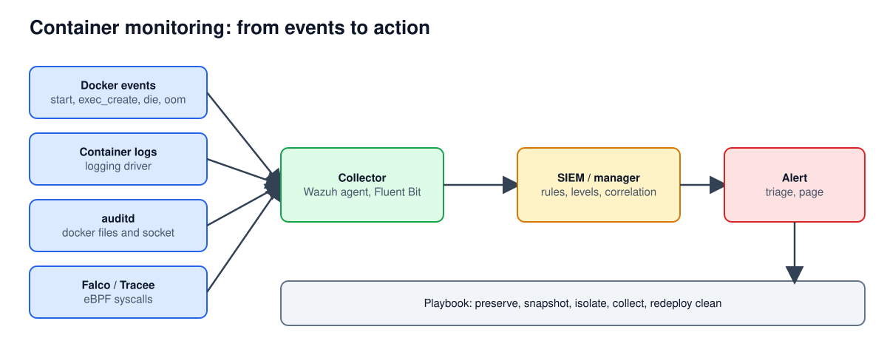
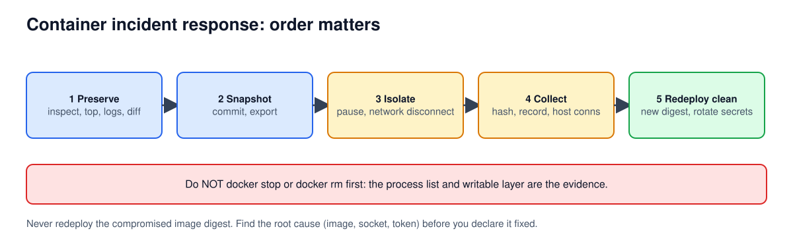

# Lesson 01: Monitoring Docker Events and Logs, and Incident Response in Containers

> **Chapter:** 12 · Container Security Monitoring · **Time:** ~3 hours
> **You will:** collect and centralise Docker events and logs, and run a container incident response that preserves evidence before anything is destroyed.

| | |
|---|---|
| **Prerequisites** | [Chapter 11](../11-defending-containers-at-scale/README.md); [cybersecurity-track 05 SOC](../../cybersecurity-track/05-soc-fundamentals/README.md) |
| **Labs** | [container-ir-playbook](labs/container-ir-playbook/README.md) |
| **Syllabus lines** | [CCSE 5] Monitoring Docker events and logs · Incident response in containers |

## 1. Why it matters

Prevention fails sometimes. Containers make detection harder (short-lived, many, hidden behind an orchestrator) and make evidence **disappear** when the container is deleted. Plan before the incident.

## 2. Monitoring Docker events and logs

**Docker events.** The daemon emits an event stream: container `create`, `start`, `exec_create: <cmd>`, `die` (with `exitCode`), `oom`, `kill`, `destroy`; image `pull`, `tag`, `delete`; network `connect`, `disconnect`; volume `mount`. Read it with `docker events --format '{{json .}}'` or via the API. Useful signals: an `exec_create: bash` in production, an image pulled from an unapproved registry, a restart loop, an OOM kill.

**Container logs.** What the process writes to stdout and stderr goes to a **logging driver**:

| Driver | Notes |
|---|---|
| `json-file` (default) | local files; **no rotation by default** (set `max-size`, `max-file`); gone when the container is removed |
| `local` | compact, rotated by default |
| `syslog`, `journald`, `fluentd`, `gelf`, `awslogs`, `splunk` ... | ship to a central system; drivers and options vary by version |

Rules: **centralise** (logs must outlive the container); log to stdout, not into files in the writable layer; include container id, image digest, host and timestamps (NTP); never log secrets; protect the log store (an attacker who owns the host will try to clear local logs). Add the **host** side: auditd for Docker files and the socket ([lesson 02](02-runtime-prevention-policy-and-tools.md#4-auditd-for-docker-files-and-binaries)), and in Kubernetes the API server audit log.

DBA analogy: archive logs shipped off the server. If the only copy of the redo is on the compromised box, it is not evidence.

## 3. Incident response in containers

The generic lifecycle (prepare, detect and analyse, contain, eradicate and recover, lessons learned) is in [cybersecurity-track 05 lesson 05](../../cybersecurity-track/05-soc-fundamentals/05-incident-response-nist-800-61.md). What is special about containers:

1. **Preserve.** Volatile state first: `docker inspect`, `docker top`, `docker logs`, `docker diff` (what changed in the writable layer), host connections (`ss -tnp`). `docker stop` or `rm` destroys the writable layer and the process list.
2. **Snapshot.** `docker commit` and `docker export` for a forensic copy to analyse **off the production host**. (Memory is not captured by commit; use host-level tools or checkpointing where supported.)
3. **Isolate the network.** `docker pause` and `docker network disconnect` (or a firewall rule, or a Kubernetes NetworkPolicy) so the attacker cannot call out, while the container stays alive for collection.
4. **Collect.** Hash every artefact (chain of custody), record who did what and when, note the **image digest**, mounts, environment variables and secrets the container could read.
5. **Eradicate and redeploy clean.** Find the **root cause** (vulnerable image? exposed socket? stolen token?). Rebuild from clean source into a **new digest**, rotate every secret the container could see, redeploy, and watch. **Never redeploy the same image** that was compromised.
6. **Lessons learned.** What detection would have caught it earlier? Add a Falco/Wazuh rule ([lesson 02](02-runtime-prevention-policy-and-tools.md)).

Also ask: was it **the container, the host, or the orchestrator**? A container escape makes the host a crime scene too; a stolen Kubernetes token makes the cluster one.

Lab: [container-ir-playbook](labs/container-ir-playbook/README.md): a runbook and a script that enforces the order.

## 4. Hands-on

1. Run the playbook and read the command order.
2. Delete the snapshot phase and watch the guard refuse a destructive step.
3. Write the first hour of your own team's container IR checklist.

## 5. Quick check

1. Why not simply `docker rm` a compromised container?
2. Why must logs leave the host?
3. What is the difference between `commit` and `export`? (Commit makes an image with the writable layer; export tars the filesystem; neither captures memory.)

## 6. References

- NIST SP 800-61 (incident handling); NIST SP 800-190.
- Docker docs: `docker events`, logging drivers (verify current pages).
