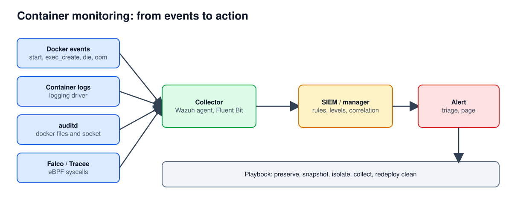

# Chapter 12: Container Security Monitoring

This chapter covers **[CCSE 5] Security Monitoring of Containers**. Prevention (chapter 11) will sometimes fail, so you need to see it happen: Docker events and logs, incident response that preserves evidence, runtime prevention and policy, and the tools: Wazuh, auditd, Falco and Tracee (eBPF). Five labs run offline with fixtures and tests.

> **Safety.** Every lab is a simulation: audit logs, syscall and eBPF event streams, Docker event JSON and a `FakeDocker` are fixtures; canary-style process names and `203.0.113.x` documentation IPs are used. Nothing loads kernel probes or touches a real Docker. Evidence files in the IR lab go to a `tempfile` directory. Install real runtime tools only on hosts you own.

> **Unofficial companion.** Your course videos and lab environment are the primary source. Tool status and options here are hedged: **verify at the source**.

## Syllabus coverage

Every line of the source chapter, verbatim and in source order.

| Syllabus item | Where to study | Lab |
|---|---|---|
| **[CCSE 5] Security Monitoring of Containers** (chapter heading) | this chapter | see below |
| [CCSE 5] Monitoring Docker events and logs | [Lesson 01 section 2](01-monitoring-logs-and-incident-response.md#2-monitoring-docker-events-and-logs) | [wazuh-docker-monitoring](labs/wazuh-docker-monitoring/README.md), [auditd-docker](labs/auditd-docker/README.md) |
| [CCSE 5] Incident response in containers | [Lesson 01 section 3](01-monitoring-logs-and-incident-response.md#3-incident-response-in-containers); [cybersecurity-track 05 IR](../../cybersecurity-track/05-soc-fundamentals/05-incident-response-nist-800-61.md) | [container-ir-playbook](labs/container-ir-playbook/README.md) |
| [CCSE 5] Docker runtime prevention | [Lesson 02 section 1](02-runtime-prevention-policy-and-tools.md#1-runtime-prevention) | [falco-runtime-rules](labs/falco-runtime-rules/README.md); [chapter 11 seccomp lab](../11-defending-containers-at-scale/labs/seccomp-apparmor-custom-policy/README.md) |
| [CCSE 5] Policy creation, enforcement, and management | [Lesson 02 section 2](02-runtime-prevention-policy-and-tools.md#2-policy-creation-enforcement-and-management) | [falco-runtime-rules](labs/falco-runtime-rules/README.md) |
| [CCSE 5] Docker security monitoring using Wazuh | [Lesson 02 section 3](02-runtime-prevention-policy-and-tools.md#3-wazuh-docker-monitoring) | [wazuh-docker-monitoring](labs/wazuh-docker-monitoring/README.md) |
| [CCSE 5] Hands-On Exercises: | Header line: the labs below | see the next rows |
| [CCSE 5] Auditing Docker using AuditD | [Lesson 02 section 4](02-runtime-prevention-policy-and-tools.md#4-auditd-for-docker-files-and-binaries) | [auditd-docker](labs/auditd-docker/README.md) |
| [CCSE 5] Sysdig Falco – Runtime Protection and Monitoring | [Lesson 02 section 5](02-runtime-prevention-policy-and-tools.md#5-falco-and-tracee) (Falco is a CNCF graduated project) | [falco-runtime-rules](labs/falco-runtime-rules/README.md) |
| [CCSE 5] Tracee – Runtime Security | [Lesson 02 section 5](02-runtime-prevention-policy-and-tools.md#5-falco-and-tracee) | [tracee-runtime](labs/tracee-runtime/README.md) |

## Outdated in the syllabus → current

| Syllabus wording | What to know now (Nov 2026; verify at source) |
|---|---|
| "Sysdig Falco" | **Falco** is now a **CNCF graduated** project (created at Sysdig). It uses a modern eBPF probe by default on current versions (the older kernel module still exists). Rule file syntax and default rules evolve: read the current docs. |
| "Tracee" | Open-source from Aqua Security, eBPF-based; signature names, CLI flags and the container image change between releases. |
| "Wazuh" Docker monitoring | The agent's **docker-listener** wodle and the JSON decoder are the integration point; option names differ by version. Wazuh is open source (SIEM/XDR). |
| "Docker runtime prevention" | Usually means seccomp, AppArmor/SELinux, capabilities, read-only rootfs and sandboxes; in Kubernetes also admission control (Pod Security Admission, policy controllers) and Falco-driven response. |
| "Docker" events and logs | Kubernetes clusters use containerd or CRI-O: events come from the kubelet and the API server audit log, container logs from the node's log files. The Docker concepts transfer. |
| auditd paths | `/run/docker.sock` vs `/var/run/docker.sock`, `/usr/bin` vs `/usr/sbin`, rootless Docker's socket under `$XDG_RUNTIME_DIR`: check your distro. |

## How the three courses overlap here

This chapter has only one source, **[CCSE 5]**. It leans on the other two courses in these ways:

- **[CDP/CDE] security monitoring and maintain** ([chapter 02](../02-tools-pipelines-and-secure-sdlc/README.md)): the "Security Monitoring/Compliance (Maintain)" stage of the secure SDLC.
- **[CDE 5] runtime analysis** ([chapter 07](../07-runtime-analysis-rasp-iast/README.md)): RASP watches inside the application; this chapter watches the container and host. They complement each other.
- The SOC side (alert triage, SIEM, EDR) is in [cybersecurity-track 05](../../cybersecurity-track/05-soc-fundamentals/README.md), [06](../../cybersecurity-track/06-siem-sentinel-splunk/README.md) and [07](../../cybersecurity-track/07-edr-xdr-mdr/README.md): link, do not repeat. App-level runtime monitoring: [06-ai-devsecops/runtime-security](../../06-ai-devsecops/runtime-security/README.md).

## Learning order

1. [Lesson 01](01-monitoring-logs-and-incident-response.md): events, logs, IR; then the `container-ir-playbook` lab.
2. [Lesson 02](02-runtime-prevention-policy-and-tools.md): prevention, policy, then Wazuh, auditd, Falco, Tracee with their labs.
3. Read the [real-tools guide](real-tools/README.md); then the exam tips and Q&As below.

## Lab index

| Lab | Course exercise | Tests |
|---|---|---|
| [auditd-docker](labs/auditd-docker/README.md) | Auditing Docker using AuditD | `test_dso_ch12_auditd.py` |
| [falco-runtime-rules](labs/falco-runtime-rules/README.md) | Sysdig Falco: Runtime Protection and Monitoring | `test_dso_ch12_falco.py` |
| [tracee-runtime](labs/tracee-runtime/README.md) | Tracee: Runtime Security | `test_dso_ch12_tracee.py` |
| [wazuh-docker-monitoring](labs/wazuh-docker-monitoring/README.md) | Docker security monitoring using Wazuh | `test_dso_ch12_wazuh.py` |
| [container-ir-playbook](labs/container-ir-playbook/README.md) | Incident response in containers | `test_dso_ch12_ir_playbook.py` |

Run all: `.venv/Scripts/python -m pytest devsecops-course/12-container-security-monitoring -q`

## Exam tips

- **Preserve before you destroy.** The IR order is preserve, snapshot, isolate, collect, redeploy clean. Never `docker rm` first, never redeploy the compromised digest.
- **Logs must leave the host.** Logging driver plus central collector; `json-file` has no rotation by default.
- **Prevention vs detection:** seccomp/AppArmor/read-only rootfs prevent; Falco/Tracee/auditd/Wazuh detect (and can respond).
- **Name the data source** of each tool: Falco and Tracee (eBPF syscalls), auditd (kernel audit), Wazuh (agent: logs, FIM, Docker events).
- **auditd:** rules are `-w path -p perms -k key`; `auid` survives sudo; always add keys.
- **Falco vocabulary:** list, macro, rule, condition, output, priority, fields like `proc.name`, `container.id`, `fd.name`, `evt.type`.
- **Policy lifecycle:** audit mode, then enforce; policies in Git; exceptions with expiry; measure false positives.
- **Hedge** tool versions and flag names.

## 15 exam-style questions

1. Which Docker events are most useful for security monitoring?

`exec_create: <cmd>` (a shell in a container), `start`, `die` with exit code (137 = killed), `oom`, `kill`, `destroy`, image `pull` from unapproved registries, and network `connect`. A restart loop (repeated `die`) is also a signal.

2. Why centralise container logs?

The default `json-file` logs live on the host and vanish when the container is removed; an attacker on the host can delete them. A logging driver or collector (syslog, fluentd, journald, a Wazuh agent) keeps evidence off the host and enables correlation. Also set rotation, include container id and image digest, and keep clocks in sync.

3. Give the container IR order and why it matters.

Preserve volatile state (inspect, top, logs, diff), snapshot (commit, export), isolate the network (pause, disconnect), collect and hash evidence, then eradicate and redeploy clean from a new image digest with rotated secrets. Stopping or removing the container first destroys the process list and writable layer, which are the evidence.

4. What does `docker diff` tell you in an incident?

The files added (A), changed (C) or deleted (D) in the container's writable layer compared with its image: dropped binaries, modified configs, a miner under `/tmp`. It is cheap and should be captured early.

5. Does `docker commit` capture memory?

No. It saves the filesystem changes as an image. Memory needs host-level tooling or checkpoint/restore support where available. `docker export` tars the filesystem without history.

6. Why must you not redeploy the same image after an incident?

The image or its configuration may be the root cause (vulnerable dependency, embedded secret, exposed port). Find the cause, rebuild from clean source into a new digest, rotate every secret the container could read, and verify with scans and monitoring.

7. Define runtime prevention and give examples.

Controls that stop an attack while it happens: non-root user, `no-new-privileges`, dropped capabilities, seccomp allowlist, AppArmor/SELinux, read-only root filesystem, resource limits, default-deny egress, sandboxed runtimes, admission policy, and automated response for high-confidence rules.

8. How do you create, enforce and manage runtime policy?

Create from a standard (CIS, NIST 800-190) and your risk list, expressed as code (Falco rules, admission policy, CI checks, Wazuh rules). Enforce at build, deploy and run. Manage in Git with reviews, test by replaying events, roll out in audit mode first, track exceptions with owners and expiry, and measure false positives per rule.

9. How does Wazuh monitor Docker?

The agent's docker-listener module reads the Docker event stream and emits JSON; the manager decodes fields such as `docker.Action` and applies rules (regex on fields, `if_sid` chaining, `frequency`/`timeframe` correlation) with levels 0 to 15. Wazuh also offers file integrity monitoring on `/etc/docker`, SCA policies and log collection. Verify module names for your version.

10. Which paths should auditd watch for Docker, and what do you alert on?

`/usr/bin/docker*`, `/usr/bin/dockerd`, containerd and runc binaries, `/var/lib/docker`, `/etc/docker` (daemon.json, TLS), the docker service and socket unit files, and `docker.sock`. Alert on non-Docker processes opening the socket, writes to daemon config, and Docker CLI use by unapproved users. Use `-k` keys and the `auid` field.

11. Explain the Falco rule language.

Lists are named sets, macros are named conditions, rules combine a condition (fields with operators and `and`/`or`/`not`), an output template, a priority and tags. Fields include `proc.name`, `container.id`, `fd.name`, `evt.type`, `fd.sport`. Falco (CNCF graduated) feeds them from eBPF syscall events and can send alerts through Falcosidekick.

12. Write the idea of a Falco rule for a shell in a container.

Condition: a process-spawn event (`evt.type = execve`), inside a container (`container.id != host`), where `proc.name` is in a list of shells and a terminal is attached (`proc.tty != 0`). Output includes user, container name and command line. Tune with exceptions for known debug workflows.

13. How do Falco and Tracee differ?

Both use eBPF to observe kernel events. Falco is built around a rule language and ecosystem (default rules, Falcosidekick, Kubernetes metadata). Tracee (Aqua) emphasises rich event capture and Go or Rego signatures such as container escape, anti-debugging and dropped executables. Many teams pick one.

14. What is eBPF and why do runtime tools use it?

eBPF runs small, kernel-verified programs at hook points (syscalls, tracepoints, security hooks) and reports events to user space. Tools see every process and file access without kernel modules or changing applications, with low overhead. They need privileges and a reasonably recent kernel.

15. A Falco rule for writing below /etc fires constantly. What do you do?

Measure the false-positive rate per rule, find the benign sources (package managers, init scripts, entrypoints that template config), add them as exceptions with a reason, narrow the path, and consider making the container's `/etc` read-only. Do not disable the rule: a write below `/etc` is a classic persistence step.

## References

- Falco docs (https://falco.org/docs/); Tracee docs (https://aquasecurity.github.io/tracee/).
- Wazuh documentation: Docker monitoring, rules syntax, `wazuh-logtest` (verify current pages).
- Linux audit: `man auditctl`, `man audit.rules`, `man ausearch`.
- NIST SP 800-61 (incident handling); NIST SP 800-190; CIS Docker Benchmark section 1.1.
- Repo: [cybersecurity-track 05](../../cybersecurity-track/05-soc-fundamentals/README.md), [06](../../cybersecurity-track/06-siem-sentinel-splunk/README.md), [07](../../cybersecurity-track/07-edr-xdr-mdr/README.md), [06-ai-devsecops runtime-security](../../06-ai-devsecops/runtime-security/README.md).
- [Real tools guide](real-tools/README.md).
