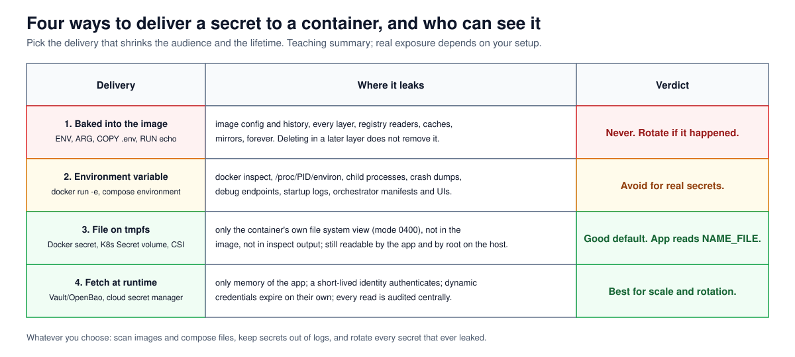

# Lesson 01: Secrets in traditional infrastructure and in containers at scale

> **Unofficial companion.** Product names and features change. **Verify at the source.**

**Syllabus items:** [CDE 8] Managing secrets in traditional infrastructure; Managing secrets in containers at Scale.

## 0. What counts as a secret, and what do we want?

A **secret** is any value that proves identity or unlocks data: passwords, API keys and tokens, private keys and certificates, database connection strings, encryption keys, signing keys, cloud credentials, webhook secrets.

Goals (memorise them, they structure every answer):

1. **Not in code, images or logs** (no secret at rest where many people can read it).
2. **Least privilege**: each workload gets only its own secrets.
3. **Short-lived and rotatable**: a leaked secret expires or can be replaced fast.
4. **Audited**: who read which secret and when.
5. **Encrypted** at rest and in transit, with the keys held separately.
6. **Delivered at runtime** over an authenticated channel, not hard-wired at build time.



## 1. Managing secrets in traditional infrastructure

"Traditional" means long-lived servers or VMs that you log into and configure (mutable infrastructure). How secrets usually live there, and the upgrade path:

| Pattern (common today) | Problem | Better |
|---|---|---|
| Password in `app.properties`, `.env`, `web.config` in the app folder | Readable by anyone with file access, copied to backups and tickets | Config file outside the web root, mode `0400`, owned by the service account; ideally the secret is not in the file at all |
| Same shared database account for every app | One leak is total; no audit of who did what | Per-application accounts; dynamic credentials |
| Secrets in a team wiki, spreadsheet or chat | Unbounded audience, no rotation | A secrets manager (Vault, cloud service, enterprise vault) |
| Secrets inside Ansible/Chef/Puppet code | Lives in git, shared password | Ansible Vault for bootstrap only; external secret lookup ([chapter 08](../08-iac-configuration-and-compliance-as-code/02-ansible-and-ansible-security.md)) |
| SSH private keys on shared jump boxes | Long-lived, copied | Per-user keys or short-lived SSH certificates; bastion with session logging |
| Service accounts that never change password | Nobody dares to rotate | Automated rotation; managed identities where the platform supports them |
| Rotation = a yearly calendar event | Leak window is a year | Rotate on a schedule and immediately on suspicion |

**DBA analogy.** You know the problem: an application connects as a shared schema owner with a password in a config file. The better pattern is an **Oracle Wallet** or password-less proxy authentication, per-app accounts with minimal grants, profiles that expire passwords, and audit. A secrets manager generalises that for everything, not only databases.

Practical steps for mutable servers:

- Inventory where secrets live (scan: [secrets scanning labs](../../csse-course/ch6-common-defenses-against-supply-chain-attacks/labs/trufflehog-secrets-scan/README.md), [chapter 05](../05-static-analysis-and-secrets/README.md)).
- Put the files under strict permissions and SELinux/AppArmor confinement (see the Linux lesson: [Linux for security analysts](../../cybersecurity-track/01-it-fundamentals/03-linux-for-security-analysts.md)).
- Use a **local agent** (Vault Agent, cloud agent) that authenticates the host (cloud IAM, AppRole, certificate), fetches the secret and renders it to a file or memory.
- Keep an audit trail and an alert for reads from unexpected hosts.
- Mutable servers drift: a hand-edited config can reintroduce a plain secret. Scan the hosts ([chapter 08 compliance as code](../08-iac-configuration-and-compliance-as-code/04-compliance-as-code.md)).

## 2. Managing secrets in containers at scale

At scale you have thousands of short-lived containers, scheduled on any node, created by automation. Rules:

- **Never in the image** (image config and history are readable by everyone who can pull).
- **Avoid environment variables** for real secrets (lesson 03).
- **Deliver at runtime**, as a file on `tmpfs` or from a secrets manager, with access tied to the workload identity.
- **Scope per workload** and per namespace.

### Docker and Swarm secrets

Docker Swarm has built-in **secrets**: stored encrypted in the Raft log, sent over mutual TLS only to nodes that run a service that needs them, mounted into the container as a file under `/run/secrets/<name>` on an in-memory filesystem. Compose supports file-based `secrets:` for local use (the lab fixture). Swarm is still part of Docker Engine; Mirantis has committed to supporting it, while Docker Inc. is not actively developing it, and **Kubernetes is the default for new work** (verify current status).

```text
docker secret create db_password -          # reads the value from stdin
docker service create --name api --secret db_password myimage   # appears at /run/secrets/db_password
```

### Kubernetes Secrets

A Kubernetes **Secret** object holds small sensitive data. Facts that surprise people:

- Values are **base64-encoded, not encrypted**. Without **encryption at rest** in etcd (a KMS provider is best), anyone who can read etcd or a backup reads the secrets. Enable it.
- **RBAC** decides who can `get` or `list` secrets. `list` on secrets in a namespace reveals every value. Restrict it ([CSSE ch4 Kubernetes](../../csse-course/ch4-attacking-kubernetes-cluster-supply-chain/README.md), [06 Kubernetes](../../06-ai-devsecops/kubernetes/README.md)).
- Prefer mounting a Secret as a **volume** (file) over `envFrom`, so the value is not in the process environment or `describe` output of the pod spec.
- Secrets in **Git** (YAML manifests) are the same problem as any secret in Git. Three popular answers:

| Tool | Idea | Notes |
|---|---|---|
| **External Secrets Operator (ESO)** | A controller syncs values from an external manager (Vault, AWS Secrets Manager, Azure Key Vault, GCP Secret Manager) into Kubernetes Secrets. You commit only an `ExternalSecret` that names the remote key. | Secret still ends up as a Kubernetes Secret (so protect etcd and RBAC). Rotation follows the source. |
| **Sealed Secrets** (Bitnami) | You encrypt a Secret with the cluster's public key into a `SealedSecret` that is safe in Git; only the controller in the cluster can decrypt it. | GitOps friendly; the key pair must be backed up and rotated; no central rotation or audit. |
| **Secrets Store CSI driver** (with provider for Vault/cloud) | Mounts external secrets straight into the pod as a volume, optionally also syncing a Secret. | Avoids storing the value in etcd if you do not enable the sync option; pod identity must be right. |

Other options: SOPS (encrypt files in Git with KMS/age keys), Vault Agent injector or Vault Secrets Operator, workload identity (IRSA, Azure Workload Identity, GKE Workload Identity) so the pod needs no stored secret at all.

**The exam answer.** "Do not store secrets in images, manifests or env vars. Use an external secrets manager with workload identity, deliver as short-lived files (CSI or operator), enable etcd encryption and tight RBAC, and rotate."

## Practice

1. Take one container you run and list every place its password could be read (image, compose file, inspect, env, logs).
2. Decide for a GitOps repo: ESO, Sealed Secrets or SOPS, and write two sentences defending the choice.
3. Continue with [lesson 02](02-cloud-secret-managers-and-version-control.md).
