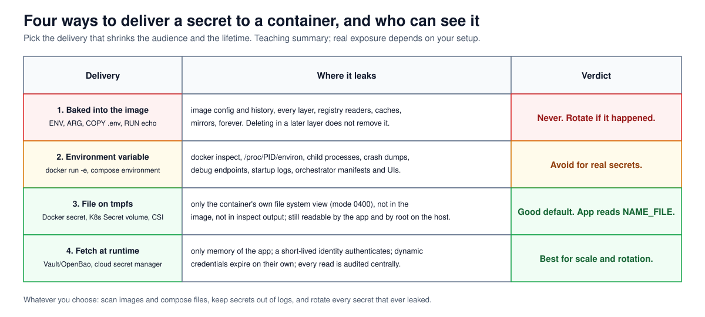

# Lesson 03: Environment variables, configuration files, Docker and immutable systems

> **Unofficial companion.** Verify tool behaviour at the source.

**Syllabus items:** [CDE 8] Environment Variables and Configuration files; Docker, immutable systems, and their security challenges. Lab: [secrets-in-env-and-images](labs/secrets-in-env-and-images/README.md).

## 1. Environment variables and configuration files

The Twelve-Factor App says "store config in the environment". That advice is about **non-secret config** (hostnames, feature flags). For **secrets** the environment is a weak place.

### Where an environment variable can be read

| Door | What happens |
|---|---|
| **`/proc/<pid>/environ`** | On Linux the initial environment of a process is readable by the same user and by root. Any compromised code in the container, a debug shell or a sidecar with the right privileges can `cat` it. The lab simulates this file (NUL-separated pairs). |
| **Child processes** | Environments are inherited. A shell-out, a build tool or a "helper" gets every secret. |
| **`docker inspect`** | Prints `Config.Env` for a container in clear text. Anyone in the `docker` group (equal to root), or with API access, reads all of them. `kubectl describe pod` shows non-secret env values; Secrets referenced via `secretKeyRef` are hidden, but anyone who can exec in the pod can read them. |
| **Image config and history** | `ENV` in a Dockerfile writes the value into the image config. `ARG` values appear in `docker history`. Both ship with the image. |
| **Logs and crash reports** | Frameworks print effective config in debug mode, error pages dump the environment, APM agents capture it. See `app_startup.log` in the lab. |
| **Orchestrator manifests and UIs** | Compose files, task definitions, deployment YAML in Git, dashboards that show environment. |
| **Process listings and shell history** | `docker run -e DB_PASSWORD=...` lands in shell history and audit logs. |

### Configuration files

Config files fare better only if you treat them as secrets:

- Permissions `0400`/`0440`, owned by the service user, outside the web root and out of the image.
- Never `COPY .env` into an image; a later `rm` does not delete it from the earlier layer (the lab shows this).
- Do not log or echo them; do not put them in backups that more people can read than the secret allows.
- Prefer **files for secrets** and **env vars for plain settings**. The `NAME_FILE` convention (`DB_PASSWORD_FILE=/run/secrets/db_password`) lets the same app work with Docker secrets, Kubernetes volumes and CSI mounts.

### Fix: runtime injection

1. Remove the secret from the Dockerfile, image, compose file and manifests.
2. Provide it at run time: Docker/Swarm secret, Kubernetes Secret volume (backed by ESO or CSI), or fetch from Vault/cloud manager with the workload identity.
3. Change the app to read `NAME_FILE` first (lab: `read_secret`).
4. For **build-time** secrets (a private package registry token) use BuildKit secret mounts so nothing lands in a layer: `RUN --mount=type=secret,id=npmrc ...` and `docker build --secret id=npmrc,src=...` (verify syntax in current Docker docs).
5. Scan images, compose files and logs in CI (lab detectors; real tools: Trivy, TruffleHog, gitleaks, Dockle).
6. **Rotate** every secret that ever appeared in a layer, an env var in a deployed container, or a log.

## 2. Docker, immutable systems and their security challenges

**Immutable infrastructure** means you never patch a running server or container; you build a new image and replace it ([chapter 08 golden images](../08-iac-configuration-and-compliance-as-code/03-packer-golden-images.md)). Good for security: predictable, no drift, easy rollback. It creates **new secret challenges**:

| Challenge | Why | Approach |
|---|---|---|
| **Nothing to edit in place** | You cannot "just put the password in the config file on the server" | Inject at start (secret volume, agent, init container) |
| **Secrets must not be baked in** | The image is shared by many environments and stored in registries | One image for all environments; environment-specific secrets come from outside |
| **Ephemeral workloads** | Containers live minutes; who owns the credential? | Identity per workload (SPIFFE, K8s service accounts, cloud IAM) and short TTL credentials |
| **Bootstrap ("secret zero")** | The workload needs one credential to fetch the others | Platform-attested identity (cloud metadata/IAM, K8s projected token, signed instance identity) or a single-use wrapped token (Vault response wrapping, AppRole secret ID) |
| **Scale and burst** | Thousands of starts hit the secrets backend at once | Caching, agents, retries with backoff, performance standby nodes; sensible lease TTLs |
| **Rotation requires restarts or hot reload** | Value read once at start stays stale | Apps re-read files, use short-lived dynamic credentials, or rolling restarts on rotation |
| **Image reuse and caches** | A leaked layer lives in registries, caches, laptops | Scan before push, immutable tags, delete and **rotate** if a secret was baked |
| **Debugging** | Teams exec into containers and print env | Restrict exec, audit it, no secrets in env |
| **Snapshots and core dumps** | Memory images contain secrets | Disable or protect dumps; encrypt volumes |
| **Host compromise** | Root on the node reads every pod's tmpfs and env | Node hardening, runtime security ([chapter 12](../12-container-security-monitoring/README.md)), sandboxed runtimes, short TTLs to limit damage |

Docker-specific reminders: the daemon socket and the `docker` group are root-equivalent (they can inspect any container's env and read any mounted secret); use rootless Docker or Podman where possible; keep `docker.sock` out of containers ([chapter 11](../11-defending-containers-at-scale/README.md)).

## Practice

1. Run the lab demo and write down which door (image, inspect, proc, log, compose) leaks each secret.
2. Rewrite the compose file by hand to use `secrets:`, then compare with the lab output.
3. Continue with [lesson 04: Vault and Consul](04-vault-and-consul.md).
