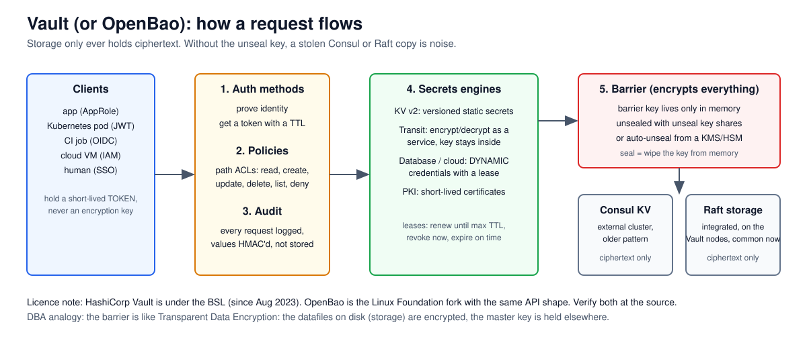

# Lesson 04: Secrets management with HashiCorp Vault and Consul

> **Unofficial companion.** Vault is under the **BSL** licence (since Aug 2023); **OpenBao** is the Linux Foundation fork. Verify licence, versions and features at the source. The lab uses a teaching mock, not real Vault.

**Syllabus items:** [CDE 8] Secrets management with HashiCorp Vault and Consul; lab *Securely store Encryption keys and other secrets using Vault/Consul*. Lab: [vault-consul-secrets](labs/vault-consul-secrets/README.md).

## 1. What Vault is, and the licence story

**Vault** is a secrets server: it stores static secrets, **generates dynamic secrets**, **encrypts data for applications** (without giving them the key), issues certificates, and **audits** every request. It is accessed over an HTTP API with a **token**.

- **Licence.** HashiCorp moved Vault (and Terraform, Packer, Consul) from MPL to the **Business Source License** in August 2023. IBM completed its acquisition of HashiCorp in 2025 (verify). BSL permits internal use but restricts offering a competing product.
- **OpenBao.** A fork from the last MPL version, hosted by the Linux Foundation (OpenSSF project), keeps the API shape and uses `bao` instead of `vault` for the CLI. Check feature parity yourself; they diverge over time.
- **Alternatives and companions**: cloud secret managers, CyberArk Conjur, Infisical, SOPS, Kubernetes External Secrets.



## 2. Consul versus Raft storage

Vault needs a **storage backend** for its data. Vault encrypts everything with a **barrier key** *before* handing it to storage, so the backend only sees ciphertext.

| | **Consul KV** (external) | **Integrated storage (Raft)** |
|---|---|---|
| What | A separate Consul cluster stores Vault's data (the course's setup) | Vault nodes store data themselves and run Raft consensus |
| Operations | Two systems to run, patch, secure and back up | One system |
| Trend | Common in older deployments; HashiCorp now recommends integrated storage for most cases (verify) | Default choice for new installs |
| Consul extras | Service discovery, health checks, service mesh, KV | n/a |
| Security notes | Secure Consul with ACLs, TLS and gossip encryption; anyone who gets Consul sees only ciphertext, but can delete or tamper (availability) | Protect the data directory and snapshots; snapshots are encrypted but contain all ciphertext |

Teach both: the exam still asks about Consul, new projects choose Raft. The lab provides a `ConsulLikeKV` (keys, modify index, check-and-set) and a `RaftIntegratedStorage` with the same interface, and a test proves that **both only ever hold ciphertext**.

### Initialise, seal and unseal

At `init`, Vault creates a **master/barrier key** and splits the unseal secret into **key shares** (Shamir, for example 5 shares with threshold 3). Vault starts **sealed**: it knows where the data is but cannot decrypt it. Operators provide enough shares to **unseal**; the barrier key then lives in memory only. **Auto-unseal** delegates this to a cloud KMS or HSM (verify supported options). `vault operator seal` is the break-glass "wipe the key from memory" button. Protect the **root token** (use it to bootstrap, then revoke it).

## 3. Authentication methods

A client proves who it is and receives a **token** with policies and a **TTL**. Common methods (verify the current list):

| Method | Good for |
|---|---|
| **Token** | Humans in emergencies, root bootstrap, derived child tokens |
| **AppRole** | Machines/CI: a stable `role_id` plus a short-lived, ideally single-use `secret_id` (often response-wrapped) |
| **Kubernetes** | Pods authenticate with their service account JWT |
| **Cloud (AWS IAM, Azure, GCP)** | VMs and functions authenticate with their cloud identity (no stored secret) |
| **OIDC/JWT** | CI systems (GitHub Actions, GitLab) and humans via SSO |
| **LDAP/userpass/GitHub** | Human login in smaller setups |
| **TLS certificates** | Mutual TLS machines |

## 4. Policies

Policies are **path-based ACLs**. In real Vault they are written in **HCL** (the lab uses a dict for simplicity):

```hcl
path "secret/data/app/*" { capabilities = ["read"] }
path "secret/metadata/app/*" { capabilities = ["list"] }
path "transit/encrypt/orders" { capabilities = ["update"] }
path "secret/data/prod/*" { capabilities = ["deny"] }
```

Capabilities: `create`, `read`, `update`, `delete`, `list`, `sudo`, `deny`. Default deny; `deny` wins. Write policies **per application** and per environment; use identity templating (verify) so one policy serves many identities. Child tokens cannot get more than their parent.

## 5. KV v2 (versioned static secrets)

The KV v2 engine keeps **versions**, supports **check-and-set (cas)** to prevent lost updates, **soft delete** and **undelete**, **destroy** (permanent), and a **max versions** setting. API paths insert `data/` and `metadata/` (so the policy path is `secret/data/app/db`, a classic mistake). Reading an old version is how you roll back after a bad rotation.

## 6. Dynamic secrets, leases and rotation

A **dynamic secret** is created on demand and dies on its own. Example: an application asks `database/creds/readonly`; Vault connects to the database, runs a `CREATE USER ...` statement, returns the credentials with a **lease** (default TTL, max TTL), and drops the user when the lease expires or is revoked.

- **Renew** extends the lease up to the **max TTL**; after that the client must request new credentials.
- **Revoke** removes the credentials immediately (also revoke by prefix after an incident).
- Benefits: unique credentials per client (auditing), no shared long-lived password, a leak expires itself.
- **Rotation** for static secrets: KV versions plus an automated job; for root credentials of the engine, `rotate-root`. Applications must tolerate change (re-fetch on auth failure, or use Vault Agent templating).

**DBA analogy.** Think of a script that creates a temporary Oracle user with a profile and an expiry, and drops it afterwards. Vault does that for every application, safely and audited.

## 7. Transit: encryption as a service

The **transit** engine performs `encrypt`, `decrypt`, `rewrap`, `sign`, `verify`, `hmac` and key rotation. The application sends plaintext and receives ciphertext (`vault:v1:...`). **The key never leaves Vault** and is not exportable unless you explicitly allow it at creation. This removes the "where does the app keep its encryption key" problem (like **TDE with the key in the wallet**, but for application data).

- **Key versions**: `rotate` creates v2; old ciphertext still decrypts; `rewrap` upgrades ciphertext without exposing plaintext; set a minimum decryption version to retire old keys.
- **Context** (key derivation or AAD) binds ciphertext to a tenant or record.
- **Separation of duties** through policy: one service may only encrypt, another only decrypt.
- The ciphertext stored in your database is safe to back up and replicate; stealing it without Vault access gets nothing.

## 8. Audit and hardening

- Enable at least two **audit devices**; a request fails if no audit device can log it. Values are **HMAC'd** in the audit log.
- TLS everywhere, restrict network access, run on dedicated hosts or containers with no shell access, disable core dumps and swap.
- Short TTLs, no long-lived root tokens, regular `secret_id` and token revocation.
- Back up storage and **test restore**; protect unseal shares with split custody.
- Monitor: failed auth, policy changes, token creation spikes, seal status.

## 9. The lab

[vault-consul-secrets](labs/vault-consul-secrets/README.md) is a **teaching mock** (in process, plus an optional HTTP wrapper bound to `127.0.0.1`):

- token and AppRole auth, path-ACL policies with `deny` and `+` wildcards;
- KV v2 versions, cas, delete, undelete, destroy, max versions, list;
- transit encrypt/decrypt/rewrap/rotate with the key held server-side (tests assert that **the application never sees the key**);
- dynamic database credentials with leases, renewal capped at max TTL, revocation;
- a Consul-like and a Raft-like backend (tests assert ciphertext only);
- seal/unseal and an audit log without values.

The mock cipher is **teaching only, not real crypto**. Also read the earlier [CMCPSE secrets-vault lab](../../cmcpse-course/ch4-defending-and-hardening-mcp-servers/labs/secrets-vault/README.md), which uses a Vault-style mock from the point of view of an MCP server.

## Practice

1. Write the HCL policy for a service that may read `secret/data/orders/*` and encrypt (not decrypt) with the `orders` transit key.
2. Explain to a DBA, in three sentences, why transit is better than keeping an AES key in the application config.
3. Do the 15 questions in the [chapter README](README.md).
