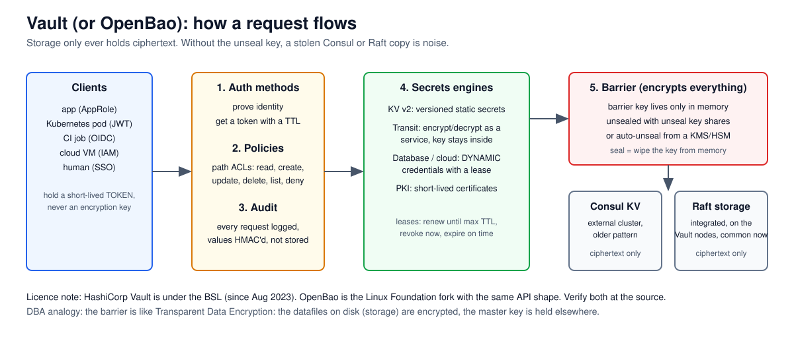
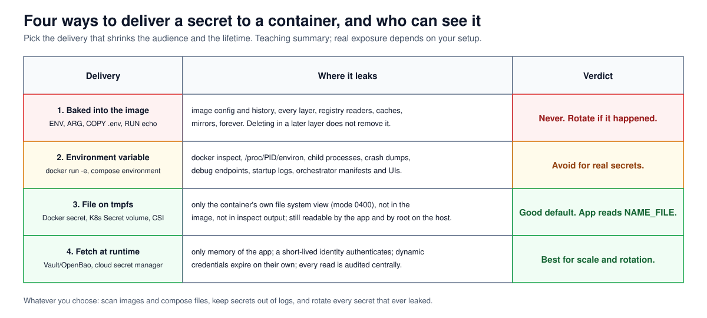

# Chapter 13: Secrets management

This chapter is **[CDE 8] Secrets management on mutable and immutable infra**. You learn where secrets live and leak in traditional servers, containers at scale, cloud platforms and version control; why environment variables and config files are risky (`/proc`, logs, `docker inspect`); what immutable infrastructure changes; and how **HashiCorp Vault (and the OpenBao fork) with Consul or Raft storage** solves the problem with auth methods, policies, KV v2, dynamic secrets, transit encryption, leases and rotation. Two labs run offline with tests: **no Vault, Consul, Docker, Kubernetes or cloud is needed**.

> **Safety.** The labs are simulations: an in-process Vault-style mock (plus an optional HTTP wrapper on 127.0.0.1), JSON/YAML/text fixtures and canary strings. Tokens are generated at run time and no token-shaped literals are stored. The mock cipher is **teaching only, not real crypto**. Never test secrets systems you do not own.

> **Unofficial companion.** Your course videos and lab environment are the primary source. Product facts are hedged: **verify at the source**.

## Syllabus coverage

| Syllabus item | Where to study | Lab |
|---|---|---|
| [CDE 8] Managing secrets in traditional infrastructure. | [Lesson 01 section 1](01-secrets-in-traditional-and-container-infrastructure.md#1-managing-secrets-in-traditional-infrastructure); repo [Linux for security analysts](../../cybersecurity-track/01-it-fundamentals/03-linux-for-security-analysts.md) | [secrets-in-env-and-images](labs/secrets-in-env-and-images/README.md) |
| [CDE 8] Managing secrets in containers at Scale. | [01 section 2](01-secrets-in-traditional-and-container-infrastructure.md#2-managing-secrets-in-containers-at-scale) (Docker secrets, Kubernetes Secrets, External Secrets, Sealed Secrets, CSI) | [secrets-in-env-and-images](labs/secrets-in-env-and-images/README.md) |
| [CDE 8] Secret Management in Cloud | [Lesson 02 section 1](02-cloud-secret-managers-and-version-control.md#1-secret-management-in-the-cloud); repo [CSSE ch5 cloud](../../csse-course/ch5-attacking-cloud-supply-chain/README.md) | n/a |
| [CDE 8] Version Control systems and Secrets. | [02 section 2](02-cloud-secret-managers-and-version-control.md#2-version-control-systems-and-secrets) (history, rotation after a leak); repo [TruffleHog lab](../../csse-course/ch6-common-defenses-against-supply-chain-attacks/labs/trufflehog-secrets-scan/README.md), [chapter 05](../05-static-analysis-and-secrets/README.md) | [secrets-in-env-and-images](labs/secrets-in-env-and-images/README.md) (compose and history scanners) |
| [CDE 8] Environment Variables and Configuration files. | [Lesson 03 section 1](03-env-vars-config-files-and-immutable-systems.md#1-environment-variables-and-configuration-files) (SVG) | [secrets-in-env-and-images](labs/secrets-in-env-and-images/README.md) |
| [CDE 8] Docker, immutable systems, and their security challenges. | [03 section 2](03-env-vars-config-files-and-immutable-systems.md#2-docker-immutable-systems-and-their-security-challenges); [chapter 08 golden images](../08-iac-configuration-and-compliance-as-code/03-packer-golden-images.md) | [secrets-in-env-and-images](labs/secrets-in-env-and-images/README.md) |
| [CDE 8] Secrets management with HashiCorp Vault and Consul. | [Lesson 04](04-vault-and-consul.md) (SVG); [real-tools/vault-openbao.md](real-tools/vault-openbao.md); repo [CMCPSE secrets-vault lab](../../cmcpse-course/ch4-defending-and-hardening-mcp-servers/labs/secrets-vault/README.md) | [vault-consul-secrets](labs/vault-consul-secrets/README.md) |
| [CDE 8] Hands-On Labs: | [Lab list](#labs) | both labs |
| [CDE 8] Securely store Encryption keys and other secrets using Vault/Consul. | [04 sections 5 to 7](04-vault-and-consul.md#5-kv-v2-versioned-static-secrets) (KV v2, dynamic secrets, transit) | [vault-consul-secrets](labs/vault-consul-secrets/README.md) |

## Learning order

1. [Lesson 01: traditional infrastructure and containers at scale](01-secrets-in-traditional-and-container-infrastructure.md).
2. [Lesson 02: cloud secret managers and version control](02-cloud-secret-managers-and-version-control.md).
3. [Lesson 03: environment variables, config files, immutable systems](03-env-vars-config-files-and-immutable-systems.md), then lab [secrets-in-env-and-images](labs/secrets-in-env-and-images/README.md).
4. [Lesson 04: Vault and Consul](04-vault-and-consul.md), then lab [vault-consul-secrets](labs/vault-consul-secrets/README.md).
5. Read the hedged guide [real-tools/vault-openbao.md](real-tools/vault-openbao.md) and run a dev server only if you want to compare.
6. Do the 15 questions below.

## Labs

| Lab | Course exercise | Tests |
|---|---|---|
| [vault-consul-secrets](labs/vault-consul-secrets/README.md) | Vault-style mock: token/AppRole auth, path policies, KV v2, transit with a server-side key, leases, Consul-like and Raft-like backends | 28 |
| [secrets-in-env-and-images](labs/secrets-in-env-and-images/README.md) | Find secrets in image config, `docker inspect`, image history, logs, `/proc`, compose; fix with runtime injection | 15 |

Run both: `.venv/Scripts/python -m pytest devsecops-course/13-secrets-management -q`

## Outdated in the syllabus → current

| Syllabus says or implies | Current (Nov 2026; verify at source) |
|---|---|
| **HashiCorp Vault** as an open-source default | Vault is under the **BSL** licence (since Aug 2023); IBM completed the HashiCorp acquisition in 2025. The **OpenBao** fork (Linux Foundation) keeps the API shape. Check licence and terms before adopting. |
| **Consul** as Vault's storage backend | Still supported, but **integrated storage (Raft)** is now the common choice for new installs. Teach both. |
| Secrets in **environment variables** (Twelve-Factor) | Fine for plain settings; for secrets prefer files on tmpfs (`NAME_FILE`), a secrets manager and workload identity. |
| Kubernetes Secrets "are encrypted" | They are only base64-encoded unless **encryption at rest** is enabled; use KMS, tight RBAC, and External Secrets, Sealed Secrets or the Secrets Store CSI driver. |
| Docker Swarm secrets as the container answer | Swarm still ships in Docker Engine (Mirantis supports it; Docker Inc. is not actively developing it). **Kubernetes** is the default for new work; the pattern (file on tmpfs) is the same. |
| Cleaning a leak = removing it from git | **Rotate first**; rewriting history is secondary hygiene. Add push protection and scanning. |
| gitrob and similar old scanners | Unmaintained; use **TruffleHog, gitleaks, detect-secrets** and platform push protection. |

## How the three courses overlap here

Only [CDE 8] has a dedicated secrets chapter, but secrets appear everywhere else: [CDP 5] secrets scanning in code ([chapter 05](../05-static-analysis-and-secrets/README.md)), [CDE 6] Ansible Vault in CI/CD ([chapter 08](../08-iac-configuration-and-compliance-as-code/02-ansible-and-ansible-security.md)), and [CCSE 3] and [CCSE 4] secrets in images, registries and `docker inspect` ([chapter 10](../10-container-reconnaissance-and-attacks/README.md) and [chapter 11](../11-defending-containers-at-scale/README.md)). This chapter is the **single place for the solution**: where secrets should live, how they are delivered and rotated, and how Vault works. The earlier chapters link here for the fix, and this chapter links back for scanning and attack detail.

## Exam tips

- **Memorise the goals**: not in code/images/logs, least privilege, short-lived, rotatable, audited, encrypted, delivered at runtime.
- **Env var doors**: `/proc/<pid>/environ`, child processes, `docker inspect`, image history, logs, manifests.
- **Layers never forget**: `ENV`, `ARG`, `COPY .env` persist in image layers; a later `rm` does not help.
- **After a leak: rotate first.** Then investigate, replace, clean history, add guardrails.
- **Kubernetes Secrets are base64, not encryption.** Name the three patterns: External Secrets, Sealed Secrets, Secrets Store CSI.
- **Vault vocabulary**: seal/unseal, barrier, auth method, token, policy (path capabilities), KV v2 (versions, cas), dynamic secret, lease (renew, max TTL, revoke), transit (key never leaves), audit device.
- **Consul versus Raft**: either way storage only holds ciphertext; Raft is the modern default.
- **Dynamic secrets beat rotation**: unique, short-lived, self-expiring, audited.
- **Transit**: say "encryption as a service; the app never holds the key; rewrap after rotation; separation of duties via policy".
- **Licence**: Vault BSL, OpenBao fork.
- **Bootstrap/secret zero**: use platform identity or single-use wrapped secret ids.

## 15 exam-style questions

1. Why are environment variables a poor place for secrets?

They are readable through `/proc/<pid>/environ`, inherited by child processes, shown by `docker inspect`, baked into image config if set with `ENV`, and often leaked into logs, crash dumps and manifests. Prefer files on tmpfs or runtime fetching.

2. A developer deleted `.env` in the last Dockerfile step. Is the secret gone?

No. The earlier layer that copied it still contains the file, and anyone who pulls the image can extract it. Rotate the secret, use BuildKit secret mounts for build-time needs, and inject runtime secrets from outside.

3. What does `ARG NPM_TOKEN` leak?

Build arguments used in `RUN` steps appear in `docker history` and image metadata. Use `RUN --mount=type=secret` so the value never lands in a layer.

4. How do Docker/Swarm secrets work?

They are stored encrypted in the Raft log, delivered over mutual TLS only to nodes running a service that needs them, and mounted as files under `/run/secrets` on an in-memory filesystem. Apps read the file (often via a `NAME_FILE` variable).

5. Are Kubernetes Secrets encrypted?

By default they are only base64-encoded in etcd. Enable encryption at rest (ideally with a KMS provider), restrict RBAC (especially `list`/`get` on secrets), and avoid exposing them through env vars where a volume works.

6. Compare External Secrets Operator, Sealed Secrets and the Secrets Store CSI driver.

ESO syncs values from an external manager into Kubernetes Secrets. Sealed Secrets lets you commit encrypted SealedSecrets that only the cluster controller can decrypt (GitOps friendly, no central rotation). The CSI driver mounts external secrets directly into pods, optionally without creating a Secret object.

7. How do cloud secret managers differ from Vault?

AWS Secrets Manager, Azure Key Vault and GCP Secret Manager are managed, integrated with their own IAM and offer versions and rotation, but are tied to one cloud and mostly static. Vault/OpenBao is cloud-neutral, offers dynamic secrets, transit and PKI, and needs to be operated. Many teams use both.

8. A key was pushed to a public repo 10 minutes ago. What do you do?

Revoke and rotate it immediately (that is the real fix), check provider logs for use during the exposure window, replace it in consumers, then clean history (filter-repo/BFG) and add push protection and scanning. Treat it as compromised even if the repo was private or the commit is removed.

9. What happens when Vault is sealed?

Vault knows where its data is in storage but has no barrier key in memory, so it cannot decrypt anything and returns errors. Unsealing needs enough unseal key shares (Shamir) or auto-unseal via a KMS/HSM. Sealing wipes the key from memory, useful in an incident.

10. Consul or Raft for Vault storage?

Both work, and in both Vault encrypts data before storing it, so the backend sees only ciphertext. Consul is a separate cluster to operate; integrated Raft storage is simpler and is now the usual choice for new installs.

11. Explain Vault policies.

Path-based ACLs that grant capabilities (create, read, update, delete, list, sudo, deny) on API paths. Default deny, `deny` wins. For KV v2 note the `data/` and `metadata/` path segments. Child tokens cannot exceed their parent's policies.

12. What are the features of KV v2?

Versioned secrets, check-and-set to avoid lost updates, soft delete and undelete, destroy for permanent removal, a configurable maximum number of versions, and metadata.

13. What are dynamic secrets and leases?

Credentials created on demand (for example a database user), unique per client, with a lease that has a TTL and a max TTL. They can be renewed until the max, revoked immediately, and expire on their own, which limits the damage of a leak and gives per-client audit.

14. How does the transit engine protect encryption keys?

The key is generated and kept inside Vault; applications send plaintext and receive ciphertext, so no key ever reaches the app, its config or its logs. Keys are versioned, rotation and rewrap upgrade ciphertext without exposing plaintext, and policies can split encrypt and decrypt rights.

15. What is the secret-zero (bootstrap) problem and how do you address it?

A workload needs a credential to obtain its credentials. Use identity attested by the platform (cloud IAM, Kubernetes service account token, OIDC from the CI system) or a single-use, short-lived, response-wrapped AppRole secret ID delivered by a trusted orchestrator, never a static password in the image.

## References

- HashiCorp Vault documentation and API docs; the BSL licence announcement of August 2023; OpenBao documentation (openbao.org); HashiCorp Consul documentation. Verify licence and feature status.
- Docker documentation on secrets and BuildKit secret mounts; Kubernetes documentation on Secrets and encryption at rest; External Secrets Operator, Sealed Secrets and Secrets Store CSI driver projects.
- AWS Secrets Manager, Azure Key Vault and GCP Secret Manager documentation.
- OWASP Secrets Management Cheat Sheet; NIST SP 800-57 (key management); NIST SP 800-190 (containers); Twelve-Factor App (config).
- TruffleHog, gitleaks, detect-secrets, git-filter-repo and BFG documentation.
- Repo: [06 runtime security (secrets)](../../06-ai-devsecops/runtime-security/README.md), [CMCPSE secrets-vault lab](../../cmcpse-course/ch4-defending-and-hardening-mcp-servers/labs/secrets-vault/README.md), [CSSE ch5](../../csse-course/ch5-attacking-cloud-supply-chain/README.md), [CSSE ch6](../../csse-course/ch6-common-defenses-against-supply-chain-attacks/README.md), [Linux for security analysts](../../cybersecurity-track/01-it-fundamentals/03-linux-for-security-analysts.md).
