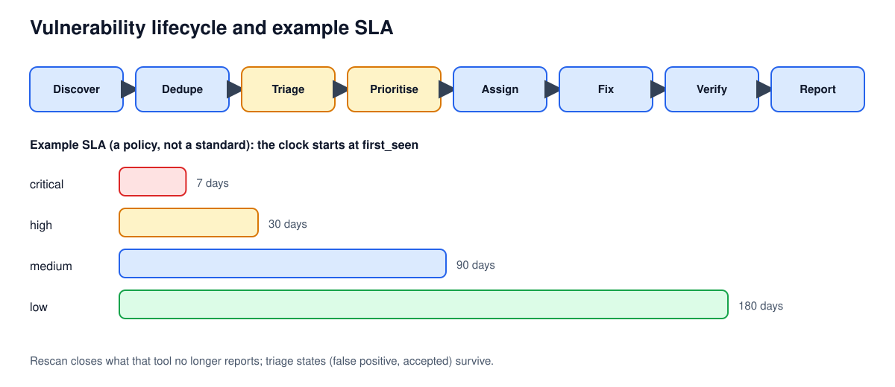

# Lesson 01: Approaches to Vulnerability Management, and Culture

> **Chapter:** 14 · Vulnerability Management · **Time:** ~3 hours
> **You will:** describe a vulnerability-management programme (lifecycle, prioritisation, SLAs, ownership), explain why DevSecOps changes it, and build the culture that makes it work.

| | |
|---|---|
| **Prerequisites** | [cybersecurity-track 08](../../cybersecurity-track/08-vulnerability-management/README.md) (lifecycle, scanners, scoring) |
| **Labs** | [defectdojo-vm](labs/defectdojo-vm/README.md) |
| **Syllabus lines** | [CDP 9] Approaches to manage the vulnerabilities in the organization. · [CDE 9] Approaches to manage the vulnerabilities in the organization. · Culture and Vulnerability Management. |

## 1. Why it matters

By chapter 13 your pipeline produces findings from SAST, SCA, DAST, IAST, IaC scans, container scans and pentests. Without a system, you get thousands of tickets, duplicate reports, arguments about who owns what, and a dashboard nobody trusts. Vulnerability management is the **database** that turns findings into decisions: it is where you answer "what do we fix first, who does it, by when, and did it work?"

DBA analogy: finding a missing patch on one Oracle instance is easy; running patching for 300 instances, with owners, windows and exceptions, is a **programme**.

## 2. Approaches to manage vulnerabilities in the organisation

**The lifecycle** (see [cybersecurity-track 08 lesson 01](../../cybersecurity-track/08-vulnerability-management/01-vm-lifecycle.md)): discover, aggregate and deduplicate, triage (real? exploitable? reachable?), prioritise, assign an owner, fix or mitigate, verify (rescan), report, learn.

**Approaches, from weakest to strongest:**

| Approach | Looks like | Problem |
|---|---|---|
| Scanner-by-scanner | each tool has its own console | duplicates, no history, no owner |
| Spreadsheet | export and merge by hand | stale the day after |
| **Central platform** (DefectDojo, a commercial aggregator, a cloud security hub) | one place; import, dedupe, SLA, metrics | needs care to keep clean |
| **Platform + pipeline automation** | CI uploads each scan; tickets created in the dev tracker; rescans auto-close | the goal |
| **Custom tools on top** | your own importer, SLA rules and reports for gaps | you maintain it: keep it small ([lab](labs/defectdojo-vm/README.md)) |

**Prioritisation** is the heart. Use several signals, because no single score is right:

- **Severity** (CVSS base) as a starting point only.
- **Exploitability**: EPSS (probability of exploitation in the wild) and the CISA KEV list (known exploited).
- **Exposure**: internet-facing? reachable code path? (an unreachable library CVE is lower).
- **Asset value**: customer data, payments, production vs test.
- **Fix availability and effort**: a one-line upgrade goes first.
- **Compensating controls**: WAF rule, network isolation, seccomp.

**SLAs by severity** make the answer predictable. Example policy (yours will differ): critical 7 days, high 30, medium 90, low 180. An SLA clock starts at the **first_seen** date, not when someone read the report. **Exceptions** (risk acceptance) need an owner, a reason, a compensating control and an **expiry**.

**Dedupe and reconcile.** The same flaw arrives from three tools. Fingerprint on a stable key (CVE or title + component + repo), merge sources, keep the earliest first_seen. A rescan should close the findings **that tool** no longer reports and reopen regressions; it must not close findings from other sources.

**DevSecOps and pentests.** A yearly pentest and a quarterly scan find problems too late for weekly releases. Keep them for depth (logic flaws, chained attacks) but feed their results into the same system, and rely on the pipeline for breadth.

## 3. Culture and vulnerability management

Tools do not fix vulnerabilities, **people** do. The CAMS principles (culture, automation, measurement, sharing) apply directly.

- **Blameless.** A vulnerability is a defect in a system, not a failure of a person. Review how it got through the gates, not who wrote it. (Same as a blameless post-mortem after an outage.)
- **Clear ownership.** Every repo and service has a named team. Unowned assets are the biggest hidden risk: report them as `UNOWNED`, visibly.
- **Security champions.** One developer per team, with some time and training, who triages first, explains findings and brings team context to the security group.
- **Make the right thing easy.** Findings arrive in the dev's tracker with the fix (upgrade to 2.0.4), the file and line, and a due date. Not a 200-page PDF.
- **Do not punish the messenger.** If teams are rated by number of open findings, they will stop scanning. Measure time to fix and SLA compliance, and celebrate fixes.
- **Share the load.** Platform teams fix base images and shared libraries once for everyone.
- **Agree the rules in advance.** Severity, SLA, exceptions, who can accept risk: written down and signed off by engineering and the business.
- **Be honest about noise.** Tune out false positives ([lesson 02](02-false-positives-and-false-negatives.md)) or developers will ignore everything.

## 4. Custom tools versus a platform

The course title for CDP 9 is "Vulnerability Management **with custom tools**". A platform like DefectDojo does importing, dedupe and metrics out of the box. Write custom code when: a source has no parser; you need a report shape the platform lacks (the CXO one-pager); you need glue to your ticketing, chat or asset inventory; you need policy-as-code around SLAs. Prefer APIs and small scripts over forks. The lab builds an importer, dedupe, SLA engine and three audience reports in about 200 lines.

## 5. Hands-on

1. Do the DefectDojo exercises: [csse ch7 defectdojo-basics](../../csse-course/ch7-managing-a-secure-software-supply-chain-program/labs/defectdojo-basics/README.md), [vuln-management-defectdojo](../../csse-course/ch7-managing-a-secure-software-supply-chain-program/labs/vuln-management-defectdojo/README.md).
2. Run the custom tools lab and follow one finding from import to closure.

## 6. Quick check

1. Why start the SLA clock at first_seen?
2. Why must a Trivy rescan not close a pentest finding?
3. Name three prioritisation signals besides CVSS.

## 7. References

- OWASP DefectDojo docs; OWASP DevSecOps Guideline; FIRST EPSS; CISA KEV catalogue (verify current URLs).
- NIST SP 800-40 (patch management).
