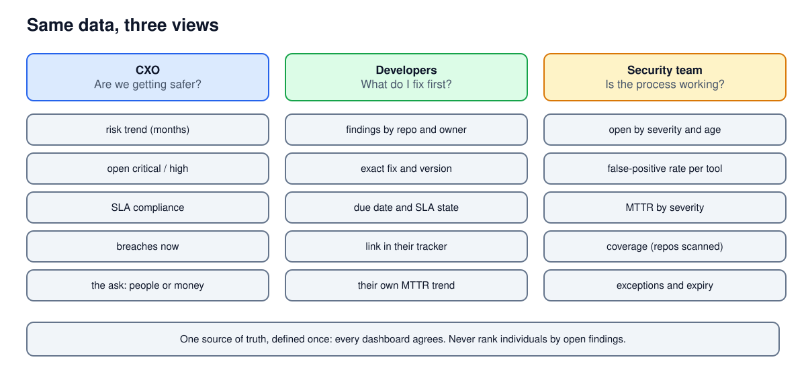

# Lesson 03: Metrics for CXOs, Developers and Security Teams, and DefectDojo

> **Chapter:** 14 · Vulnerability Management · **Time:** ~3 hours
> **You will:** pick the right few metrics for each audience, avoid vanity numbers, and use DefectDojo (and small custom code) to produce them.

| | |
|---|---|
| **Prerequisites** | [Lessons 01 and 02](01-approaches-and-culture.md) |
| **Labs** | [defectdojo-vm](labs/defectdojo-vm/README.md) (with `custom-vm-tools/`) |
| **Syllabus lines** | [CDE 9] Creating different metrics for CXOs, devs and security teams. · [CDE 9] Using Defect Dojo for vulnerability management. · [CDP 9] Using Defect Dojo for vulnerability management. |

## 1. Why it matters

One number for everyone fails. A CXO needs a **trend and a decision**, a developer needs **their next fix**, a security team needs **process health**. Give each their own view of the **same data**, so no one argues about whose spreadsheet is right.

## 2. Metrics for CXOs, devs and security teams

| Metric | CXO | Developer | Security team | Definition |
|---|---|---|---|---|
| **Risk trend** (weighted open findings over months) | yes | | yes | sum of weights (critical 10, high 5, medium 2, low 1) over open findings; the **direction** matters |
| **Open by severity** | critical and high only | own repos | all | count of open findings |
| **SLA compliance** | yes | own team | yes | % of findings fixed within SLA (or still open and not yet breached) |
| **SLA breaches now** | yes (count) | own list | yes | open findings past due |
| **MTTR** (mean time to remediate) | optional | own team trend | by severity | mean days from first_seen to closed |
| **Next fixes** (by due date, with the fix) | | **yes** | | the actionable list |
| **Findings per repo and owner** | top 3 | own | yes | accountability map |
| **False-positive rate** | | noise they feel | **yes**, per tool and rule | FP / triaged |
| **Escape rate** | yes | | yes | issues found in production or by pentest that the pipeline missed (an FN proxy) |
| **Coverage** | yes | | yes | % of repos/services scanned by each tool |
| **Age buckets** | | | yes | 0-30, 31-90, 90+ days open |
| **Exceptions** | yes (count) | | yes | risk accepted, with expiry |

**Rules:**

- **CXO:** one page, plain language, trend over snapshot, a stated ask ("two engineer-weeks to retire 3 criticals in Payments"). No CVE ids.
- **Dev:** what, where (file, line, version), how to fix, due date. Filtered to their repos. Linked from their tracker.
- **Security:** process health. Which tool is noisy, which severity is slow, where SLA breaks, which repos are unscanned.
- **Beware Goodhart's law:** when a measure becomes a target it stops being a good measure. Counting "open findings" rewards turning scanners off; pair it with coverage. Never rank individuals.
- **Define metrics once**, in code or a shared doc, so every dashboard agrees.

The lab generates all three as Markdown from the same fixture findings: an **exec one-pager** with a risk trend, a **dev view by repo and owner**, and a **security view by severity and FP rate**. DBA analogy: the same AWR data, summarised differently for the CIO, the application team and the DBA group.

## 3. Reading the numbers

| Signal | Possible meaning | Next step |
|---|---|---|
| risk trend falling, SLA compliance falling | closing easy lows while criticals age | re-prioritise by severity |
| MTTR long for one team | unclear ownership, blocked upgrades | champion, platform help |
| FP rate high for one tool | noisy default rules | tune ([lesson 02](02-false-positives-and-false-negatives.md)) |
| coverage low | blind spots | onboard repos before celebrating |
| many exceptions near expiry | debt coming due | review dates |

## 4. DefectDojo

**DefectDojo** (OWASP flagship) is an open-source vulnerability-management and orchestration platform. There is an open-source edition and a commercial "DefectDojo Pro" edition (feature split changes: verify at source).

| Concept | Meaning |
|---|---|
| **Product type, Product** | business unit, application or service |
| **Engagement** | a time-boxed testing activity (a sprint, a pentest, a CI stream) |
| **Test** | one scan result of one type inside an engagement |
| **Finding** | a single issue, with severity, status (active, verified, false positive, mitigated, risk accepted), SLA |
| **Import / reimport** | upload a scan; **reimport** updates the same test and closes findings that vanished |
| **Deduplication** | hash-code or legacy algorithm per scan type; merges repeats |
| **SLA configuration** | days by severity; findings show remaining time |
| **Metrics and dashboards** | counts, trends, SLA, by product |
| **Integrations** | 100+ parsers (Trivy, Semgrep, ZAP, Dependency-Check ...), Jira/GitHub issues, REST API |

Typical pipeline use: CI runs a scanner, posts the report to the DefectDojo API (reimport into the product's CI engagement), DefectDojo dedupes and applies SLA, creates tickets, and a dashboard reads the numbers. Walk-throughs: [csse ch7 defectdojo-basics](../../csse-course/ch7-managing-a-secure-software-supply-chain-program/labs/defectdojo-basics/README.md) and [vuln-management-defectdojo](../../csse-course/ch7-managing-a-secure-software-supply-chain-program/labs/vuln-management-defectdojo/README.md); theory: [cybersecurity-track 08](../../cybersecurity-track/08-vulnerability-management/README.md). Custom importer, dedupe, SLA and reports: [defectdojo-vm](labs/defectdojo-vm/README.md).

## 5. Hands-on

1. Do the two DefectDojo exercises.
2. Run the custom reports; change one SLA value and see which audience's report changes.
3. Add one metric (escape rate) to the security view.

## 6. Quick check

1. Name two metrics a CXO should and should not see.
2. Why can "number of open findings" hurt?
3. What does reimport do that import does not?

## 7. References

- DefectDojo documentation (OWASP): verify current version and edition features.
- FIRST EPSS; CISA KEV; OWASP DSOMM "Test and Verification" and "Culture and Organization" dimensions.
