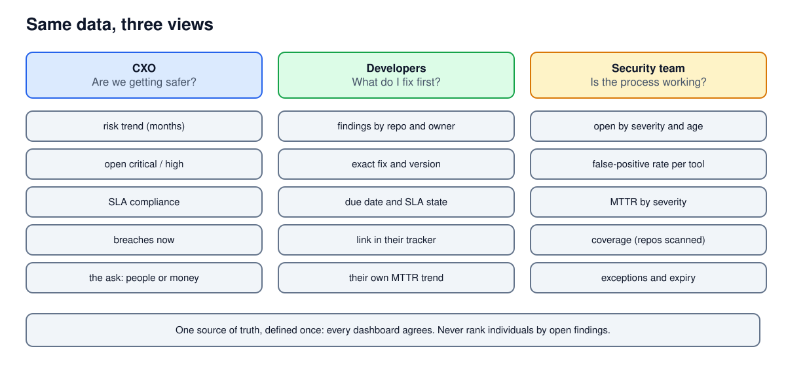

# Chapter 14: Vulnerability Management

This chapter merges **[CDE 9] Advanced vulnerability management** and **[CDP 9] Vulnerability Management with custom tools**. You learn how organisations manage findings at scale (approaches, prioritisation, SLAs), how to measure and tune false positives and false negatives, how culture decides whether any of it works, which metrics each audience needs, and how to use DefectDojo and your own small tools. Two labs run offline with fixtures and tests.

> **Safety.** Labs use fixture findings (Trivy-style JSON, SARIF, a pentest CSV, labelled scan results) with **fictional** CVE ids (`CVE-2099-xxxx`) and fictional repos. No scanner or DefectDojo server runs. Do not upload real findings to online services you do not control.

> **Unofficial companion.** Your course videos and lab environment are the primary source. Tool and edition details are hedged: **verify at the source**.

## Syllabus coverage

Every line of both source chapters, verbatim and in source order.

| Syllabus item | Where to study | Lab |
|---|---|---|
| **[CDE 9] Advanced vulnerability management** (chapter heading) | this chapter | see below |
| [CDE 9] Approaches to manage the vulnerabilities in the organization. | [Lesson 01 section 2](01-approaches-and-culture.md#2-approaches-to-manage-vulnerabilities-in-the-organisation); [cybersecurity-track 08](../../cybersecurity-track/08-vulnerability-management/README.md) | [defectdojo-vm](labs/defectdojo-vm/README.md) |
| [CDE 9] False positives and False Negatives. | [Lesson 02](02-false-positives-and-false-negatives.md) | [fp-fn-analysis](labs/fp-fn-analysis/README.md) |
| [CDE 9] Culture and Vulnerability Management. | [Lesson 01 section 3](01-approaches-and-culture.md#3-culture-and-vulnerability-management) | n/a (culture); owners and champions appear in the [defectdojo-vm](labs/defectdojo-vm/README.md) dev view |
| [CDE 9] Creating different metrics for CXOs, devs and security teams. | [Lesson 03 section 2](03-metrics-for-cxos-devs-and-security.md#2-metrics-for-cxos-devs-and-security-teams) (table and SVG) | [defectdojo-vm](labs/defectdojo-vm/README.md) (`custom-vm-tools`: exec, dev, security reports) |
| [CDE 9] Hands-On Labs: | Header line: the lab below | [defectdojo-vm](labs/defectdojo-vm/README.md) |
| [CDE 9] Using Defect Dojo for vulnerability management. | [Lesson 03 section 4](03-metrics-for-cxos-devs-and-security.md#4-defectdojo); [csse ch7 defectdojo-basics](../../csse-course/ch7-managing-a-secure-software-supply-chain-program/labs/defectdojo-basics/README.md); [vuln-management-defectdojo](../../csse-course/ch7-managing-a-secure-software-supply-chain-program/labs/vuln-management-defectdojo/README.md) | [defectdojo-vm](labs/defectdojo-vm/README.md) |
| **[CDP 9] Vulnerability Management with custom tools** (chapter heading) | this chapter | see below |
| [CDP 9] Approaches to manage the vulnerabilities in the organization. | [Lesson 01 section 2](01-approaches-and-culture.md#2-approaches-to-manage-vulnerabilities-in-the-organisation); [cybersecurity-track 08](../../cybersecurity-track/08-vulnerability-management/README.md) | [defectdojo-vm](labs/defectdojo-vm/README.md) |
| [CDP 9] Hands-On Labs: | Header line: the lab below | [defectdojo-vm](labs/defectdojo-vm/README.md) |
| [CDP 9] Using Defect Dojo for vulnerability management. | [Lesson 03 section 4](03-metrics-for-cxos-devs-and-security.md#4-defectdojo); [csse ch7 defectdojo-basics](../../csse-course/ch7-managing-a-secure-software-supply-chain-program/labs/defectdojo-basics/README.md); [vuln-management-defectdojo](../../csse-course/ch7-managing-a-secure-software-supply-chain-program/labs/vuln-management-defectdojo/README.md) | [defectdojo-vm](labs/defectdojo-vm/README.md) |

## Outdated in the syllabus → current

| Syllabus wording | What to know now (Nov 2026; verify at source) |
|---|---|
| "Defect Dojo" | Written **DefectDojo**; an **OWASP flagship** project. There is an open-source edition and a commercial **DefectDojo Pro** edition (the feature split changes: verify). Install with docker-compose per the project README. |
| "False positives and False Negatives" | Still the core tuning problem. Newer practice adds **VEX** (vulnerability exploitability exchange) statements, **EPSS** and the **CISA KEV** list for prioritisation, and **reachability analysis** in SCA tools to cut library-CVE noise. |
| Metrics: "CXOs, devs and security teams" | Common current metrics: MTTR, SLA compliance, open by severity, escape rate, false-positive rate, coverage. Some teams add **DORA** delivery metrics next to security metrics; keep definitions written down. |
| "Custom tools" | Prefer the DefectDojo REST API and small scripts over forking; many scanners now emit SARIF or CycloneDX VEX, which simplifies importers. |
| Culture | Language has moved from "security gatekeeper" to **blameless**, **security champions** and **platform-provided paved roads**. DSOMM (check the current version) has dimensions such as Culture and Organization and Test and Verification. |

## How the three courses overlap here

- **[CDP 9]** has one topic (approaches) and one lab (DefectDojo) under the title "with custom tools".
- **[CDE 9]** repeats the approaches and the DefectDojo lab, and adds false positives and negatives, culture, and per-audience metrics.
- **One lesson 01 serves both approach rows.** The DefectDojo exercise is shared: one lab (`defectdojo-vm`) with the real-tool half linked to csse ch7 and the **custom-tools** half in `custom-vm-tools/`.
- Theory and scanners are in [cybersecurity-track 08](../../cybersecurity-track/08-vulnerability-management/README.md) (lifecycle, scoring, remediation); do not repeat it.
- The DevSecOps pipeline that produces the findings is chapters [04](../04-software-component-analysis/README.md) to [07](../07-runtime-analysis-rasp-iast/README.md) and [11](../11-defending-containers-at-scale/README.md).

## Learning order

1. [Lesson 01](01-approaches-and-culture.md): approaches, prioritisation, SLAs, culture.
2. [Lesson 02](02-false-positives-and-false-negatives.md) and the `fp-fn-analysis` lab.
3. [Lesson 03](03-metrics-for-cxos-devs-and-security.md): metrics per audience, then DefectDojo.
4. Do the csse ch7 DefectDojo labs, then the `defectdojo-vm` custom tools.
5. [Real-tools guide](real-tools/README.md), exam tips and Q&As.

## Lab index

| Lab | Course exercise | Tests |
|---|---|---|
| [defectdojo-vm](labs/defectdojo-vm/README.md) (+ `custom-vm-tools/`) | Using Defect Dojo for vulnerability management; custom tools | `custom-vm-tools/test_dso_ch14_vm_tools.py` |
| [fp-fn-analysis](labs/fp-fn-analysis/README.md) | False positives and false negatives | `test_dso_ch14_fp_fn.py` |

Run all: `.venv/Scripts/python -m pytest devsecops-course/14-vulnerability-management -q`

## Exam tips

- **Findings need an owner, a clock and an exit.** Say "owner, SLA, verification" in every answer.
- **Prioritise with more than CVSS:** exploitability (EPSS, KEV), exposure, asset value, fix availability, compensating controls.
- **FN is invisible.** You need ground truth to measure it; never read "no findings" as "no vulnerabilities".
- **Metrics per audience:** CXO = trend and ask; dev = next fix; security = process health (FP rate, MTTR, coverage). Same data, different views.
- **Goodhart:** never rank people by open findings; pair counts with coverage.
- **Rescan semantics:** close only what the same tool stopped reporting; preserve triage state; reopen regressions.
- **Mute vs tune:** mute a rule with no true positives; narrow a mixed rule; raising a confidence threshold trades recall for precision.
- **DefectDojo vocabulary:** product, engagement, test, finding, import vs reimport, dedupe, SLA.

## 15 exam-style questions

1. What are the main approaches to managing vulnerabilities in an organisation?

From weakest to strongest: per-scanner consoles, spreadsheets, a central platform (DefectDojo or commercial) that imports, dedupes and tracks SLAs, platform plus pipeline automation (CI uploads, tickets, auto-close), and custom tools for gaps. The lifecycle is discover, aggregate and dedupe, triage, prioritise, assign, fix, verify, report.

2. How do you prioritise beyond CVSS?

Combine severity with exploit likelihood (EPSS, CISA KEV), exposure (internet-facing, reachable code), asset value and data sensitivity, fix availability and effort, and compensating controls. A reachable high on a payments service outranks an unreachable critical in a test tool.

3. What is an SLA in vulnerability management and when does the clock start?

A time limit to fix by severity (for example critical 7 days, high 30, medium 90, low 180; an example policy, not a standard). The clock starts at first_seen, the first detection, not when someone reads the report. Exceptions need an owner, reason, compensating control and expiry.

4. How does deduplication work and why does it matter?

Findings get a fingerprint from stable fields (CVE or title, component or location, repo); repeats from rescans or other tools merge, keeping the earliest first_seen and the union of sources. Without it you get duplicate tickets and wrong counts.

5. What should a rescan do to existing findings?

Close the findings that the same tool no longer reports for that repo, add new ones, keep triage states (false positive, risk accepted), and reopen regressions. It must not close findings from other sources such as a pentest.

6. Define false positive, false negative, precision and recall.

A false positive is a reported issue that is not real; a false negative is a real issue not reported. Precision = TP / (TP + FP); recall = TP / (TP + FN). Precision is what developers feel as noise; recall is the invisible risk.

7. How do you measure false negatives?

Against ground truth: a seeded vulnerable app, pentest or bug-bounty confirmed issues, past incidents and red-team results. Run your tools, count which known issues were found, and repeat after each tool or rule change. Without ground truth you cannot measure them.

8. What are good ways to reduce false positives?

Mute rules with no true positives, narrow mixed rules (custom rules, sanitiser lists, path excludes), apply confidence or severity thresholds knowingly, add reachability or VEX data, suppress with reason and expiry, and sample and label findings regularly. Re-measure after each change.

9. A rule produced 12 findings, 11 false. Mute it or tune it?

If the one true finding matters, tune (narrow) it rather than mute it, since muting loses a real detection. If a rule has zero true positives over a meaningful sample, muting is safe. Record the decision and review it after tool upgrades.

10. Why are union and intersection of two tools useful?

Union (any tool's finding) raises recall because tools miss different things, at the cost of more triage. Intersection (both tools agree) raises precision but lowers recall, so it suits high-confidence automation (such as blocking a build).

11. How does culture affect vulnerability management?

Tools do not fix vulnerabilities, people do. Blameless reviews, clear ownership, security champions, findings delivered with the fix in the developer's tracker, measuring time to fix rather than counts, and agreed SLAs make remediation routine. Blame and count-based targets make teams hide problems or turn scanners off.

12. What metrics suit CXOs, developers and the security team?

CXO: risk trend, open critical and high, SLA compliance, a clear ask, no CVE ids. Developers: their findings by repo and owner with exact fix and due date. Security: open by severity and age, MTTR, false-positive rate per tool, coverage, exceptions. All from one source of truth.

13. Define MTTR, SLA compliance and escape rate.

MTTR is the mean time from first detection to closure (report by severity). SLA compliance is the share of findings closed within SLA (or still open and not yet breached). Escape rate is the share of issues found late (production, pentest, incident) that the pipeline should have caught, a proxy for false negatives.

14. Explain DefectDojo's main objects and the import/reimport difference.

Product types and products organise assets; an engagement is a time-boxed activity (a CI stream or pentest); a test holds one scan's results; findings carry severity, status and SLA. Import creates a new test; reimport updates the same test, deduplicates and closes findings that disappeared. There are open-source and Pro editions (verify).

15. When would you write custom vulnerability-management tools?

When a source has no parser, you need a report shape the platform lacks (such as a CXO one-pager), you need glue to ticketing, chat or asset inventory, or you want policy-as-code for SLAs. Keep them small, use the platform's API, and test them with fixtures.

## References

- OWASP DefectDojo documentation and API docs (verify current version and edition features).
- FIRST EPSS; CISA Known Exploited Vulnerabilities catalogue; OpenVEX and CycloneDX VEX specs.
- NIST SP 800-40 (patch management); OWASP DevSecOps Guideline and DSOMM (https://dsomm.owasp.org).
- OWASP Benchmark Project for measuring SAST accuracy (verify status).
- Repo: [csse ch7 labs](../../csse-course/ch7-managing-a-secure-software-supply-chain-program/README.md), [cybersecurity-track 08](../../cybersecurity-track/08-vulnerability-management/README.md), [csse ch6 false-positive-analysis](../../csse-course/ch6-common-defenses-against-supply-chain-attacks/labs/false-positive-analysis/README.md).
- [Real tools guide](real-tools/README.md).
